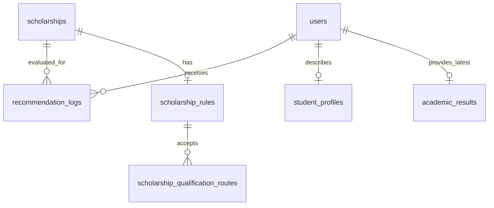

# ScholarMatch — Architecture Document

**Version:** 4.3 — Student account administration and shared validation
**Updated:** 2026-11-08 (Asia/Singapore)
**Stack:** Laravel 13, PHP 8.3+, MySQL (application), SQLite (isolated tests), Blade, Tailwind CSS, Alpine.js, Vite and Pest

## 1. Architecture Overview

ScholarMatch is a Laravel MVC monolith with an application service for eligibility evaluation.

Browser → Routes → Role Middleware → Controllers → ScholarshipRecommendationService → Eloquent → Database

## 2. Architecture Pattern

Controllers validate requests and coordinate views. Models provide relationships and academic-readiness checks. The service evaluates conditions and returns arrays suitable for caching. Shared Blade components render decision badges and requirement explanations.

Administrator student operations use the existing auth/role middleware, StudentController and StudentAccountRequest. Resource targets are restricted to student users. The controller assigns only approved account fields, forces the student role on creation and uses transactions for credential updates/deletion. Profile/academic relationships are read-only in the administrator view. Existing foreign-key cascades remove related student records on deletion; explicit cleanup removes database sessions and reset tokens. The deployed database session driver is required for immediate session invalidation. No migration or eligibility algorithm change is needed.

AccountValidation centralises normalized name/email rules for registration, LoginRequest, ProfileUpdateRequest and administrator forms. The account-input Blade component exports the same format patterns to native browser validation; account-validation.js adds inline feedback and normalization. Server validation remains authoritative. Names support Unicode, and avatar initials use multibyte-safe extraction. These checks do not prove email ownership and do not diagnose the previously reported, unreproduced Azure 500 error.

## 3. Core Modules

### Shared evaluation and rule-testing services

ScholarshipEligibilityEvaluator contains the existing single-award rule comparisons. ScholarshipRecommendationService retains official readiness/catalogue/cache/order responsibilities and calls that evaluator. AcademicResultInput contains the former academic-controller validation/normalisation; official saves and synthetic previews share it. These extractions retain decisions-v8-stpm-cgpa semantics and the existing schema.

EligibilityGap adds display-only shortfall sentences to existing student comparisons. This is an explanation refinement; the recommendation decisions and required/student values are unchanged.

Admin RulePreviewController validates draft rules with ScholarshipRuleEditor and synthetic sample data with AcademicResultInput, builds unsaved model relationships and returns JSON comparisons. Sample controls use their own form, so normal saves are unaffected. The AJAX controller strips the parent's method override, retains CSRF, and discards stale responses on edits. bootstrap/app.php enables JSON exceptions specifically for admin.rule-preview alongside existing API routes. See docs/ELIGIBILITY_PLANNING.md.

### 3.1 Authentication Module

Laravel Breeze handles authentication and account management. RoleMiddleware protects student and administrator routes. Nested rule controllers verify that the supplied rule belongs to the supplied scholarship.

StudentOnboarding::nextRoute centralises first-incomplete-section navigation for student login, the generic dashboard landing and setup form saves. It calls StudentProfile::isComplete (shared required-field validation) and AcademicResult::isReadyForRecommendations. New registration assigns the student role explicitly and opens profile setup. Login clears stale intended URLs only for incomplete students; completed users retain normal intended navigation. Model relations are refreshed after saves so a just-created result/profile is recognised. Existing student pages remain accessible; this is guided navigation rather than a new global access-blocking middleware.

StudentProfile::STATES provides the dropdown's short territory names. normalizeState maps the three legacy Wilayah Persekutuan labels for prefilling and submitted saves; GET requests do not rewrite saved data. No onboarding-state column, state enum restriction, migration or eligibility-rule change was introduced.

### 3.2 Student Profile Module

Student profiles actively store nationality, state, household income and dependents. Income category is calculated on profile save and recalculated against current ranges during recommendation generation. Legacy institution/field columns remain nullable for migration recovery and first-form prefill, but are not mass assignable or edited through Profile.

The shared scholarship.nationalities configuration contains only Malaysian and Non-Malaysian. Profile and rule validation use that list; an empty scholarship nationality restriction remains unrestricted. The evaluator compares categories exactly and requires legacy/invalid profile values to be corrected before evaluation. Unsupported country-specific legacy rules are preserved but excluded as awaiting configuration; they do not block other scholarships or silently become broader restrictions.

State and dependents are currently informational rather than evaluation criteria.

### 3.3 Academic Result Module

AcademicResult stores one latest record per user:

- education_level: current/latest qualification supplying academic evidence.
- study_status: studying/completed.
- year_of_study: current year for studying CGPA-based students.
- funding_study_level: manually selected programme level seeking funding.
- institution_type and field_of_study: required choices for the programme seeking funding; grouped with funding_study_level in the Academic Result form.
- grading_scale and grade_counts: the selected scale and grade-to-subject-count JSON map for SPM, IGCSE, O-Level, A-Level, Senior UEC and STPM.
- spm_as and spm_credits: compatibility totals derived from SPM grade counts on new submissions; cgpa: official cumulative/final CGPA for the original CGPA qualifications.
- stam_rank: STAM overall pangkat, ordered from Mumtaz to Rasib.
- stpm_pa_grade and stpm_cgpa_confirmed: identify the already-counted Pengajian Am result and store the student's confirmation of the completed-STPM calculation.
- result_status: official for new submissions; old pending rows are preserved but incomplete.

AcademicQualifications defines supported categories, qualifications, scales, grade order, input limits and labels for PHP and JavaScript. Category is derived rather than stored. Undergraduate, UEC and O-Level retain their stored identifiers and display as Bachelor’s Degree, Senior UEC and Cambridge O-Level. Category groups do not imply equivalence between qualifications.

AcademicResult::isReadyForRecommendations checks required fields and official results. Completed STPM saves use AcademicQualifications::stpmCgpa: remove one PA occurrence, add its points to the best three other subjects, divide by four and round half up with integer hundredths. The controller ignores submitted CGPA for this case and requires confirmation. New calculation records must retain consistent counts/PA/CGPA and confirmation. Existing usable manual CGPA records without a PA identity are preserved until edited; studying STPM remains manual. The academic controller validates whole-number counts, rejects unknown/mixed-scale grades, derives SPM totals and clears irrelevant stored values. The Alpine editor in resources/js/academic-qualifications.js provides grouped radio buttons, direct entry and minus/plus counters, a live summary and explicit IGCSE scale selection. Switching category, qualification or scale clears incompatible inputs and official confirmation.

Institution and field matching read AcademicResult, using shared config choices. Profile updates ignore these fields and cannot overwrite academic selections. Changes to academic programme values alter the recommendation input hash, so cached matches refresh immediately. Dashboard academic-completion status requires both values. AcademicResultController prefills legacy programme choices only when there is no saved academic record.

SPM, IGCSE, O-Level, A-Level, UEC and STAM require completed exams and official final results. STPM now requires both official CGPA and valid subject counts, retaining studying/completed status and current year. Existing CGPA-only STPM rows remain intact but require an actual breakdown; it is not inferred. STPM, Foundation, Matriculation, Diploma and Undergraduate require the latest official cumulative CGPA or final CGPA if completed. Students without these results cannot generate recommendations. Existing SPM aggregates are preserved but cannot establish a grade distribution; those students must enter their actual breakdown. No subjects or grades are inferred during migration. Completed STPM now identifies Pengajian Am as a bounded exception; other subject names are not collected.

### 3.4 Scholarship Module

Scholarships contain provider metadata, an active flag, a nullable date-only deadline, application link, intake notes and optional special_requirements text. Catalogue entries additionally retain a stable key, official source URL and source-check date. Add and Edit forms share the special-requirements and intake-note fields.

Only active scholarships with an unexpired or unknown deadline enter evaluation. A known deadline remains unexpired throughout its calendar date. Unknown dates require provider confirmation and sort last. Saved expired scholarships remain visible as expired.

### 3.5 Scholarship Rule Module

A scholarship has at most one rule record. Every specified condition is enforced; empty values are not applicable.

The parent rule stores general nationality, funded level, income, field and institution restrictions. ScholarshipQualificationRoute belongs to ScholarshipRule; a rule has many ordered qualificationRoutes. Each route stores education_level, study_status, optional min_spm_as/min_spm_credits or min_cgpa, optional min_year_of_study/max_year_of_study, grading_scale, grade_requirements, min_stam_rank, uec_average, stpm_average and uec_total. Grade conditions mean a minimum number of subjects at a threshold grade or better. AAB is represented by two subjects at A or better AND three at B or better.

ScholarshipRuleEditor validates shared Add/Edit Scholarship and Rules forms and replaces routes in a transaction. Qualification and status are required per box. All exam-based qualifications only allow Completed. CGPA-based routes permit studying, completed or either status; year limits only apply to studying. Inactive academic/year fields are cleared on the server. Each year boundary may be empty; both supplied boundaries must be ordered. A hidden initialization marker prevents an uninitialized JavaScript editor from wiping routes.

IGCSE conditions require an exact grading scale; no conversion occurs between letters and 9–1. A route with no scale or grade condition accepts either. STAM compares the ordered overall ranks. UEC formulas select the best N subjects meeting a configured minimum grade and compare their A1=1…F9=9 average or total against a maximum; lower is better and too few qualifying subjects fails. STPM uses its official subject-point map to compute an explicitly configured minimum best-N average, separate from overall CGPA. Higher is better. Average thresholds accept at most two decimal places; UEC total limits are integers. Actual averages are compared without rounding into a pass. Named-subject conditions belong in Special Requirements for provider verification.

required_study_level describes the funded programme and is compared against funding_study_level. Each route compares the student's latest education_level, study_status, official results and current year. AcademicRouteEvaluator combines conditions within each route with AND and complete routes with OR. General restrictions combine with AND. Two boxes may accept the same qualification under different conditions. With no routes, academic restrictions are not applicable.

The route migration backfills existing lists and threshold types; legacyAcademicRoutes provides the same fallback for legacy imports/seeders without route rows. Legacy CGPA inference is restricted to the original five CGPA qualifications. Newly edited rules clear old academic columns so deleting the last route cannot resurrect an obsolete minimum. General rule and scholarship changes commit atomically. qualificationEditor in resources/js/academic-qualifications.js manages stable box/requirement/grade-row identities, input names, addition/removal and conditional controls. Explicit selected states restore saved type/grade options after dynamic option rendering. The editor loads legacy columns into typed condition rows and renders the existing validated field names; the selector itself is not a separate database field. It offers relevant types only, prevents duplicate requirement types, clears type-specific values on switches and shows plain-language previews and cumulative grade patterns. A single grade-count group contains all grade rows. It loads and submits the same flat grade_requirements list, so this presentation change requires no schema or evaluation-version change. Each row can be removed; removing the final row removes only its group.

The old hard/soft/none columns and rule_payload are inactive compatibility fields. The service does not read them or parse JSON/free text into requirements.

## 4. Recommendation Engine

The service returns error and recommendations. Incomplete student information produces a completion error and an empty result list. Unclassifiable income produces an administrator-action error. Scholarships without rules are skipped and counted in unconfigured_count.

For each configured, open scholarship:

1. Evaluate general conditions and every academic route independently. Require one complete passing route if routes exist.
2. Record every outcome and explanation without stopping at the first failure.
3. Return Not Eligible when a general condition fails or no route passes. Never combine partial matches from different routes.
4. Otherwise return Eligible.
5. Set requires_verification only for an Eligible result with non-whitespace special text.

| Data | Meaning |
| --- | --- |
| status | Eligible or Not Eligible |
| requires_verification | True only for otherwise Eligible results with admin special text |
| special_requirements | Text to verify with the provider |
| requirement_results | key, label, required, actual, outcome, message per condition; academic_route includes nested route comparisons |
| failed_requirements | Keys of automatic conditions that fail |
| explanation | Plain text descriptions of the comparisons |

There is no active score, weighting, normalization or percentage ranking.

For the main explanation, the evaluator selects a passing route, or the closest relevant failing route (qualification, then status, then failed-condition count, with stable order). Nested alternatives remain available without contributing unrelated failures to the overall decision. This selection explains the decision; it does not rank scholarships or award points.

Example: SPM qualification with 8 As and 9 credits, funding level Undergraduate, compared with a scholarship funding Undergraduate and accepting SPM with minimum 8 As and 9 credits. Both academic minimums and the funding-level check pass. Other applicable requirements must also pass.

An interview note adds ! to an Eligible result. It cannot override a failed CGPA, income, nationality or other automatic condition.

## 5. Recommendation Execution Strategy

Evaluation is synchronous when the dashboard, list or detail page requests recommendations. The list also upserts the latest evaluation log per user/scholarship. Detail pages evaluate current data rather than trusting an old log.

Results are cached for 30 minutes. Cache identity includes algorithm version, user ID, a hash of actual profile/academic attributes, catalog version and today's date. This avoids same-second update collisions and prevents yesterday's open deadline from persisting after midnight.

Admin scholarship, rule and income-category mutations invalidate the catalog version. The service reclassifies income, avoiding stale stored categories after threshold changes.

Within each decision group, order by deadline, name and ID. Eligible results with special warnings remain in the Eligible group.

RecommendationController validates GET search/programme/award filters, then filters the cached evaluation collection in memory. Programme filters use the existing required values and not_applicable outcomes, including scholarships with unrestricted criteria. Counts are computed after filtering and before selecting a decision group. A LengthAwarePaginator slices the selected group into 10-card pages while retaining query parameters. Group/filter changes omit page; stale high page values are clamped to the last page. The controller still logs the complete unfiltered evaluation set, so browsing does not rewrite decisions or omit off-page evaluations. The dashboard continues using its existing recent-recommendation list.

## 6. Database Tables

Core tables: users, student_profiles, academic_results, income_categories, scholarships, scholarship_rules, scholarship_qualification_routes, saved_scholarships and recommendation_logs.

The route table has a cascading scholarship_rule_id foreign key, education_level and study_status strings, nullable integer SPM/year minima/maxima, nullable decimal(3,2) CGPA, and timestamps. Migration 2026_10_19_010000 backfills equivalent alternatives while retaining old columns. New saves use the child rows. Algorithm version decisions-v8-stpm-cgpa invalidates earlier cached decisions and identifies older logs as previous evaluations until refreshed.

Migration 2026_10_31_000000_add_qualification_grade_counts extends the academic education-level enum and adds nullable grading_scale, grade_counts JSON and stam_rank to academic_results; it adds nullable grading_scale, grade_requirements JSON, min_stam_rank and uec_average JSON to scholarship_qualification_routes. Existing values and rows are preserved. Its rollback refuses to discard new-format records or rules. Migration 2026_10_31_010000_add_subject_point_requirements adds nullable stpm_average and uec_total JSON fields to route rows and guards rollback when data is present. Migration 2026_10_31_020000_add_stpm_cgpa_calculation adds nullable PA grade and default-false confirmation to academic_results without recalculating existing results, and guards against discarding those values on rollback. See docs/ACADEMIC_QUALIFICATIONS.md, docs/ACADEMIC_REQUIREMENT_TYPES.md and docs/STPM_CGPA_CALCULATION.md for formats, formulas and upgrade behaviour.

New academic fields are nullable at schema level so migration can preserve legacy records without inventing study status or funding intent. New submissions require them through application validation.

New log fields: evaluation_version, requirement_results, failed_requirements, requires_verification, special_requirements and legacy_evaluation. The status column supports the new decision labels.

The migration snapshots existing score-based log data into legacy_evaluation and marks evaluation_version as legacy-score-v4. Existing score columns remain intact for preservation; active models/views do not use them as current scoring. Existing legacy rule-type columns also remain stored but inactive. Refreshing a log updates its current decision while retaining its legacy snapshot.

No live student records or scholarships are deleted or recreated by the migration.

Migration 2026_10_20_000000_move_programme_details_to_academic_results adds nullable institution_type/field_of_study columns to academic_results and copies values for matching user IDs. It makes legacy profile columns nullable so personal profiles can be created independently. Students without academic records keep their legacy choices; no grade, qualification or academic row is invented. Down migration copies current academic choices back to existing profiles before removing the new columns.

## 7. Recommended Folder Structure

- app/Services/ScholarshipRecommendationService.php: evaluation, cache and latest log storage.
- app/Services/AcademicRouteEvaluator.php: AND within routes, OR between routes and nested explanations.
- app/Services/ScholarshipRuleEditor.php: shared validation, normalization and transactional route replacement.
- app/Models/AcademicResult.php: official-result readiness.
- app/Support/AcademicQualifications.php: shared category, qualification, scale, grade and label definitions.
- resources/js/academic-qualifications.js: student counters and administrator qualification editor.
- app/Models/ScholarshipRule.php: qualification routes and supported fields.
- app/Models/ScholarshipQualificationRoute.php: individual alternative requirements.
- app/Http/Controllers/Student/: academic, profile, recommendation and dashboard workflows.
- app/Http/Controllers/Admin/: scholarship, rule, income and log workflows.
- resources/views/components/: decision-badge, requirement-results and scholarship-card.
- database/migrations/: additive upgrade and legacy-log preservation.
- tests/: unit, feature and migration checks.

## 8. Testing Strategy

Tests cover individual requirement failures, AND/OR combinations, qualification/funding separation, zero and boundary values, official-result validation, special-warning priority, expired/unconfigured scholarships, stable ordering, cache invalidation, log snapshots and role/nested-resource protection.

Pest uses isolated in-memory SQLite by default. The full suite also runs against a separate MySQL database, including five MySQL-only transfer/backup cases. JSON object comparisons ignore key order while retaining strict grade/count values. No test runs against the application database. See docs/MYSQL_SETUP.md.

## 9. Security Design

Use server-side validation and role middleware, escaped Blade output, CSRF forms, user-scoped saved scholarships and nested-rule ownership checks. Special text remains plain text and cannot execute scripts. External application links use rel=noopener noreferrer.

## 10. Seed Data and Localhost

Seeders provide local demonstration users, income ranges and a deterministic 20-entry fictional scholarship catalogue. database/data/demo-scholarships.json supplies metadata and rules using stable demo-rich-01 through demo-rich-20 keys. See docs/DEMO_SCHOLARSHIPS.md; earlier catalogues are historical and are not seeded.

`ScholarshipCatalogSeeder` upserts the 20 current demo awards/rules without running account seeders. IDs and bookmarks on those scholarships are preserved; the demo rules are restored from the snapshot. Manual awards remain. The backed-up replacement command deletes only the 70 exact retired demo keys before seeding the new catalogue. Fresh installations have 20 awards; existing installations can include manual awards.

Each record persists `deadline_type`: published, admission-linked, relative, rolling, intake-based, automatic or unconfirmed. The current catalogue uses synthetic 2099 dates or rolling/intake/automatic timing. Matching semantics and version decisions-v8-stpm-cgpa are unchanged. `DatabaseSnapshot` creates SQLite or MySQL data backups before targeted demo replacement; foreign keys cascade only records associated with removed awards. Catalogue caches are invalidated after seed/replacement.

For an existing database, apply php artisan migrate; do not use migrate:fresh. Existing students update their academic status and funding level before generating new decisions. Rebuild frontend assets after changing templates.

Date-only deadlines close after the configured application's deadline day. Existing timestamp/timezone conventions are preserved.

## 11. Final Architecture Notes

### Shared study-field registry

Matching Settings renders Income Categories above Fields of Study at /admin/matching-settings; the old income-category index remains compatible. StudyField stores current name, stable original seed_name and active status. The migration initializes defaults/backfills used labels without rewriting existing academic/rule records. Runtime forms/validation/readiness use the database registry; config is now the initial seed definition only.

StudyFieldController restricts writes to administrators. A rename updates academic/legacy profile strings and both legacy single-field and current multi-field rule values within one transaction, then invalidates catalogue caches. Existing historical logs remain snapshots. Deactivation blocks new assignments while preserving existing selections, matching and edits; filters/non-persistent previews can inspect all known fields. No delete endpoint is provided. Field references remain labels rather than new foreign-key IDs. StudyFieldSeeder preserves edits, and demo rule seeding resolves original default labels to current names through seed_name. See docs/MATCHING_SETTINGS.md.

SqliteDatabaseTransfer includes study_fields. It accepts only an empty registry or untouched migration defaults on an otherwise empty destination, replacing those unused defaults in the import transaction. Source field IDs/labels/status are then copied and verified. Edited/custom destination settings are refused. This permits new-install migrations without losing source field customizations.

### MySQL transfer and targeted catalogue refresh

IncomeCategory provides shared ordered classification, range-label formatting and monetary validation. Admin category writes run with batched saved-profile reclassification inside one transaction, followed by catalogue cache invalidation. Updated incomes are guarded during batch writes. ProfileController builds server-rendered feedback and a JSON snapshot of the same ranges; income-category-preview.js updates text through Alpine while typing. The reference cards use the model's rangeLabel, rather than fixed thresholds. No classification ranges are changed automatically, and refresh is required to obtain later admin edits. Historical recommendation logs remain snapshots rather than being rewritten.

MySQL is the application default; SQLite is retained for isolated tests and legacy data transfer. The early saved-scholarship migration now defers its scholarship foreign key until the parent table exists, allowing a clean MySQL installation while retaining the same migration names. No logical table/relationship redesign was needed. MySQL DATE/DECIMAL/JSON storage representations are handled during verified transfer, without changing eligibility logic.

`database:import-sqlite` delegates to `SqliteDatabaseTransfer`: read-only source snapshot, integrity/foreign-key checks, matching migration history, empty destination checks, parent-first inserts and row-content/count verification within a MySQL transaction. It preserves primary keys and password hashes, retains the destination's migration history and rebuilds caches. Import failures roll back inserted rows. `DatabaseSnapshot` provides pre-refresh SQLite snapshots or verified MySQL JSON data backups. See docs/MYSQL_SETUP.md for operational limits and hosting preparation.

This version evaluates one latest qualification. It does not infer earlier qualifications, GPA equivalence, award renewal eligibility, or entry/enrolment context solely from the selected funding level. Conditions requiring evidence beyond the supported fields belong in the special-requirements description or a future data-model extension.

### Current default: fictional demo catalogue

`ScholarshipCatalog::entries()` reads database/data/demo-scholarships.json, version scholarmatch-rich-demo-20-v1. Twenty fictional awards combine realistic benefit descriptions, academic alternatives, grade counts, STPM average/CGPA, STAM rank, UEC totals/average, current-year limits and personal/programme restrictions. The dataset covers all 11 supported qualifications and six award types. Named-subject, interview, admission, portfolio, renewal and bond conditions remain explicit provider checks.

Current demo keys use demo-rich-01 through demo-rich-20. `Scholarship::isDemo()` recognises their demo- prefix. Names/descriptions label fiction, source fields are null, and presentation Apply links use reserved scholarmatch.example placeholders. Automatic checks determine Eligible / Not Eligible; provider conditions retain Eligible ! semantics.
