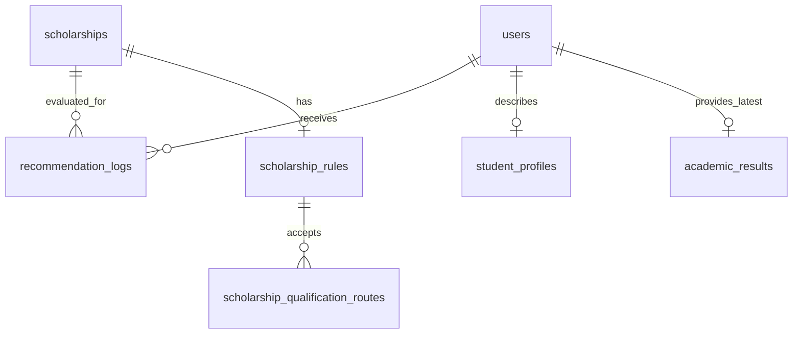

# ScholarMatch — Architecture Document

**Version:** 3.4 — Recommendation browsing and binary nationality
**Updated:** 2026-10-20 (Asia/Singapore)
**Stack:** Laravel 13, PHP 8.3+, MySQL/SQLite, Blade, Tailwind CSS, Alpine.js, Vite and Pest

## 1. Architecture Overview

ScholarMatch is a Laravel MVC monolith with an application service for eligibility evaluation.

Browser → Routes → Role Middleware → Controllers → ScholarshipRecommendationService → Eloquent → Database

## 2. Architecture Pattern

Controllers validate requests and coordinate views. Models provide relationships and academic-readiness checks. The service evaluates conditions and returns arrays suitable for caching. Shared Blade components render decision badges and requirement explanations.

## 3. Core Modules

### 3.1 Authentication Module

Laravel Breeze handles authentication and account management. RoleMiddleware protects student and administrator routes. Nested rule controllers verify that the supplied rule belongs to the supplied scholarship.

### 3.2 Student Profile Module

Student profiles actively store nationality, state, household income and dependents. Income category is calculated on profile save and recalculated against current ranges during recommendation generation. Legacy institution/field columns remain nullable for migration recovery and first-form prefill, but are not mass assignable or edited through Profile.

The shared scholarship.nationalities configuration contains only Malaysian and Non-Malaysian. Profile and rule validation use that list; an empty scholarship nationality restriction remains unrestricted. The evaluator compares categories exactly and requires legacy/invalid profile values to be corrected before evaluation. Unsupported country-specific legacy rules are preserved but excluded as awaiting configuration; they do not block other scholarships or silently become broader restrictions.

State and dependents are currently informational rather than evaluation criteria.

### 3.3 Academic Result Module

AcademicResult stores one latest record per user:

- education_level: current/latest qualification supplying academic evidence.
- study_status: studying/completed.
- year_of_study: current year for studying non-SPM students.
- funding_study_level: manually selected programme level seeking funding.
- institution_type and field_of_study: required choices for the programme seeking funding; grouped with funding_study_level in the Academic Result form.
- spm_as, spm_credits or cgpa: official results.
- result_status: official for new submissions; old pending rows are preserved but incomplete.

AcademicResult::isReadyForRecommendations checks required fields and official results. The academic controller enforces these rules server-side and clears irrelevant values when the qualification or status changes.

Institution and field matching read AcademicResult, using shared config choices. Profile updates ignore these fields and cannot overwrite academic selections. Changes to academic programme values alter the recommendation input hash, so cached matches refresh immediately. Dashboard academic-completion status requires both values. AcademicResultController prefills legacy programme choices only when there is no saved academic record.

SPM submissions require completed exams and received official results. CGPA-based submissions require the latest official cumulative CGPA or final CGPA if completed. Students without these results cannot generate recommendations.

### 3.4 Scholarship Module

Scholarships contain provider metadata, an active flag, a nullable date-only deadline, application link, intake notes and optional special_requirements text. Catalogue entries additionally retain a stable key, official source URL and source-check date. Add and Edit forms share the special-requirements and intake-note fields.

Only active scholarships with an unexpired or unknown deadline enter evaluation. A known deadline remains unexpired throughout its calendar date. Unknown dates require provider confirmation and sort last. Saved expired scholarships remain visible as expired.

### 3.5 Scholarship Rule Module

A scholarship has at most one rule record. Every specified condition is enforced; empty values are not applicable.

The parent rule stores general nationality, funded level, income, field and institution restrictions. ScholarshipQualificationRoute belongs to ScholarshipRule; a rule has many ordered qualificationRoutes. Each route stores education_level, study_status, optional min_spm_as/min_spm_credits or min_cgpa, and optional min_year_of_study/max_year_of_study.

ScholarshipRuleEditor validates shared Add/Edit Scholarship and Rules forms and replaces routes in a transaction. Qualification and status are required per box. SPM only allows Completed. Either status preserves unrestricted non-SPM status. Inactive academic/year fields are cleared on the server. Each year boundary may be empty; both supplied boundaries must be ordered. A hidden initialization marker prevents an uninitialized JavaScript editor from wiping routes.

required_study_level describes the funded programme and is compared against funding_study_level. Each route compares the student's latest education_level, study_status, official results and current year. AcademicRouteEvaluator combines conditions within each route with AND and complete routes with OR. General restrictions combine with AND. Two boxes may accept the same qualification under different conditions. With no routes, academic restrictions are not applicable.

The migration backfills routes from existing lists and threshold types; legacyAcademicRoutes provides the same fallback for legacy imports/seeders without route rows. Newly edited rules clear old academic columns so deleting the last route cannot resurrect an obsolete minimum. General rule and scholarship changes commit atomically. qualificationEditor in resources/js/app.js manages stable box identities, input names, addition/removal and conditional controls.

The old hard/soft/none columns and rule_payload are inactive compatibility fields. The service does not read them or parse JSON/free text into requirements.

## 4. Recommendation Engine

The service returns error and recommendations. Incomplete student information produces a completion error and an empty result list. Unclassifiable income produces an administrator-action error. Scholarships without rules are skipped and counted in unconfigured_count.

For each configured, open scholarship:

1. Evaluate general conditions and every academic route independently. Require one complete passing route if routes exist.
2. Record every outcome and explanation without stopping at the first failure.
3. Return Not Eligible when a general condition fails or no route passes. Never combine partial matches from different routes.
4. Otherwise return Eligible.
5. Set requires_verification only for an Eligible result with non-whitespace special text.

| Data | Meaning |
| --- | --- |
| status | Eligible or Not Eligible |
| requires_verification | True only for otherwise Eligible results with admin special text |
| special_requirements | Text to verify with the provider |
| requirement_results | key, label, required, actual, outcome, message per condition; academic_route includes nested route comparisons |
| failed_requirements | Keys of automatic conditions that fail |
| explanation | Plain text descriptions of the comparisons |

There is no active score, weighting, normalization or percentage ranking.

For the main explanation, the evaluator selects a passing route, or the closest relevant failing route (qualification, then status, then failed-condition count, with stable order). Nested alternatives remain available without contributing unrelated failures to the overall decision. This selection explains the decision; it does not rank scholarships or award points.

Example: SPM qualification with 8 As and 9 credits, funding level Undergraduate, compared with a scholarship funding Undergraduate and accepting SPM with minimum 8 As and 9 credits. Both academic minimums and the funding-level check pass. Other applicable requirements must also pass.

An interview note adds ! to an Eligible result. It cannot override a failed CGPA, income, nationality or other automatic condition.

## 5. Recommendation Execution Strategy

Evaluation is synchronous when the dashboard, list or detail page requests recommendations. The list also upserts the latest evaluation log per user/scholarship. Detail pages evaluate current data rather than trusting an old log.

Results are cached for 30 minutes. Cache identity includes algorithm version, user ID, a hash of actual profile/academic attributes, catalog version and today's date. This avoids same-second update collisions and prevents yesterday's open deadline from persisting after midnight.

Admin scholarship, rule and income-category mutations invalidate the catalog version. The service reclassifies income, avoiding stale stored categories after threshold changes.

Within each decision group, order by deadline, name and ID. Eligible results with special warnings remain in the Eligible group.

RecommendationController validates GET search/programme/award filters, then filters the cached evaluation collection in memory. Programme filters use the existing required values and not_applicable outcomes, including scholarships with unrestricted criteria. Counts are computed after filtering and before selecting a decision group. A LengthAwarePaginator slices the selected group into 10-card pages while retaining query parameters. Group/filter changes omit page; stale high page values are clamped to the last page. The controller still logs the complete unfiltered evaluation set, so browsing does not rewrite decisions or omit off-page evaluations. The dashboard continues using its existing recent-recommendation list.

## 6. Database Tables

Core tables: users, student_profiles, academic_results, income_categories, scholarships, scholarship_rules, scholarship_qualification_routes, saved_scholarships and recommendation_logs.

The route table has a cascading scholarship_rule_id foreign key, education_level and study_status strings, nullable integer SPM/year minima/maxima, nullable decimal(3,2) CGPA, and timestamps. Migration 2026_10_19_010000 backfills equivalent alternatives while retaining old columns. New saves use the child rows. Algorithm version decisions-v5-local-award-windows invalidates earlier cached decisions and identifies older logs as previous evaluations until refreshed.

New academic fields are nullable at schema level so migration can preserve legacy records without inventing study status or funding intent. New submissions require them through application validation.

New log fields: evaluation_version, requirement_results, failed_requirements, requires_verification, special_requirements and legacy_evaluation. The status column supports the new decision labels.

The migration snapshots existing score-based log data into legacy_evaluation and marks evaluation_version as legacy-score-v4. Existing score columns remain intact for preservation; active models/views do not use them as current scoring. Existing legacy rule-type columns also remain stored but inactive. Refreshing a log updates its current decision while retaining its legacy snapshot.

No live student records or scholarships are deleted or recreated by the migration.

Migration 2026_10_20_000000_move_programme_details_to_academic_results adds nullable institution_type/field_of_study columns to academic_results and copies values for matching user IDs. It makes legacy profile columns nullable so personal profiles can be created independently. Students without academic records keep their legacy choices; no grade, qualification or academic row is invented. Down migration copies current academic choices back to existing profiles before removing the new columns.

## 7. Recommended Folder Structure

- app/Services/ScholarshipRecommendationService.php: evaluation, cache and latest log storage.
- app/Services/AcademicRouteEvaluator.php: AND within routes, OR between routes and nested explanations.
- app/Services/ScholarshipRuleEditor.php: shared validation, normalization and transactional route replacement.
- app/Models/AcademicResult.php: official-result readiness.
- app/Models/ScholarshipRule.php: qualification routes and supported fields.
- app/Models/ScholarshipQualificationRoute.php: individual alternative requirements.
- app/Http/Controllers/Student/: academic, profile, recommendation and dashboard workflows.
- app/Http/Controllers/Admin/: scholarship, rule, income and log workflows.
- resources/views/components/: decision-badge, requirement-results and scholarship-card.
- database/migrations/: additive upgrade and legacy-log preservation.
- tests/: unit, feature and migration checks.

## 8. Testing Strategy

Tests cover individual requirement failures, AND/OR combinations, qualification/funding separation, zero and boundary values, official-result validation, special-warning priority, expired/unconfigured scholarships, stable ordering, cache invalidation, log snapshots and role/nested-resource protection.

Pest uses an isolated in-memory SQLite database. Migration tests exercise old log preservation and academic-data preservation. Browser checks additionally verify form switching, tab interaction and expandable special text.

## 9. Security Design

Use server-side validation and role middleware, escaped Blade output, CSRF forms, user-scoped saved scholarships and nested-rule ownership checks. Special text remains plain text and cannot execute scripts. External application links use rel=noopener noreferrer.

## 10. Seed Data and Localhost

Seeders provide demonstration users, income ranges and a fixed 70-entry fictional scholarship catalogue for study in Malaysia. `database/data/demo-scholarships.json` supplies metadata and rules. Stable `catalog_key` values support normal upserts. See `docs/DEMO_SCHOLARSHIPS.md` for the scenario register; the old real-world dataset remains archived and is not seeded.

`ScholarshipCatalogSeeder` updates scholarships/rules without running account seeders. Rerunning it restores the snapshot, keeps scholarship IDs and bookmarks, and deactivates exact matches of old demo metadata without deletion. Custom rows are preserved. A fresh installation contains exactly 70 scholarships; existing installations may retain archived/custom rows. `composer setup` now includes seeding.

Each record persists `deadline_type`: published, admission-linked, calculated relative, rolling, intake-based, automatic or unconfirmed. The current demo snapshot has 60 synthetic fixed dates in 2099, nine rolling awards and one automatic award; all remain open for repeatable demonstrations. The matcher version is decisions-v5-local-award-windows. `scholarships:replace-catalog` validates dates, backs up file-backed SQLite, and transactionally deletes/reseeds all scholarships (cascading scholarship-related records only). Ordinary catalogue reseeding still preserves IDs/custom records/history.

For an existing database, apply php artisan migrate; do not use migrate:fresh. Existing students update their academic status and funding level before generating new decisions. Rebuild frontend assets after changing templates.

Date-only deadlines close after the configured application's deadline day. Existing timestamp/timezone conventions are preserved.

## 11. Final Architecture Notes

This version evaluates one latest qualification. It does not infer earlier qualifications, GPA equivalence, award renewal eligibility, or entry/enrolment context solely from the selected funding level. Conditions requiring evidence beyond the supported fields belong in the special-requirements description or a future data-model extension.

### Current default: fictional demo catalogue

`ScholarshipCatalog::entries()` now reads `database/data/demo-scholarships.json` (version `scholarmatch-demo-70-v2`), a deterministic 70-record fictional dataset. The previous real-world JSON is retained as an archive and is not seeded. All 70 demo awards have supported structured rules and active/open windows: 60 fixed synthetic dates in 2099, nine rolling and one automatic. The data covers all six result qualifications, all six institution types, all configured fields, all three income categories, both nationality categories and six award types. Existing matching behavior and input fields are unchanged.

Demo keys use `demo-01` through `demo-70`. `Scholarship::isDemo()` identifies them for a fictional-data label and an Apply label even for rolling demo awards. Cards and details show Apply for Eligible results; saved listings also expose the application link. These buttons use reserved placeholder URLs for presentations. Source URL/check date stay null. Catalogue validation requires a clear Demo name, fictional description and reserved scholarmatch.example placeholder; real records still require a source. Normal seeders upsert by stable keys; explicit replacement remains the backed-up path to removing the prior dataset.
