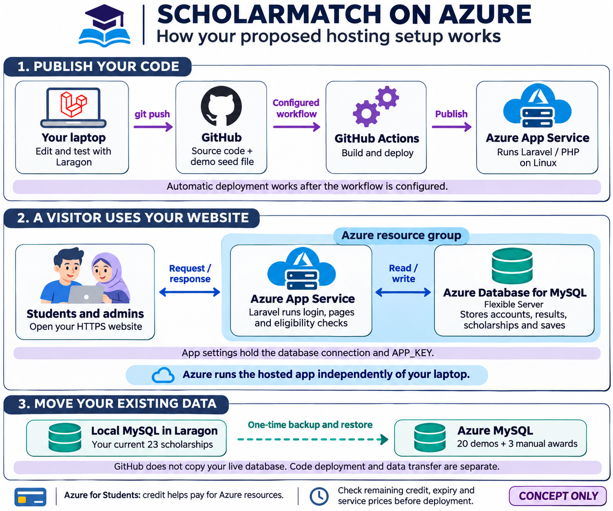

# How ScholarMatch would work on Azure

This is a proposed hosting concept, checked against Microsoft documentation on 7 November 2026. Azure resources have not been provisioned by this task.

## Read the infographic

**1. Publish code.** You edit and test ScholarMatch with Laragon on your laptop, then push source changes to GitHub. After a deployment workflow is configured, GitHub Actions can build the application and deploy it to Azure App Service. Pushing code alone does not create or configure the hosting. [Microsoft deployment guide](https://learn.microsoft.com/en-us/azure/app-service/deploy-github-actions)

**2. Serve visitors.** Students and administrators open the hosted HTTPS website. App Service runs Laravel/PHP on Linux and handles pages, login and rule evaluation. Laravel reads/writes a separate Azure Database for MySQL Flexible Server. Visitors interact with Laravel, rather than connecting directly to MySQL. A resource group organizes related Azure services; the App Service plan defines the app's hosting capacity and pricing tier. Azure hosts the app independently of the developer's laptop. [Microsoft PHP/MySQL guide](https://learn.microsoft.com/en-us/azure/app-service/tutorial-php-mysql-app)

**3. Move existing records.** The current local MySQL database has 20 fictional demo awards and 3 manually entered awards. Preserving those 23 awards, student accounts, passwords, profiles, results and relationships requires a separate database backup/restore process. GitHub contains the source and demo seed definitions; it does not copy live MySQL records or local `.env` credentials. Routine code deployments should preserve the hosted database. Do not reseed demo accounts or reset tables on every deployment.

## Azure for Students

This is the subscription offer used to access/pay for Azure resources, rather than a separate web-server product. Microsoft advertises US$100 credit for one year, renewable while eligible. This does not establish the balance or expiry of an account activated earlier. Check the actual subscription, remaining credit, region/quotas and service prices before selecting resources; do not assume the app/database combination is permanently free. [Microsoft student offer](https://learn.microsoft.com/en-us/azure/education-hub/about-azure-for-students)

## What we would prepare next

Confirm the subscription and suitable App Service/MySQL options. Then prepare production environment settings, database migration and the deployment workflow. App settings supply the database connection and APP_KEY privately; `.env` stays outside Git. Preserve the existing APP_KEY when transferring encrypted data. No Azure credentials, database exports or personal records were included in this infographic.

The recommended concept uses the existing Laravel + MySQL application. Optional extras such as Redis, a custom domain or other infrastructure are outside this diagram. The present system uses database-backed cache/session/queue settings, so this concept does not add another cache service.

## Artifact details

Created with the built-in image-generation tool. The final [generation prompt](diagrams/azure-hosting-concept.prompt.txt) is saved alongside the PNG for reproducibility. It is an educational illustration of a proposal, not a screenshot or proof of a deployed system. The original generated image remains in the image tool's output directory; the project copy is under docs/diagrams.
