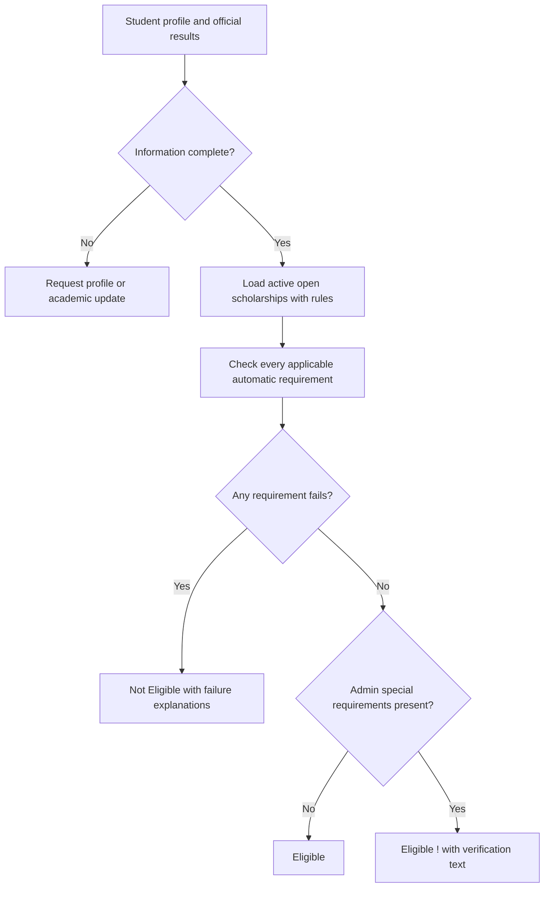

# ScholarMatch Improvement Log

**Updated:** 2026-10-19 (Asia/Singapore)

This file records completed changes, verification, and the project/FYP documentation to revise. Chapter numbers are omitted because the student's report structure has not been supplied.

## Current agreed behaviour

| Situation | Result |
| --- | --- |
| General requirements pass and any one complete qualification route passes (or no routes restrict it); no special text | Eligible |
| Same automatic checks pass; administrator entered special text | Eligible !, inside the Eligible group |
| A general requirement fails, or none of the configured qualification routes passes | Not Eligible |
| Required profile/official academic information is incomplete | Ask the student to complete it before generating recommendations |

The ! warning applies only to administrator-entered special requirements. It is not used for missing student results. The provider makes the final award decision.

Academic information uses one latest study level, Currently Studying/Completed status, current year when studying, and a manually selected Study Level Seeking Funding. SPM requires completed exams and official results. Other levels require a latest official cumulative CGPA, or final CGPA if completed. SPM credits count subjects graded C or above, including A subjects.

Administrator qualification boxes combine with OR; requirements inside each box combine with AND. Each box has its own result/status/year settings. See IMP-005 for the current route editor and migration; earlier entries describe previous stages.

## IMP-001 — Establish this improvement log

**Date:** 2026-10-19
**Type:** Documentation
**Status:** Completed

Added this record so implementation changes can be traced to the corresponding FYP report edits.

## IMP-002 — Review the original recommendation engine

**Date:** 2026-10-19
**Type:** Implementation review
**Status:** Completed; original behaviour superseded by IMP-003

The original engine checked hard requirements and then calculated weighted academic/field/institution/income points, normalized the result, and classified it as Eligible, Partially Eligible or Not Suitable. Academic minimums affected points rather than acting as universal eligibility requirements. The same education-level field was used for academic evidence and funded study level.

The review identified the need to separate qualification and funding level, remove scores and hard/soft categories, and explain individual requirements.

## IMP-003 — Replace scoring with requirement-based eligibility

**Date:** 2026-10-19
**Type:** Recommendation redesign, academic workflow, interface, data migration and documentation
**Implementation status:** Completed and verified

### What changed and why

| Area | Before | After / benefit |
| --- | --- | --- |
| Decisions | Score thresholds determined Eligible, Partially Eligible or Not Suitable | Every applicable automatic condition must pass for Eligible; any failure produces Not Eligible |
| Requirement settings | Hard, soft and none selectors, plus weighted points | Every specified condition is enforced; empty criteria are Not Applicable |
| Academic evidence | One level mixed qualification and funded programme; pending grades could be evaluated | Latest qualification and manually selected funding level are separate |
| Study status/year | Not recorded | Currently Studying or Completed; current year required for studying CGPA-based records |
| Official results | Pending results generated preliminary guidance | Official results are required before recommendations; SPM additionally requires completed exams |
| SPM minimums | As and credits used a points fallback | Both configured minimums must pass; credits must include all A subjects |
| Qualification routes | Threshold applicability could silently skip the intended academic evidence | Admin specifies accepted latest qualifications; threshold types provide a fallback for existing rules |
| Special conditions | No scholarship-level field | Optional Add/Edit Scholarship textbox; otherwise Eligible results display expandable ! and provider-check guidance |
| Explanations | Score circles, point breakdowns and message-wording guesses | Explicit Requirement / Required / Your Information / Result comparisons |
| Ordering | Highest score first | Eligible group (including !) then Not Eligible; nearest deadline, name and ID within each group |
| Availability | Expired active listings were evaluated as unsuitable | Only active, open, configured scholarships enter recommendations; deadline day remains open |
| Income updates | Stored category and cached results could become stale | Reclassify current income and invalidate decisions when admin thresholds change |
| Cache updates | Timestamp-only keys could collide within a second | Input-content hash, catalog version and calendar date determine cache identity |
| Nationality | Student choices and admin country-specific choices differed | Shared options; a broad Non-Malaysian answer requests clarification when a specific nationality is needed |
| Old evaluations | Old score statuses could be mistaken for current results | Preserve a legacy snapshot and label Previous Evaluation until refreshed |

### Files and implementation areas

- Engine: app/Services/ScholarshipRecommendationService.php.
- Models: app/Models/AcademicResult.php, Scholarship.php, ScholarshipRule.php and RecommendationLog.php.
- Student controllers: AcademicResultController.php, RecommendationController.php, DashboardController.php and ProfileController.php.
- Admin controllers: ScholarshipController.php, ScholarshipRuleController.php, IncomeCategoryController.php and RecommendationLogController.php.
- Shared configuration: config/scholarship.php.
- Database upgrade: database/migrations/2026_10_19_000000_add_decision_based_recommendations.php.
- Student screens: academic result, profile, recommendations list/detail, dashboard and saved-scholarship deadline display.
- Admin screens: scholarship Add/Edit, rule Add/Edit/summary, dashboard and recommendation-log list/detail.
- Shared views: components/decision-badge.blade.php, requirement-results.blade.php and scholarship-card.blade.php.
- Public information: resources/views/public/home.blade.php and about.blade.php.
- Supporting files: resources/css/app.css, ScholarshipRuleSeeder.php and the affected unit/feature/migration tests.

### Implementation choices

- At this stage, keep one latest qualification record. Multiple academic-history records and different CGPA thresholds for individual qualification routes were outside scope. IMP-005 subsequently adds different per-route thresholds; multiple student academic-history records remain outside scope.
- Funded level is selected directly. The system does not infer new-entry, existing-award or renewal status solely from that level.
- Matching any supported field/qualification value is sufficient. Independent applicable conditions combine with AND; equality passes at minimums/maximums.
- Within the student's accepted qualification route, all configured academic minimums must pass.
- Missing official results or required onboarding fields block recommendations; they are not classified as Not Eligible and do not produce !.
- Scholarships without a rule record are excluded with a configuration notice. An intentionally saved unrestricted rule can pass its non-applicable criteria.
- Special text is plain text, safely escaped, with no internal administrator approval workflow.
- Existing score/rule-type database columns remain inactive to preserve compatibility and historical data. No active scoring code or score display uses them.

### Documentation updated and FYP report impact

| Project document | Updated sections | FYP report material to revise |
| --- | --- | --- |
| PRD.md | 1, 5, 6.2–6.9, 7–14 and 16–17 | Requirements, user stories, use cases, decision table, validation and scope |
| ARCHITECTURE.md | 3.2–3.5, 4–10 and 11 | Academic/rule data design, ERD/data dictionary, algorithm, execution/cache strategy and limitations |
| DESIGN.md | Scholarship Cards, Badges & Chips, Academic Form and Requirement Explanations | Interface design, warning behaviour, academic form and screenshots |
| README.md | Key features, How recommendations work, upgrade and testing guidance | System overview, installation/upgrade and demonstration instructions |
| MANUAL_TEST_CASES.md | 4, 5, 10, 12–13 and regression/coverage notes | Academic/recommendation/admin test tables and expected results |
| Public Home/About pages | Feature descriptions and methodology | User guide and public-page screenshots |

Replace the report's weighted-score formula, 40/25/20/15 point table, score-threshold classification and hard/soft flowchart with the decision flow below. Update screenshots that show circular match scores, Partially Eligible tabs, pending-result choices or hard/soft selectors.

**Suggested report wording:** “ScholarMatch applies a requirement-based eligibility process. The system compares the student's official academic results and socioeconomic profile with each applicable scholarship condition. A failure produces Not Eligible; satisfying all automatic conditions produces Eligible. Administrator-entered special conditions add an exclamation warning to otherwise Eligible results and identify what the student must verify with the provider. The student's latest academic qualification is recorded separately from the study level seeking funding.”

### Verification and database upgrade

- Baseline before application edits: 133 tests and 444 assertions passed.
- Updated suite: 162 tests and 495 assertions passed after the final code changes.
- Laravel Pint passed; git diff --check passed after documentation whitespace cleanup.
- Frontend production build succeeded with Vite 8.1.0.
- Desktop browser checks used a separate synthetic SQLite database: decision tabs, expandable ! text, failed CGPA explanation, academic form switching, Add Scholarship special textbox, rule editor and administrator logs.
- The actual project-local SQLite database was backed up, then upgraded. The pending existing multi-field migration was also applied.
- Record counts were unchanged: users 5; profiles 2; academic records 2; scholarships 21; rule records 20; saved scholarships 1; recommendation logs 20.
- SQLite integrity_check returned ok.
- Backup retained at storage/app/private/scholarmatch-before-decisions-20261019-021601-27456.sqlite.
- Verification environment: PHP 8.5.11 and SQLite. MySQL integration and the full manual/mobile checklist have not been executed.

### What the student must update for the FYP

1. Replace the recommendation methodology and flowchart with the new decision process.
2. Revise the academic-result and scholarship-rule data dictionaries/ERD with the added fields.
3. Capture current student/admin screens, especially the official-result form, Eligible ! disclosure and requirement explanation table.
4. Replace score-based test cases/results with the requirement-based cases and verified automated results.
5. Describe the latest-qualification scope and provider verification as limitations.

### Upgrade note

Existing students must update their academic form to confirm study status, required year, funding level and official results. These values were not guessed during migration. Existing scholarships and student records were preserved; old evaluations refresh when students open recommendations.

## IMP-004 — Clarify required form inputs

**Date:** 2026-10-19
**Type:** Form usability and guidance
**Status:** Completed

- Added red * markers to required academic inputs and the official-results confirmation, with screen-reader text. Existing conditional visibility and validation remain in place: SPM shows As/credits, other levels show CGPA, and current year is shown for Currently Studying.
- Added a required-field legend to student profile, academic-result and administrator scholarship Add/Edit forms. Existing profile and scholarship markers were retained; scholarship description is explicitly labelled optional.
- Clarified admin rule guidance: configure only provider restrictions; Diploma uses the CGPA route; academic minimums can be empty when unrestricted; year limits require Currently Studying and a maximum year requires a minimum.
- No new mandatory eligibility criteria or scoring were introduced. * means an input must be completed, while every configured scholarship condition still applies equally.

**FYP report updates:** Revise the form/interface design and user-guide explanation of required versus optional inputs. Replace academic-form and scholarship Add/Edit screenshots. Explain conditional SPM/CGPA/year inputs and the distinction between required form entries and optional administrator restrictions. DESIGN.md records the input-marker convention.

**Admin workflow discussion:** A future option is to show only the result inputs relevant to explicitly accepted qualifications, and show year controls only for Currently Studying. This visibility change has not been implemented as part of the marker update.

**Verification:** Existing student academic/profile and admin scholarship/rule feature tests passed: 57 tests, 201 assertions. git diff --check passed. No eligibility algorithm or validation rules changed in this update.

## IMP-005 — Add repeatable qualification boxes and alternative matching

**Date:** 2026-10-19
**Type:** Administrator workflow, database, recommendation logic and explanations
**Status:** Completed; supersedes the shared academic settings in IMP-003 and the proposed workflow in IMP-004

### Behaviour and reason for the change

An Undergraduate award can accept a Completed Diploma applicant with CGPA >= 3.00 OR a Currently Studying Undergraduate applicant with CGPA >= 3.30 in Years 1–3. The previous shared status/year/CGPA fields could not express these independent alternatives.

- Add/Edit Scholarship now includes general eligibility settings and an Add Qualification button. The same editor is used on Add/Edit Rules.
- Each repeatable box stores its own qualification level, study status, result minimums and current-year boundaries. Qualification and status have required * markers. Each box has Remove; removing a middle box keeps the remaining values associated correctly.
- SPM shows optional minimum As and credits and requires Completed. Other qualifications show optional minimum CGPA. Currently Studying reveals optional minimum/maximum years. Either status is available for non-SPM, including unrestricted legacy settings.
- Result minimums and year boundaries are optional independently. Both year bounds, when supplied, are inclusive and ordered. Zero is a real result minimum. Switching qualification/status hides, disables and clears inapplicable fields; the server also clears them.
- All conditions within a box use AND. Complete boxes use OR. Students must pass any one complete box plus every applicable general nationality, funded-level, income, field and institution requirement. Conditions from separate boxes cannot be combined.
- No boxes means no academic qualification/result/status/year restriction. Students still need complete official academic information before recommendations. Removing the last box clears old academic columns so old restrictions cannot return.
- Funded Study Level remains outside the boxes. The student still supplies only one latest qualification; historical qualifications are not inferred.
- Student and administrator-log explanations include the matched route (or closest relevant failing route), plus an expandable comparison of every alternative. Failing an unused alternative does not override a passing route. Eligible ! keeps its existing special-requirements meaning.
- Scholarship metadata, general requirements and route rows save in a transaction. Invalid routes prevent partial updates. An initialization marker prevents submissions without a working JavaScript editor from erasing routes.

### Database and implementation

- Added scholarship_qualification_routes: id, scholarship_rule_id, education_level, study_status, min_spm_as, min_spm_credits, min_cgpa, min_year_of_study, max_year_of_study and timestamps. A scholarship rule has many routes; deleting its scholarship/rule cascades to the route rows.
- Added migration 2026_10_19_010000_create_scholarship_qualification_routes_table.php, which backfills equivalent routes from existing settings and retains legacy columns. Existing imports/seeders have a legacy fallback; new form saves use route rows and clear old academic columns.
- Added ScholarshipQualificationRoute model, ScholarshipRuleEditor service and AcademicRouteEvaluator service; updated scholarship/rule controllers, route relationships and recommendation service.
- Added admin/rules/_qualification-routes.blade.php and qualificationEditor in resources/js/app.js; updated shared rule form, scholarship Add/Edit, rule summary and requirement explanation component.
- Algorithm version is decisions-v2-routes. Earlier cached results cannot be reused; previous logs remain identifiable until recommendations refresh.

### FYP documentation to revise

| Report area | Required change | Updated project reference |
| --- | --- | --- |
| Functional requirements / use cases | Add/remove multiple qualification boxes directly on Add/Edit Scholarship; separate general restrictions from alternatives | PRD.md sections 6.4–6.7 |
| Database / ERD / data dictionary | Add one-to-many scholarship_rules to scholarship_qualification_routes; document per-route nullable result/year fields and cascading relationship | PRD.md section 8; ARCHITECTURE.md sections 3.5 and 6 |
| Recommendation methodology / flowchart | General conditions AND any one complete qualification route; AND within each route; no mixing partial matches | PRD.md section 6.6; ARCHITECTURE.md section 4 |
| Interface / user guide | Screenshot Add/Edit with Diploma Completed and Undergraduate Currently Studying boxes; explain *, optional thresholds, conditional fields and Remove | DESIGN.md Administrator Qualification Boxes; screenshot storage/app/private/qualification-routes-preview.jpg |
| Testing / evaluation | Add alternative-route, same-level alternatives, partial-match rejection, middle-removal, stale-field clearing, transaction and migration cases | MANUAL_TEST_CASES.md section 10; new QualificationRoutesTest and engine tests |
| Scope / limitations | Continue to state that each student has one latest qualification and that provider award decisions/manual verification are external | PRD.md sections 9 and 14 |

**Suggested report wording:** “ScholarMatch represents accepted academic backgrounds as alternative qualification routes. Each route defines a qualification level, study status and optional result or current-year thresholds. A student must satisfy all applicable conditions within at least one route, together with the scholarship's general requirements. This supports scholarships that accept both completed Diploma applicants and current Undergraduate students under different academic conditions.”

### Verification and local database upgrade

- Automated suite passed: 185 tests, 584 assertions. Includes separate qualification thresholds/statuses, same-level alternatives, failure of incomplete routes, SPM As/credits, general-condition priority, transactional saves, server normalization, removal, initialization guard and legacy backfill.
- Laravel Pint passed and the Vite production build succeeded. git diff --check passed.
- Browser checks used a separate synthetic SQLite database: Add/Edit shared controls, SPM-to-Diploma switching, adding/removing a middle box, current-year controls/clearing, saving/reopening both routes, and Eligible ! with a passing Undergraduate route plus expanded alternatives.
- Before applying the route migration, created storage/app/private/scholarmatch-before-qualification-routes-20261019-110935.sqlite.
- Existing local database counts were preserved: users 5; profiles 2; academic records 2; scholarships 21; rules 21; saved scholarships 1; recommendation logs 30. Counts reflect the database at this upgrade and may differ from earlier log entries.
- Backfilled 94 qualification route rows; SQLite integrity_check returned ok. No sample preview records were inserted into the user's database.
- MySQL integration and the full manual/mobile checklist have not been executed.
