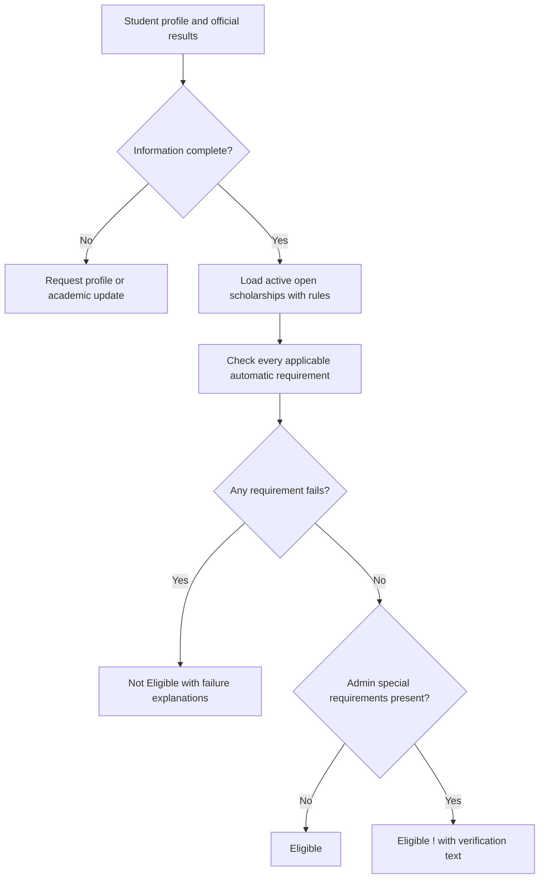

# ScholarMatch Improvement Log

**Updated:** 2026-10-20 (Asia/Singapore)

This file records completed changes, verification, and the project/FYP documentation to revise. Chapter numbers are omitted because the student's report structure has not been supplied.

## Current agreed behaviour

| Situation | Result |
| --- | --- |
| General requirements pass and any one complete qualification route passes (or no routes restrict it); no special text | Eligible |
| Same automatic checks pass; administrator entered special text | Eligible !, inside the Eligible group |
| A general requirement fails, or none of the configured qualification routes passes | Not Eligible |
| Required profile/official academic information is incomplete | Ask the student to complete it before generating recommendations |

The ! warning applies only to administrator-entered special requirements. It is not used for missing student results. The provider makes the final award decision.

Academic information uses one latest study level, Currently Studying/Completed status, current year when studying, and a manually selected Study Level Seeking Funding. SPM requires completed exams and official results. Other levels require a latest official cumulative CGPA, or final CGPA if completed. SPM credits count subjects graded C or above, including A subjects.

Administrator qualification boxes combine with OR; requirements inside each box combine with AND. Each box has its own result/status/year settings. See IMP-005 for the current route editor and migration; earlier entries describe previous stages.

## IMP-001 — Establish this improvement log

**Date:** 2026-10-19
**Type:** Documentation
**Status:** Completed

Added this record so implementation changes can be traced to the corresponding FYP report edits.

## IMP-002 — Review the original recommendation engine

**Date:** 2026-10-19
**Type:** Implementation review
**Status:** Completed; original behaviour superseded by IMP-003

The original engine checked hard requirements and then calculated weighted academic/field/institution/income points, normalized the result, and classified it as Eligible, Partially Eligible or Not Suitable. Academic minimums affected points rather than acting as universal eligibility requirements. The same education-level field was used for academic evidence and funded study level.

The review identified the need to separate qualification and funding level, remove scores and hard/soft categories, and explain individual requirements.

## IMP-003 — Replace scoring with requirement-based eligibility

**Date:** 2026-10-19
**Type:** Recommendation redesign, academic workflow, interface, data migration and documentation
**Implementation status:** Completed and verified

### What changed and why

| Area | Before | After / benefit |
| --- | --- | --- |
| Decisions | Score thresholds determined Eligible, Partially Eligible or Not Suitable | Every applicable automatic condition must pass for Eligible; any failure produces Not Eligible |
| Requirement settings | Hard, soft and none selectors, plus weighted points | Every specified condition is enforced; empty criteria are Not Applicable |
| Academic evidence | One level mixed qualification and funded programme; pending grades could be evaluated | Latest qualification and manually selected funding level are separate |
| Study status/year | Not recorded | Currently Studying or Completed; current year required for studying CGPA-based records |
| Official results | Pending results generated preliminary guidance | Official results are required before recommendations; SPM additionally requires completed exams |
| SPM minimums | As and credits used a points fallback | Both configured minimums must pass; credits must include all A subjects |
| Qualification routes | Threshold applicability could silently skip the intended academic evidence | Admin specifies accepted latest qualifications; threshold types provide a fallback for existing rules |
| Special conditions | No scholarship-level field | Optional Add/Edit Scholarship textbox; otherwise Eligible results display expandable ! and provider-check guidance |
| Explanations | Score circles, point breakdowns and message-wording guesses | Explicit Requirement / Required / Your Information / Result comparisons |
| Ordering | Highest score first | Eligible group (including !) then Not Eligible; nearest deadline, name and ID within each group |
| Availability | Expired active listings were evaluated as unsuitable | Only active, open, configured scholarships enter recommendations; deadline day remains open |
| Income updates | Stored category and cached results could become stale | Reclassify current income and invalidate decisions when admin thresholds change |
| Cache updates | Timestamp-only keys could collide within a second | Input-content hash, catalog version and calendar date determine cache identity |
| Nationality | Student choices and admin country-specific choices differed | Shared options; a broad Non-Malaysian answer requests clarification when a specific nationality is needed |
| Old evaluations | Old score statuses could be mistaken for current results | Preserve a legacy snapshot and label Previous Evaluation until refreshed |

### Files and implementation areas

- Engine: app/Services/ScholarshipRecommendationService.php.
- Models: app/Models/AcademicResult.php, Scholarship.php, ScholarshipRule.php and RecommendationLog.php.
- Student controllers: AcademicResultController.php, RecommendationController.php, DashboardController.php and ProfileController.php.
- Admin controllers: ScholarshipController.php, ScholarshipRuleController.php, IncomeCategoryController.php and RecommendationLogController.php.
- Shared configuration: config/scholarship.php.
- Database upgrade: database/migrations/2026_10_19_000000_add_decision_based_recommendations.php.
- Student screens: academic result, profile, recommendations list/detail, dashboard and saved-scholarship deadline display.
- Admin screens: scholarship Add/Edit, rule Add/Edit/summary, dashboard and recommendation-log list/detail.
- Shared views: components/decision-badge.blade.php, requirement-results.blade.php and scholarship-card.blade.php.
- Public information: resources/views/public/home.blade.php and about.blade.php.
- Supporting files: resources/css/app.css, ScholarshipRuleSeeder.php and the affected unit/feature/migration tests.

### Implementation choices

- At this stage, keep one latest qualification record. Multiple academic-history records and different CGPA thresholds for individual qualification routes were outside scope. IMP-005 subsequently adds different per-route thresholds; multiple student academic-history records remain outside scope.
- Funded level is selected directly. The system does not infer new-entry, existing-award or renewal status solely from that level.
- Matching any supported field/qualification value is sufficient. Independent applicable conditions combine with AND; equality passes at minimums/maximums.
- Within the student's accepted qualification route, all configured academic minimums must pass.
- Missing official results or required onboarding fields block recommendations; they are not classified as Not Eligible and do not produce !.
- Scholarships without a rule record are excluded with a configuration notice. An intentionally saved unrestricted rule can pass its non-applicable criteria.
- Special text is plain text, safely escaped, with no internal administrator approval workflow.
- Existing score/rule-type database columns remain inactive to preserve compatibility and historical data. No active scoring code or score display uses them.

### Documentation updated and FYP report impact

| Project document | Updated sections | FYP report material to revise |
| --- | --- | --- |
| PRD.md | 1, 5, 6.2–6.9, 7–14 and 16–17 | Requirements, user stories, use cases, decision table, validation and scope |
| ARCHITECTURE.md | 3.2–3.5, 4–10 and 11 | Academic/rule data design, ERD/data dictionary, algorithm, execution/cache strategy and limitations |
| DESIGN.md | Scholarship Cards, Badges & Chips, Academic Form and Requirement Explanations | Interface design, warning behaviour, academic form and screenshots |
| README.md | Key features, How recommendations work, upgrade and testing guidance | System overview, installation/upgrade and demonstration instructions |
| MANUAL_TEST_CASES.md | 4, 5, 10, 12–13 and regression/coverage notes | Academic/recommendation/admin test tables and expected results |
| Public Home/About pages | Feature descriptions and methodology | User guide and public-page screenshots |

Replace the report's weighted-score formula, 40/25/20/15 point table, score-threshold classification and hard/soft flowchart with the decision flow below. Update screenshots that show circular match scores, Partially Eligible tabs, pending-result choices or hard/soft selectors.

**Suggested report wording:** “ScholarMatch applies a requirement-based eligibility process. The system compares the student's official academic results and socioeconomic profile with each applicable scholarship condition. A failure produces Not Eligible; satisfying all automatic conditions produces Eligible. Administrator-entered special conditions add an exclamation warning to otherwise Eligible results and identify what the student must verify with the provider. The student's latest academic qualification is recorded separately from the study level seeking funding.”

### Verification and database upgrade

- Baseline before application edits: 133 tests and 444 assertions passed.
- Updated suite: 162 tests and 495 assertions passed after the final code changes.
- Laravel Pint passed; git diff --check passed after documentation whitespace cleanup.
- Frontend production build succeeded with Vite 8.1.0.
- Desktop browser checks used a separate synthetic SQLite database: decision tabs, expandable ! text, failed CGPA explanation, academic form switching, Add Scholarship special textbox, rule editor and administrator logs.
- The actual project-local SQLite database was backed up, then upgraded. The pending existing multi-field migration was also applied.
- Record counts were unchanged: users 5; profiles 2; academic records 2; scholarships 21; rule records 20; saved scholarships 1; recommendation logs 20.
- SQLite integrity_check returned ok.
- Backup retained at storage/app/private/scholarmatch-before-decisions-20261019-021601-27456.sqlite.
- Verification environment: PHP 8.5.11 and SQLite. MySQL integration and the full manual/mobile checklist have not been executed.

### What the student must update for the FYP

1. Replace the recommendation methodology and flowchart with the new decision process.
2. Revise the academic-result and scholarship-rule data dictionaries/ERD with the added fields.
3. Capture current student/admin screens, especially the official-result form, Eligible ! disclosure and requirement explanation table.
4. Replace score-based test cases/results with the requirement-based cases and verified automated results.
5. Describe the latest-qualification scope and provider verification as limitations.

### Upgrade note

Existing students must update their academic form to confirm study status, required year, funding level and official results. These values were not guessed during migration. Existing scholarships and student records were preserved; old evaluations refresh when students open recommendations.

## IMP-004 — Clarify required form inputs

**Date:** 2026-10-19
**Type:** Form usability and guidance
**Status:** Completed

- Added red * markers to required academic inputs and the official-results confirmation, with screen-reader text. Existing conditional visibility and validation remain in place: SPM shows As/credits, other levels show CGPA, and current year is shown for Currently Studying.
- Added a required-field legend to student profile, academic-result and administrator scholarship Add/Edit forms. Existing profile and scholarship markers were retained; scholarship description is explicitly labelled optional.
- Clarified admin rule guidance: configure only provider restrictions; Diploma uses the CGPA route; academic minimums can be empty when unrestricted; year limits require Currently Studying and a maximum year requires a minimum.
- No new mandatory eligibility criteria or scoring were introduced. * means an input must be completed, while every configured scholarship condition still applies equally.

**FYP report updates:** Revise the form/interface design and user-guide explanation of required versus optional inputs. Replace academic-form and scholarship Add/Edit screenshots. Explain conditional SPM/CGPA/year inputs and the distinction between required form entries and optional administrator restrictions. DESIGN.md records the input-marker convention.

**Admin workflow discussion:** A future option is to show only the result inputs relevant to explicitly accepted qualifications, and show year controls only for Currently Studying. This visibility change has not been implemented as part of the marker update.

**Verification:** Existing student academic/profile and admin scholarship/rule feature tests passed: 57 tests, 201 assertions. git diff --check passed. No eligibility algorithm or validation rules changed in this update.

## IMP-005 — Add repeatable qualification boxes and alternative matching

**Date:** 2026-10-19
**Type:** Administrator workflow, database, recommendation logic and explanations
**Status:** Completed; supersedes the shared academic settings in IMP-003 and the proposed workflow in IMP-004

### Behaviour and reason for the change

An Undergraduate award can accept a Completed Diploma applicant with CGPA >= 3.00 OR a Currently Studying Undergraduate applicant with CGPA >= 3.30 in Years 1–3. The previous shared status/year/CGPA fields could not express these independent alternatives.

- Add/Edit Scholarship now includes general eligibility settings and an Add Qualification button. The same editor is used on Add/Edit Rules.
- Each repeatable box stores its own qualification level, study status, result minimums and current-year boundaries. Qualification and status have required * markers. Each box has Remove; removing a middle box keeps the remaining values associated correctly.
- SPM shows optional minimum As and credits and requires Completed. Other qualifications show optional minimum CGPA. Currently Studying reveals optional minimum/maximum years. Either status is available for non-SPM, including unrestricted legacy settings.
- Result minimums and year boundaries are optional independently. Both year bounds, when supplied, are inclusive and ordered. Zero is a real result minimum. Switching qualification/status hides, disables and clears inapplicable fields; the server also clears them.
- All conditions within a box use AND. Complete boxes use OR. Students must pass any one complete box plus every applicable general nationality, funded-level, income, field and institution requirement. Conditions from separate boxes cannot be combined.
- No boxes means no academic qualification/result/status/year restriction. Students still need complete official academic information before recommendations. Removing the last box clears old academic columns so old restrictions cannot return.
- Funded Study Level remains outside the boxes. The student still supplies only one latest qualification; historical qualifications are not inferred.
- Student and administrator-log explanations include the matched route (or closest relevant failing route), plus an expandable comparison of every alternative. Failing an unused alternative does not override a passing route. Eligible ! keeps its existing special-requirements meaning.
- Scholarship metadata, general requirements and route rows save in a transaction. Invalid routes prevent partial updates. An initialization marker prevents submissions without a working JavaScript editor from erasing routes.

### Database and implementation

- Added scholarship_qualification_routes: id, scholarship_rule_id, education_level, study_status, min_spm_as, min_spm_credits, min_cgpa, min_year_of_study, max_year_of_study and timestamps. A scholarship rule has many routes; deleting its scholarship/rule cascades to the route rows.
- Added migration 2026_10_19_010000_create_scholarship_qualification_routes_table.php, which backfills equivalent routes from existing settings and retains legacy columns. Existing imports/seeders have a legacy fallback; new form saves use route rows and clear old academic columns.
- Added ScholarshipQualificationRoute model, ScholarshipRuleEditor service and AcademicRouteEvaluator service; updated scholarship/rule controllers, route relationships and recommendation service.
- Added admin/rules/_qualification-routes.blade.php and qualificationEditor in resources/js/app.js; updated shared rule form, scholarship Add/Edit, rule summary and requirement explanation component.
- Algorithm version is decisions-v2-routes. Earlier cached results cannot be reused; previous logs remain identifiable until recommendations refresh.

### FYP documentation to revise

| Report area | Required change | Updated project reference |
| --- | --- | --- |
| Functional requirements / use cases | Add/remove multiple qualification boxes directly on Add/Edit Scholarship; separate general restrictions from alternatives | PRD.md sections 6.4–6.7 |
| Database / ERD / data dictionary | Add one-to-many scholarship_rules to scholarship_qualification_routes; document per-route nullable result/year fields and cascading relationship | PRD.md section 8; ARCHITECTURE.md sections 3.5 and 6 |
| Recommendation methodology / flowchart | General conditions AND any one complete qualification route; AND within each route; no mixing partial matches | PRD.md section 6.6; ARCHITECTURE.md section 4 |
| Interface / user guide | Screenshot Add/Edit with Diploma Completed and Undergraduate Currently Studying boxes; explain *, optional thresholds, conditional fields and Remove | DESIGN.md Administrator Qualification Boxes; screenshot storage/app/private/qualification-routes-preview.jpg |
| Testing / evaluation | Add alternative-route, same-level alternatives, partial-match rejection, middle-removal, stale-field clearing, transaction and migration cases | MANUAL_TEST_CASES.md section 10; new QualificationRoutesTest and engine tests |
| Scope / limitations | Continue to state that each student has one latest qualification and that provider award decisions/manual verification are external | PRD.md sections 9 and 14 |

**Suggested report wording:** “ScholarMatch represents accepted academic backgrounds as alternative qualification routes. Each route defines a qualification level, study status and optional result or current-year thresholds. A student must satisfy all applicable conditions within at least one route, together with the scholarship's general requirements. This supports scholarships that accept both completed Diploma applicants and current Undergraduate students under different academic conditions.”

### Verification and local database upgrade

- Automated suite passed: 185 tests, 584 assertions. Includes separate qualification thresholds/statuses, same-level alternatives, failure of incomplete routes, SPM As/credits, general-condition priority, transactional saves, server normalization, removal, initialization guard and legacy backfill.
- Laravel Pint passed and the Vite production build succeeded. git diff --check passed.
- Browser checks used a separate synthetic SQLite database: Add/Edit shared controls, SPM-to-Diploma switching, adding/removing a middle box, current-year controls/clearing, saving/reopening both routes, and Eligible ! with a passing Undergraduate route plus expanded alternatives.
- Before applying the route migration, created storage/app/private/scholarmatch-before-qualification-routes-20261019-110935.sqlite.
- Existing local database counts were preserved: users 5; profiles 2; academic records 2; scholarships 21; rules 21; saved scholarships 1; recommendation logs 30. Counts reflect the database at this upgrade and may differ from earlier log entries.
- Backfilled 94 qualification route rows; SQLite integrity_check returned ok. No sample preview records were inserted into the user's database.
- MySQL integration and the full manual/mobile checklist have not been executed.

## IMP-006 — Group programme details inside Academic Result

**Date:** 2026-10-20
**Type:** Student workflow, data ownership and migration
**Status:** Completed

- Moved Institution Type and Field of Study from Profile into Academic Result, grouped with Study Level Seeking Funding under Programme Seeking Funding. Both retain required * markers and describe the programme seeking funding, which may differ from the latest qualification supplying results.
- Profile now edits nationality, state, household income and dependents, and links to Academic Result for programme details. Its save endpoint ignores programme fields and cannot overwrite academic choices.
- Added required academic validation and completeness checks for shared supported institution/field options. Matching and explanations read academic_results; edits change the recommendation input hash immediately. Missing programme choices produce an academic-completion prompt.
- Added migration 2026_10_20_000000_move_programme_details_to_academic_results.php. It copies existing selections to existing academic records, keeps nullable legacy profile columns for recovery, and does not invent qualifications, results or academic records. Profile-only legacy choices prefill the first academic form. Rollback copies updated academic values back to existing profiles.
- Updated models/controllers, shared configuration, student/public views, test fixtures and recommendation checks. Existing qualification-route and special-warning logic is unchanged.

**FYP report updates:** Revise Profile and Academic Result functional requirements/user guides, form screenshots, data dictionaries and ERD field ownership. Institution Type and Field of Study now belong to academic_results; legacy profile columns are inactive compatibility data. Describe Programme Seeking Funding separately from the qualification supplying results. PRD.md sections 6.2–6.3, 8–9 and 11; ARCHITECTURE.md sections 3.2–3.3 and 6; DESIGN.md, README.md and MANUAL_TEST_CASES.md were updated.

**Verification:** 196 tests passed with 622 assertions; Vite production build passed. PHP formatting checked. A full-suite run initially encountered a Windows lock in the shared compiled-view cache; rerunning with a separate test view folder passed. Browser checks with synthetic data confirmed Profile saves without programme fields, the academic section displays all three choices, and changed institution/field selections save and reopen correctly. Screenshot: storage/app/private/programme-details-preview.jpg. MySQL integration and the full mobile checklist were not run.

**Local database:** Backed up to storage/app/private/scholarmatch-before-programme-details-20261020-19aa1d9b.sqlite before migration. All original academic values and record counts were preserved: users 5; profiles 2; academics 2; scholarships 21; rules 21; qualification routes 94; saved scholarships 1; logs 30. Both existing academic records received the matching saved programme choices. SQLite integrity_check returned ok.

## IMP-007 — Give View Details a visible button border

**Date:** 2026-10-20
**Type:** Interface consistency
**Status:** Completed

Changed View Details in the shared scholarship-card component from the borderless ghost style to btn-outline, matching Save. Apply Now remains the filled primary action. The border, padding, corner radius, hover and focus treatment come from the existing shared button styles; destination and behaviour are unchanged. This applies wherever the shared card appears, including the dashboard and recommendations.

**FYP report updates:** Replace scholarship-card/action screenshots in the interface design or user guide. DESIGN.md Scholarship Cards and MANUAL_TEST_CASES.md REC-21 describe the outlined View Details action. No algorithm or database change is associated with this styling update.

**Verification:** Browser preview confirmed a visible 1px border matching Save, and clicking View Details still opens the scholarship. Screenshot: storage/app/private/view-details-button-preview.jpg. The styling reuses existing compiled button CSS; no additional automated test was added for the class-only change.

## IMP-008 — Position card badges and colour requirement explanations

**Date:** 2026-10-20
**Type:** Interface layout, visual emphasis and accessibility
**Status:** Completed

- Moved Eligible / Eligible ! / Not Eligible to the top-right corner of the shared card header. Titles/providers wrap on the left without overlapping the badge, including narrow recommendation-grid cards.
- Preserved the Eligible ! disclosure as a keyboard-accessible, bounded amber panel anchored below the top-right badge. It retains the existing special text and verification meaning.
- Card explanations now use pale green panels for Met and pale red panels for Not Met. Labels, required values and student information receive stronger emphasis. Award type uses a blue-tinted chip and the deadline date is bold.
- Shared requirement tables use green met rows, red unmet rows and neutral Not Applicable rows. Applicable required/student values are bold; student values and result pills use darker outcome colours. Added a shared requirement-status component with check/cross/dash and explicit labels, preserving meaning without relying on colour alone.
- Alternative-route tables and administrator recommendation-log explanations inherit the shared styling. The detail page highlights award/deadline information, failed requirements and amber special conditions.
- Changed presentation only. Academic routes, AND/OR evaluation, thresholds, decisions and database records are unchanged. All displayed values and special text remain escaped.

**FYP report updates:** Replace dashboard/recommendation-card screenshots and scholarship/log detail screenshots. Describe badge placement, required-versus-student-value emphasis and the green/red/neutral outcome convention in interface design and the user guide. DESIGN.md Scholarship Cards, Badges & Chips, and Academic Form and Requirement Explanations were updated; MANUAL_TEST_CASES.md REC-22–REC-24 cover the new presentation.

**Verification:** Existing dashboard, recommendation and administrator-log tests passed: 27 tests, 104 assertions. Vite production build and git diff --check passed. Synthetic browser checks confirmed the top-right badge on wide and 310px cards without title overlap, keyboard activation of the ! disclosure, green expanded card explanations, and red/green/neutral detail rows with bold results. Screenshots: storage/app/private/recommendation-card-colours.jpg and storage/app/private/requirement-result-colours.jpg. No new automated tests were added for the presentation-only changes, and no live student data was modified for previewing.

## IMP-009 — Simplify the card explanation list

**Date:** 2026-10-20
**Type:** Readability refinement
**Status:** Completed; replaces the expanded card panels from IMP-008

Restored View Explanation to one plain message per applicable check, with a bold green Met or red Not Met label. Removed the individual boxes, separate status pills, repeated requirement headings and duplicated required/student value rows. Longer messages wrap naturally. The top-right eligibility badge, highlighted award/deadline and colour-coded detail/log tables remain in place; recommendation logic is unchanged.

**FYP report updates:** Replace any screenshots of the expanded card-panel design with the simplified explanation list. Update the card interaction/user-guide description: View Explanation is a quick summary, and View Details provides the full comparison table. DESIGN.md Scholarship Cards and MANUAL_TEST_CASES.md REC-25 reflect the final layout.

**Verification:** Existing dashboard and recommendation tests passed: 21 tests, 76 assertions. Vite production build and git diff --check passed. A synthetic browser preview confirmed the plain, wrapping green explanation lines, bold outcome labels and retained top-right badge. Screenshot: storage/app/private/simple-explanation-preview.jpg. No recommendation rules or live student records were changed.

## IMP-010 — Simplify required-field notes and fix income input overlap

**Date:** 2026-10-20
**Type:** Form readability and layout correction
**Status:** Completed

- Removed the separate “* Required field.” note from Profile, Academic Result and administrator Add/Edit Scholarship forms. Required label stars, accessibility text and validation remain in place. The academic form retains its useful explanation about conditional result/year fields.
- Removed the overlaid RM prefix and its special padding from Household Income. The currency remains clear in the Household Income (RM) label, while the input shows only the numeric amount without overlap.

**FYP report updates:** Refresh Profile and affected form screenshots in the interface design/user guide. Describe required fields using their label stars and household income as a numeric amount with the currency in its label. DESIGN.md Input Fields reflects this update. No database, income classification or recommendation logic changed.

**Verification:** Existing Profile, Academic Result and administrator Scholarship tests passed: 51 tests, 177 assertions. Browser preview with synthetic income 3000.00 confirmed a readable numeric amount and the removed top note. Screenshot: storage/app/private/profile-income-layout-preview.jpg. MANUAL_TEST_CASES.md S10–S11 cover the layout and required-label behaviour. No new automated tests were added for this presentation-only change; git diff --check passed.

## IMP-011 — Align the Academic Result programme section divider

**Date:** 2026-10-20
**Type:** Form layout correction
**Status:** Completed

Moved the Programme Seeking Funding divider from the fieldset onto an outer wrapper. The line now spans the content width above the heading instead of being interrupted by the legend. Removed the legend's extra top padding while preserving the accessible fieldset grouping, section spacing, inputs and validation.

**FYP report updates:** Refresh the Academic Result screenshot in interface design/user-guide sections to show the full-width divider above Programme Seeking Funding. DESIGN.md Academic Form and Requirement Explanations describes the corrected layout. No data or eligibility logic changed.

**Verification:** Existing Academic Result tests passed: 26 tests, 88 assertions. Synthetic browser previews confirmed the continuous divider and readable section spacing at desktop and 390px widths. Screenshots: storage/app/private/academic-divider-preview.jpg and storage/app/private/academic-divider-mobile-preview.jpg. MANUAL_TEST_CASES.md AR-15 covers the visual check. Existing CSS utilities were reused; git diff --check passed.

## IMP-012 — Add recommendation filters, full-width cards and 10-item pages

**Date:** 2026-10-20
**Type:** Scholarship browsing functionality and responsive layout
**Status:** Completed

- Added a desktop filter sidebar for scholarship/provider search, award type, funded study level, supported field and institution type. Search ignores case; filters combine with AND. Unrestricted programme criteria also match a selected programme choice, and field filtering supports multiple accepted fields.
- Replaced the small multi-column card grid with one full-width card per row, reusing the Dashboard card component. Filters stack above the list on narrow screens.
- Eligible (including !) and Not Eligible use GET navigation with filtered totals. Each selected group displays at most 10 cards, with result ranges, current page, numbered links and previous/next controls. Filters/group persist across pages; applying/resetting filters or changing group starts at page 1. Stale high page values resolve to the last available page.
- Empty groups retain the filter controls, Reset and helpful guidance. Query values are validated and displayed text remains escaped. The results anchor respects the sticky header.
- Filtering runs after evaluation/cache retrieval and preserves existing ordering. It does not alter student data, scholarship rules or eligibility outcomes. Evaluation logs still cover all evaluated scholarships, including those hidden by filters or pagination; Dashboard behaviour is unchanged.

**FYP report updates:** Add recommendation filtering/pagination to functional requirements and browsing use cases. Refresh recommendation-page screenshots to show the sidebar, single-column list and page controls. Explain unrestricted filter matching, filtered group totals and preserved selections in the interface design/user guide. PRD.md 6.7, ARCHITECTURE.md 5, DESIGN.md and MANUAL_TEST_CASES.md REC-26–REC-30 describe the implementation. No database migration is required.

**Verification:** Recommendation filter, existing recommendation and Dashboard tests passed: 36 tests, 160 assertions. PHP formatting, Vite production build and git diff --check passed. Browser checks using a separate synthetic database confirmed combined filters, 10-card pages, remaining results on page 2, preserved query parameters, group/page resets, empty results and Reset. A 390px preview confirmed filters stack above readable cards. Screenshots: storage/app/private/recommendation-filters-preview.jpg, recommendation-page-two-preview.jpg and recommendation-filters-mobile-preview.jpg. Live student/scholarship data was not used for the preview.

## IMP-013 — Limit nationality to Malaysian or Non-Malaysian

**Date:** 2026-10-20
**Type:** Shared form choices, validation and eligibility matching
**Status:** Completed

- Reduced the shared nationality choices to Malaysian and Non-Malaysian for Profile and all scholarship/rule forms. The student placeholder remains unanswered; administrators can still use Any nationality for an unrestricted requirement.
- Profile and rule validation reject individual-country and Other values. Matching compares the two supported categories exactly, while an unrestricted scholarship accepts either. Removed the request for a specific country, since that is no longer an available input.
- Unsupported legacy student nationality values now request a valid Profile selection before evaluation. Unsupported country-specific legacy scholarship rules remain intact and awaiting configuration rather than being silently broadened or blocking other awards. Country-specific conditions can be entered as Special Requirements for provider verification.
- Advanced the evaluation version to decisions-v3-nationality so old cached results and logs refresh under the current rules. Academic-route evaluation, special-warning meaning and list filters/pagination remain in place.
- Read-only audit of the existing local SQLite database found 2 student profiles and 21 scholarship rules, all using Malaysian. No data conversion, schema migration or live-record modification was required.

**FYP report updates:** Update the Nationality input definition and screenshots to show Malaysian/Non-Malaysian only. Explain exact-category matching and the optional unrestricted scholarship setting; place country-specific conditions under special verification. Update the current algorithm version in implementation/cache/log descriptions. PRD.md 6.2, ARCHITECTURE.md, README.md, DESIGN.md and MANUAL_TEST_CASES.md S12–S13 reflect the changes.

**Verification:** Full suite passed: 226 tests, 756 assertions, including exact-category/unrestricted matching, unsupported legacy values, profile/rule validation, and the new filters/pagination. PHP formatting and git diff --check passed; the frontend production build from IMP-012 remains current. A synthetic browser preview confirmed the Profile dropdown contains only its placeholder, Malaysian and Non-Malaysian, and that Non-Malaysian can be selected. Screenshot: storage/app/private/nationality-options-preview.jpg.

## IMP-014 — Agree on grade-count entry and manual subject-specific conditions

**Date:** 2026-10-31
**Type:** Academic-input design decision
**Status:** Implemented in IMP-015 below; this entry retains the original design decision.

- For the proposed grade-based qualification forms, students enter the number of subjects at each grade using minus/plus counters or direct numeric entry. The summary and relevant totals are calculated from those counts. Individual subject names and grades are outside this design.
- Administrators record named-subject conditions, such as Mathematics at least C or English at least B, in the scholarship's existing Special Requirements textbox. Grade counts cannot establish which grade belongs to a particular subject, so these conditions must not be displayed as automatically met.
- Existing decision meanings remain: passing automatic checks with non-empty Special Requirements produces Eligible ! for provider verification; an automatic failure produces Not Eligible. The ! does not confirm that the subject-specific condition has been satisfied.
- The earlier official-results-only policy remains the proposed default. This decision concerns grade-based results; existing CGPA inputs and the proposed STAM pangkat input retain their own result formats. The complete new qualification list and its automatic threshold rules still need to be finalised before implementation.

**FYP report updates:** Record the input-design decision and scope in the proposed interface/system design: aggregate grade counts support general academic thresholds, while named-subject restrictions are explained as provider-verification conditions. Update implementation descriptions, form screenshots, data dictionaries and tests when this design is implemented; no new result-entry behaviour is claimed by this documentation-only entry.

## IMP-015 — Implement grouped qualifications, official grade counts and matching rules

**Date:** 2026-10-31
**Type:** Student academic entry, administrator rules, matching, migration and documentation
**Status:** Implemented and verified locally

**Student changes**

- Replaced the single qualification dropdown with category buttons followed by qualification buttons: Secondary (SPM, Cambridge IGCSE, Cambridge O-Level), Pre-U, Diploma & Pathway (STPM, STAM, A-Level, Senior UEC, Matriculation, Foundation, Diploma), and Undergraduate (Bachelor’s Degree). Categories organise the interface; they do not imply qualification equivalence.
- Added minus/number/plus grade counters, direct whole-number entry, a live grade summary and total subjects for SPM, IGCSE, O-Level, A-Level and Senior UEC. SPM As count A+/A/A- and credits count C or above automatically. Students no longer enter As/credits separately. No subject names or individual subject results are collected.
- Supported IGCSE letter grades and 9–1 as separate, explicitly selected scales, with no conversion. Full A-Level uses A*–U; Senior UEC uses A1–F9. STAM uses the official overall pangkat from Mumtaz through Rasib. Existing STPM/Foundation/Matriculation/Diploma/Bachelor’s Degree results remain CGPA-based.
- All exam-based qualifications require Completed and official final results. Currently studying CGPA students provide current year and official cumulative CGPA; completed students provide final CGPA. Forecast/expected/pending results and AS-Level are not accepted. Changing category, qualification, scale or status clears incompatible form values and official confirmation.
- Kept Programme Seeking Funding separate, with funding level, institution type and field. Friendly labels preserve existing stored identifiers: Bachelor’s Degree = Undergraduate, Senior UEC = UEC, Cambridge O-Level = O-Level.
- Added server validation for whole non-negative counts, recognised grades, matching scales, at least one subject and supported totals. Entry caps are 12 SPM subjects and 20 for the other supported grade-count formats; these are application limits, not examination-board maxima.

**Administrator and recommendation changes**

- Extended shared Add/Edit Scholarship and Rules qualification boxes with conditional grade requirements, exact IGCSE scale, minimum STAM overall rank and optional UEC best-subject average settings. Existing SPM As/credits, CGPA and current-year limits remain available where applicable. Incompatible values are cleared by both the editor and server.
- Each grade condition means a minimum number of subjects at a grade or better. AAB is represented by 2 subjects at A or better AND 3 at B or better. Every condition inside a box uses AND; complete alternative boxes use OR. General nationality, funding, income, field and institution conditions still apply.
- UEC grade ordering treats A1 as strongest. An explicitly configured average selects the best N subjects meeting the minimum grade, maps A1=1 through F9=9 and requires an average no higher than the maximum. Too few qualifying subjects fails; lower is better. Maximum thresholds allow two decimal places; actual averages are compared without rounding into a pass. Other provider conversion formulas remain special conditions.
- Named-subject conditions such as Mathematics at least C belong in Special Requirements. Passing automatic checks with special text gives Eligible ! for provider verification; the system does not claim that the named subject was verified. An automatic failure remains Not Eligible. Existing application-date/provider warning and Apply/Check Provider behaviour is retained.
- Fixed a browser-discovered edit issue: saved grade dropdowns now restore their selected values after dynamic options render. Adding/removing conditions retains the other boxes’ values and stable identities.

**Data and implementation**

- Added the shared AcademicQualifications catalogue, the academic-qualifications.js student/admin editors and migration 2026_10_31_000000_add_qualification_grade_counts. Student fields: grading_scale, grade_counts JSON and stam_rank. Route fields: grading_scale, grade_requirements JSON, min_stam_rank and uec_average JSON. The academic qualification enum now accepts eleven qualifications.
- Preserved existing SPM aggregate columns for reference/compatibility; new submissions derive them from real counts. Old aggregates cannot reveal a student's grade distribution, so migration invents no breakdown. Legacy SPM students see their saved totals and must enter actual counts before recommendations; valid existing CGPA records continue working.
- Migration preserves existing records and values; rollback refuses to discard new-format result/rule data. Advanced the matcher version to decisions-v6-grade-counts to refresh prior caches/logs. Legacy CGPA inference remains limited to the original five CGPA qualifications.
- The stock 70-entry fictional demo catalogue was not replaced or expanded; it still covers the original six qualifications. New qualification cases have dedicated tests, and administrators can add their rules through the editor.

**Where to update the FYP report**

| Report area | Required revision | Project reference |
| --- | --- | --- |
| Functional requirements and scope | Eleven supported qualifications, grouped selection, official-result gate, aggregate counts only, subject-specific provider checks | PRD.md sections 6.3 and 6.5; docs/ACADEMIC_QUALIFICATIONS.md |
| Use cases and activity diagrams | Category → qualification → applicable result input → official confirmation → save; admin adds alternative qualification boxes | DESIGN.md Academic Form and Administrator Qualification Boxes |
| Interface design and user guide | Replace student/admin screenshots; explain counters, IGCSE scale selection, STAM rank, CGPA/year and separate funded programme | Screenshots listed below; DESIGN.md |
| Data dictionary and ERD | Add the student and route fields above, extend education_level values, describe category as derived and aggregates as calculated | PRD.md section 8; ARCHITECTURE.md sections 3.3, 3.5 and 6 |
| Algorithm/pseudocode | Grade ordering/count-at-or-above, AAB example, exact IGCSE scale, STAM direction, best-N UEC average, AND within/OR between routes | docs/ACADEMIC_QUALIFICATIONS.md; AcademicRouteEvaluator |
| Testing and evaluation | Add valid/invalid counts, persistence, threshold boundaries, scale changes, admin edit restoration, migration preservation and mobile checks | MANUAL_TEST_CASES.md AR-16–AR-25 and RULE-17–RULE-25; new PHP/Node tests |

Updated README.md, PRD.md, ARCHITECTURE.md, DESIGN.md, MANUAL_TEST_CASES.md and .ai-handoff.md. Added [the academic format and matching reference](docs/ACADEMIC_QUALIFICATIONS.md). This log is the change summary for the FYP report and GitHub description.

**Verification:** Full PHP suite passed: **385 tests, 1,793 assertions**. All **6 JavaScript tests** passed via npm run test:academic. Vite production build, targeted Pint formatting checks and git diff whitespace checks passed. Synthetic browser checks confirmed saved Bachelor’s Degree values, SPM counter totals/save/reload, UEC save/reload, IGCSE scale switching/reset, STAM save/reload, responsive 390px layout, and administrator saved grade options/add/remove/full-form submission. No synthetic records were inserted into the real local database.

Screenshots retained for the report: storage/app/private/uec-grade-counts-preview.jpg (current student result interaction), storage/app/private/uec-grade-counts-full-preview.jpg (full form), storage/app/private/admin-grade-requirements-preview.jpg (AAB/UEC rules) and storage/app/private/grade-counts-mobile-preview.jpg (390px layout).

**Local database:** Backed up before migrating to storage/app/private/scholarmatch-before-grade-counts-20261031-b7e505dc.sqlite. Original values and record counts were compared and preserved: users 5; profiles 2; academic results 2; scholarships 71; rules 71; qualification routes 114; saved scholarships 0; recommendation logs 71. SQLite integrity_check returned ok. One existing SPM record needs its actual grade breakdown; no grades or student results were fabricated. No catalogue reseed/replacement was performed.

**Current limits:** One latest academic record and one IGCSE scale per record; no subject-level automatic checks, cross-qualification equivalence or automatic grade-scale conversion. AUSMAT, IB Diploma, CIMP, AS-Level and unspecified qualifications are outside this implementation. SQLite migration/testing passed; MySQL integration was not run. Changes remain in the working tree; no commit or push was made.

## IMP-016 — Add explicit requirement types and STPM grade/subject-point checks

**Date:** 2026-10-31
**Type:** Academic data, administrator input, eligibility calculations and user guidance
**Status:** Implemented and verified locally

**What changed**

- Replaced separate result panels in the shared Add/Edit Scholarship and Rules editor with **Add Condition → Requirement Type**. Offer supported choices only: minimum overall CGPA, minimum grade count, SPM As/credits, STAM pangkat, STPM minimum best-subject average, and UEC maximum best-subject average or total. Each added condition must be complete. Non-grade types have one setting per box; grade thresholds can repeat at different grades.
- Added a live plain-language explanation for each condition and a cumulative minimum grade-pattern preview. A-Level 1 subject at A or better AND 3 at B or better displays A, B, B, because the A already counts towards the three. UEC 2 As including A1/A2 uses 2 subjects at A2 or better. STPM 1A uses A, or A- only when the provider explicitly accepts it. The interface includes qualification-specific examples.
- STPM students now enter both official overall CGPA and grade counts using A, A-, B+, B, B-, C+, C, C-, D+, D and F. The application cap is five subjects. Official CGPA is entered from the result record; it is never reconstructed from unnamed counts. Currently studying students retain status/year and official latest results; completed students use final results. Changing status clears the form's old STPM grades/CGPA/confirmation.
- Added a minimum average across the best N eligible STPM subjects using official subject points (A=4.00 through F=0.00). This is separate from overall CGPA and from requiring N subjects each at a grade threshold. Example: A/B/C/C has a best-three average of 3.00, but only two B-or-better subjects. Too few qualifying subjects fails; compare actual averages without rounding into a pass. Average thresholds support two decimal places and a real zero minimum.
- Added a direct UEC maximum-total option. A confirmed best-five total of 11 or below can be entered as N=5 and maximum=11, without the previous average conversion. A1/A1/A2/B3/B4 totals 11. Lower UEC points are better. Administrators specify a grade cutoff, or the lowest grade when no extra cutoff is stated. Integer totals must lie between N and 9N; too few qualifying subjects fails.
- Kept AND within a qualification box and OR between complete boxes. General requirements still apply. Existing saved thresholds reopen as typed rows without changing their meaning. Adding/removing conditions retains other rows' stable values; changing type or qualification clears incompatible values and disables irrelevant controls.
- Retained provider verification for unclear wording, named-subject calculations and unsupported conversions. “3.0 in 3 subjects” must be clarified as an average versus a minimum in each subject. Southern UC's A-Level CGPA 3.20 wording provides no conversion formula, so it stays in Special Requirements. Generic A-Level CGPA conversion is not offered. UEC “minimum 11 points” also needs its comparison direction confirmed before using an automatic maximum.

**Data and compatibility**

- Reused grading_scale/grade_counts for STPM and kept existing min_cgpa, SPM minima, grade_requirements, min_stam_rank and uec_average storage. Requirement Type is editor state that generates names for these validated fields, not a free-text rule parser or a new independent score.
- Added nullable route JSON fields stpm_average={subjects, minimum_grade, min_average} and uec_total={subjects, minimum_grade, max_total} through migration 2026_10_31_010000_add_subject_point_requirements. Existing rows/values are preserved; rollback refuses to discard new point rules. Advanced the matcher/cache/log version to decisions-v7-academic-requirement-types.
- Legacy STPM CGPA is preserved, but actual subject counts are now needed before recommendations. Missing counts prompt profile completion rather than Not Eligible or Eligible !. No real grades are invented. Other qualifications and the existing 70-entry fictional catalogue retain their records and rules.

**FYP report updates**

| Report area | What to change |
| --- | --- |
| Requirements/scope | STPM now has CGPA plus grade counts; admins select supported condition types and can express UEC totals directly. Explain unsupported formulas and named-subject verification. |
| UI design/user guide | Replace Add/Edit Scholarship, Rules and STPM screenshots. Describe Add Condition, conditional inputs, live explanations and the cumulative ABB pattern. |
| Use cases/activity diagrams | Add condition → choose type → enter applicable values → review preview → validate/save; student supplies official STPM CGPA and counts. |
| Data dictionary/ERD | Add stpm_average and uec_total JSON to qualification routes; describe STPM use of existing count/scale fields and keep overall CGPA separate. |
| Algorithm/pseudocode | Add exact best-N selection, STPM grade-point averaging versus per-subject minima, UEC maximum totals, insufficient-subject failure and unrounded comparisons; retain AND/OR structure. |
| Evaluation/testing | Add STPM 1A/A- boundaries, average-versus-overall-CGPA examples, UEC total 11 boundaries, validation, saved-type restoration, migration preservation, Add/Edit submission and mobile cases. |

Current references: [requirement-type guide](docs/ACADEMIC_REQUIREMENT_TYPES.md), docs/ACADEMIC_QUALIFICATIONS.md, PRD.md and ARCHITECTURE.md version 3.8, DESIGN.md and MANUAL_TEST_CASES.md (AR-26–AR-28, RULE-26–RULE-33). README.md and .ai-handoff.md were updated.

**Verification:** Full PHP suite passed **416 tests / 1,906 assertions**; all **10 JavaScript tests** passed. Production Vite build, targeted Pint and git diff whitespace checks passed. Synthetic browser checks confirmed: STPM grade counts plus official CGPA save/reload; creation and full edit submission of typed rules; restored old UEC average and new maximum-total values; condition removal/type switching; and student/admin layouts at 390px without horizontal page overflow. A prior HTML-label assertion was updated to the new Requirement Type/Add Condition controls. Tests and previews use separate databases and compiled-view folders; no synthetic records were added to the user's database.

Report screenshots: storage/app/private/admin-stpm-requirement-types-preview.png; storage/app/private/admin-uec-total-points-preview.png; storage/app/private/student-stpm-cgpa-grades-preview.png; storage/app/private/student-stpm-mobile-preview.png; storage/app/private/admin-requirement-types-mobile-preview.png.

**Local database:** Created a full backup at storage/app/private/scholarmatch-before-requirement-types-20261031-289d47ff.sqlite, applied the additive migration, and compared all original values/counts. Preserved users 5; profiles 2; academic records 2; scholarships 71; rules 71; qualification routes 114; saved items 0; recommendation logs 71. SQLite integrity_check returned ok. There are no existing STPM records needing a breakdown locally. No reseed or catalogue replacement was performed.

**Limits:** One latest academic record, aggregate grades only, no named-subject automatic checks or undocumented conversions. Best-N formulas apply only where the provider confirms that any qualifying subjects may be used; specific subject inclusions/exclusions require verification. MySQL integration was not run. No commit or push was made.

## IMP-017 — Group grade thresholds under one requirement-type selector

**Date:** 2026-10-31
**Type:** Administrator form layout and interaction
**Status:** Implemented and verified locally

- Combined all “Number of subjects at a grade or better” thresholds in each qualification box into one requirement group. Its Requirement Type dropdown appears once, with compact Minimum Subjects / At Grade or Better rows below. For ABB, the rows show 1 at A and 3 at B.
- Added **Add Grade Row** inside the group and renamed the outer button to **Add Another Requirement** for CGPA, rank, average or total-point types. Only one grade-count group is offered per qualification; up to 20 grade rows fit inside it. Other requirement types remain separate.
- Each row has a Remove action. Removing the first/middle row preserves the other values and stable identities. Removing the final row removes only the grade group; CGPA/average settings stay intact. Remove this requirement deletes the entire chosen group. Changing the group to another type clears its old grade rows.
- Replaced repeated per-grade explanations with one combined minimum-pattern preview. An incomplete row prompts completion; numeric zero minima are preserved. Every row still uses AND, and stronger grades still count towards lower thresholds. Separate qualification boxes remain OR alternatives.
- Existing flat grade_requirements lists automatically reopen as grouped rows and are submitted using the same validated flat field names. No schema migration, matcher/version change, real database modification or catalogue reseed was needed.

**FYP report updates:** Refresh Add/Edit Scholarship and Rules screenshots and the admin user guide. Explain the distinction between adding a grade row and adding another requirement type, the per-row/group removal actions, the single combined preview and responsive layout. Update the requirement-entry activity diagram to include repeated rows inside one grade group. The data dictionary, ERD and eligibility algorithm retain their existing structure and semantics. Current references: DESIGN.md Administrator Qualification Boxes; PRD.md section 6.5; ARCHITECTURE.md section 3.5; docs/ACADEMIC_REQUIREMENT_TYPES.md; MANUAL_TEST_CASES.md RULE-34–RULE-37. README.md, the academic-format guide and .ai-handoff.md were updated.

**Verification:** Full PHP suite passed **416 tests / 1,908 assertions**; all **14 JavaScript tests** passed. Production Vite build, affected PHP formatting and git diff whitespace checks passed. Synthetic browser checks confirmed old ABB thresholds load as one group, first-row removal preserves the other value, final-row removal preserves separate CGPA/average requirements, a new scholarship can be created with two grouped rows, and full Edit Scholarship submission saves/reopens the same minima. At 390px, the two columns and removal controls remained usable without horizontal page overflow. Preview accounts/data were isolated from the real database, and temporary preview files were removed.

**Screenshots:** storage/app/private/admin-grouped-grade-rows-preview.png and storage/app/private/admin-grouped-grade-rows-mobile-preview.png. Previous IMP-016 screenshots describe the earlier ungrouped layout; use these new screenshots for the grade-count section. No commit or push was made.

## IMP-018 — Calculate completed STPM overall CGPA using Pengajian Am

**Date:** 2026-10-31
**Type:** Student result entry, validated calculation and data preservation
**Status:** Implemented and verified locally

**Changes**

- Completed STPM students enter four/five official final subject results using the existing grade counters, then select the **Pengajian Am Grade** already included in those counts. This is the explicitly approved exception to aggregate-only entry; other subject names are not collected and subject-specific scholarship conditions remain Special Requirements.
- Added a read-only **Calculated Overall CGPA** using Pengajian Am plus the strongest three other subjects, divided by four. PA is removed once from a working copy before choosing the other subjects, so it is never counted twice or dropped for a stronger extra subject. Example: four As and PA=C gives (2+4+4+4)/4 = 3.50. With the same counts and PA=A, the strongest four included grades give 4.00.
- PHP and JavaScript share the STPM point map. They calculate in integer hundredths and round half up to two decimals consistently (e.g. 2A/2A- gives 3.84). A real calculated 0.00 remains valid.
- Added a required confirmation that the calculated value matches the official STPM slip. Count edits through typing/counters or changing PA clear the confirmation. Missing/uncounted/unsupported PA grades, incomplete result codes, insufficient/excessive final subjects, unconfirmed values and pending results cannot save. The controller excludes a submitted completed-STPM cgpa value and recalculates on the server, preventing a forged client value from inflating eligibility.
- Currently studying STPM retains manual official cumulative CGPA, official subject counts and current year. Switching status/qualification clears incompatible PA/calculation-confirmation data. The overall calculation remains separate from provider-defined best-N scholarship averages; the grouped administrator grade editor and AND/OR logic are unchanged.

**Data and upgrade**

- Added migration 2026_10_31_020000_add_stpm_cgpa_calculation with academic_results.stpm_pa_grade (nullable string) and stpm_cgpa_confirmed (boolean, default false). Existing cgpa, counts and other values are preserved. No PA identity or grade is guessed, and migration does not recalculate prior records. Rollback refuses to discard stored PA/confirmation data.
- Existing usable official manual STPM records with valid counts remain usable until edited, when the completed-result form requires PA and calculation confirmation. Older STPM records missing counts still follow the earlier completion prompt. New calculation records require confirmation and consistency of stored counts/PA/CGPA before recommendations.
- Advanced the evaluation version to decisions-v8-stpm-cgpa so caches/logs refresh under the new input workflow. No scholarship catalogue reseed/replacement was performed.

**Where to update the FYP report**

| Area | Required update |
| --- | --- |
| Functional requirements/scope | Completed STPM calculates overall CGPA; studying STPM stays manual. Explain the single PA identification exception and official-slip confirmation. |
| Use case/activity diagram | Branch on studying/completed; completed: final counts → PA selection → calculation → match confirmation → server validation/save. |
| UI design and user guide | Replace completed-STPM screenshots with the PA dropdown, read-only CGPA and confirmation; explain that PA is already included in the counters. |
| Data dictionary/ERD | Add the two academic_results fields; describe cgpa as derived for new completed STPM submissions and manual in the supported other cases. |
| Algorithm/pseudocode | Validate 4–5 final subjects, reserve PA once, select best three other grades, use published points, divide by four and round half up. Separate this from scholarship-specific averages. |
| Testing/evaluation | Include weak-PA inclusion, 4/5 subjects, zero and rounding boundaries, invalid data, confirmation reset, forged CGPA, manual studying, legacy preservation and rollback protection. |

Added [STPM_CGPA_CALCULATION.md](docs/STPM_CGPA_CALCULATION.md); updated PRD.md/ARCHITECTURE.md to version 3.9, DESIGN.md, README.md, the qualification/requirement-type guides, MANUAL_TEST_CASES.md AR-29–AR-36, public About text and .ai-handoff.md.

**Verification:** Full PHP suite passed **441 tests / 2,087 assertions**; all **18 JavaScript tests** passed. Production Vite build, changed-PHP Pint checks and git diff whitespace checks passed. Synthetic browser checks confirmed PA=C produces 3.50 for four As/one C, the value is read-only, count edits clear confirmation, insufficient results and an uncounted PA grade leave no calculable value, confirmed results save/reload with PA and confirmation restored, and currently studying STPM still saves/reloads manual 3.20. Both desktop and 390px layouts were checked without horizontal page overflow. Preview data used a separate SQLite database and compiled-view folder.

**Local database:** Created a full backup at storage/app/private/scholarmatch-before-stpm-cgpa-20261031-f329f032.sqlite before the additive migration. All original column values and counts were compared and preserved: users 5; profiles 2; academic results 2; scholarships 73; rules 73; qualification routes 126; saved items 0; logs 73. These are the database totals at this upgrade. SQLite integrity_check returned ok. The existing STPM record was preserved with no invented PA grade or recalculated CGPA. No catalogue replacement/reseed occurred.

**Screenshots:** storage/app/private/student-stpm-auto-cgpa-preview.png and storage/app/private/student-stpm-auto-cgpa-mobile-preview.png.

**Limits:** This is for complete final STPM subject grades, with four/five subjects including PA; it does not infer final results from semester marks or generate PNGK for fewer than four subjects/incomplete codes. The student must check the calculation against the official slip. Other subject-specific scholarship checks remain manual. SQLite tests/migration passed; MySQL integration was not run. No commit or push was made.

## IMP-019 — Improve login, registration and password recovery navigation

**Date:** 2026-10-31
**Type:** Authentication interface and usability
**Status:** Implemented and verified locally

**Changes**

- Added a full-width **Register | Login** switch at the top of both account forms. Register is on the left, Login on the right, and the current destination is highlighted in Primary Blue with aria-current="page". The links navigate to the existing Breeze routes. Removed the redundant Already registered? link.
- Added page headings, consistent input styling and full-width blue submit buttons. Login places Remember me and Forgot password? in a row that wraps on narrow screens.
- Added **Back to Login** above Forgot Password and Reset Password. On Forgot Password the link stays visible before/after a reset request and alongside validation/status messages. Shortened the explanatory text and labelled the action Send Reset Link.
- Added an eye button to Login Password, Register Password/Confirm Password and Reset Password Password/Confirm Password. Fields start hidden and toggle independently. Buttons have type="button", keyboard focus, Show password/Hide password labels, aria-controls and aria-pressed. Space activates a focused control without submitting the form. Input padding reserves room for the icon.
- Navigation uses normal links. Eye controls use the existing Alpine runtime and are hidden until it initialises; masked password inputs remain usable without JavaScript. Existing field names, required/autocomplete attributes, CSRF inputs, validation errors and reset tokens are preserved.

**Implementation files**

- resources/views/auth/login.blade.php, register.blade.php, forgot-password.blade.php and reset-password.blade.php.
- New shared components: resources/views/components/auth-switch.blade.php, password-input.blade.php and back-to-login.blade.php.
- No controller, authentication policy, password hashing, database schema or recommendation logic changes were needed.

**Where to update the FYP report**

| Area | Required update |
| --- | --- |
| Functional requirements | Users can switch Login/Register, return to Login during recovery and reveal/hide each password field. |
| Interface design and screenshots | Replace the Login, Register, Forgot Password and Reset Password screens; explain the blue active switch and eye controls. |
| User guide/use cases | Describe switching account forms, toggling password visibility and returning from password recovery. |
| Testing/usability evaluation | Add switch navigation, independent/default-hidden controls, keyboard operation, recovery return before/after status messages and mobile layout cases. |
| Data dictionary/ERD | No change for this interface update. |

Updated PRD.md section 6.1, DESIGN.md Authentication Cards, README.md, MANUAL_TEST_CASES.md A8–A13 and .ai-handoff.md.

**Verification:** All **18 existing authentication tests passed (38 assertions)** after the final template adjustment. Production Vite build passed. Browser checks confirmed the left/right switch and active states, Login show/hide, independent Register and Reset Password controls, Space-key activation, return links, and the Forgot Password success message with the return link still available. Desktop and 390px layouts were checked; inspected mobile pages had no horizontal overflow, and no browser warning/error logs were reported. The full 441-test suite result belongs to IMP-018; this interface update used the focused authentication suite.

**Preview and screenshots:** Browser verification used an isolated SQLite database, a synthetic student and an array mail transport, so the reset request sent no external email. Existing application records and credentials were not changed. Screenshots are storage/app/private/login-auth-preview.png, register-auth-mobile-preview.png and forgot-password-auth-mobile-preview.png. No commit or push was made.

## IMP-020 — Stabilise and animate account switching; clarify password icons

**Date:** 2026-10-31
**Status:** Implemented and verified locally

- Login and Register now render the shared auth-card component. Both form panels occupy the same grid cell and contribute to its natural height. The inactive panel is invisible/inert, reserving the taller form's space and preventing card/logo movement. Submit buttons share the same bottom alignment. The layout can grow for longer content and validation messages.
- The blue selection background slides between Register and Login over 250ms, and the selected form fades in over 150ms. Reduced-motion preferences disable these transitions. Switching is handled inside the same card; normal form POSTs still use the existing authentication endpoints.
- Added resources/js/auth-card.js and registered its Alpine factory in app.js. Switching updates the URL/history; Back/Forward and direct refresh select the appropriate form. Links retain normal navigation without JavaScript and for modified clicks. Each form has unique input/label IDs, and errors/old input belong to the server-selected mode. Inactive fields cannot receive focus.
- Password icons now describe the current state: crossed eye when hidden, open eye when visible. Accessible labels continue describing the action. Mouse clicks add no blue outline; keyboard focus retains a subtle inset ring. Form switches mask any revealed password fields again. The shared control also applies these icon/focus changes to Reset Password.

**Implementation:** resources/views/components/auth-card.blade.php, auth-switch.blade.php and password-input.blade.php; auth/login.blade.php and auth/register.blade.php; resources/js/auth-card.js and app.js; resources/css/app.css. No database schema, authentication policy or recommendation changes.

**FYP documentation updates**

| Section | Update |
| --- | --- |
| Interface design/screenshots | Show the equal-height card, aligned actions, sliding highlight, current-state eye icons and keyboard-only eye focus. |
| Functional requirements/user guide | Explain switching forms in place, URL/history navigation, password visibility and automatic masking on mode changes. |
| Implementation | Describe the shared Blade component, overlapping grid panels, inert hidden form, Alpine state/history and reduced-motion CSS. |
| Testing/usability | Compare card geometry across modes on desktop/mobile; check icons, mouse/keyboard focus, Back/refresh, inactive fields and validation errors. |
| ERD/data dictionary | No change. |

Updated PRD.md, DESIGN.md, MANUAL_TEST_CASES.md A14–A17 and .ai-handoff.md. This entry supersedes IMP-019's page-navigation/eye-icon presentation.

**Verification:** All 18 existing authentication tests passed (38 assertions). Production Vite build and whitespace checks passed. Browser measurements showed both modes at height 534px/top 145px on the desktop viewport, and height 534px/top 128px at 390px width, with no mobile horizontal overflow. Verified active/inert panel state, slider endpoints and 250ms styling, Back navigation, direct Register refresh, current-state icons, mouse focus without shadow, visible keyboard inset ring, masking after switches and invalid-login error display in the correct panel. Preview used a separate empty SQLite database and synthetic invalid credentials; no existing application records were changed.

**Screenshots:** storage/app/private/auth-stable-register-preview.png, auth-stable-login-preview.png and auth-stable-mobile-preview.png. No commit or push was made.

## IMP-021 — Distinguish Add Qualification with a blue button

**Date:** 2026-11-01
**Status:** Implemented

- Changed **+ Add Qualification** from the outlined button style to the existing Primary Blue style with white text. **+ Add Another Requirement** retains its outlined style, distinguishing adding a qualification route from adding conditions inside one route.
- Updated resources/views/admin/rules/_qualification-routes.blade.php. This shared editor applies the same appearance to Add/Edit Scholarship and the Rules form. Click behaviour and the 50-route limit are unchanged.

**FYP documentation:** Refresh the administrator scholarship/rules screenshots and user guide to show the blue Add Qualification action and outlined Add Another Requirement action. No algorithm, ERD or data dictionary changes are needed.

**Verification:** Checked the scoped diff, existing primary-button CSS and whitespace. This reuses an existing compiled style; no new CSS, JavaScript, schema or automated tests were needed. No commit or push was made.

## IMP-022 — Place qualification removal in the header

**Date:** 2026-11-01
**Status:** Implemented

- Moved the red Remove action onto the same header row as Qualification 1/2/etc., aligned right inside the box. Removed its separate row above the dropdowns, reducing unused vertical space.
- Kept the numbered fieldset legend available to screen readers, the existing accessible Remove qualification label, and normal spacing between the header and controls. The shared editor applies this layout to Add/Edit Scholarship and Rules. Removal behaviour is unchanged.
- Updated resources/views/admin/rules/_qualification-routes.blade.php and DESIGN.md Administrator Qualification Boxes.

**FYP documentation:** Refresh administrator scholarship/rule form screenshots and explain the qualification header's right-aligned Remove action in the user guide. No data model or algorithm changes.

**Verification:** All 9 existing qualification-route tests passed (59 assertions), covering shared Add/Edit rendering and route operations. Scoped diff and whitespace checks passed. Existing compiled layout utilities are reused; no new automated tests or asset rebuild were needed. No commit or push was made.

## IMP-023 — Simplify student scholarship requirement explanations

**Date:** 2026-11-01
**Status:** Implemented and verified locally

- Replaced the dense student detail table with a short decision summary and grouped comparisons. The selected qualification route is identified once; qualification and study status share one comparison. Failing checks appear first, followed by passing academic and other configured restrictions.
- Each comparison shows a readable label, Met/Not Met pill and bold required/student values. Green/red text reinforces outcomes. Values sit side by side on desktop and stack on mobile; income values include RM, and real zero values are retained.
- Other accepted routes are collapsed, with a reminder that a student needs to pass only one complete route. Each alternative can be opened separately. Alternative failures are not promoted into overall rejection reasons. Unrestricted/irrelevant rows move into View criteria with no restrictions, retaining their student information.
- Consolidated provider checks into one amber section for uncertain dates and special conditions. Rolling/automatic timing stays informational. Special text is escaped. Removed duplicate failed-requirement and special-condition panels from outside the main explanation.
- Added app/Support/StudentRequirementExplanation.php and student-requirement-explanation/student-requirement-row Blade components; updated student/recommendations/show.blade.php. The helper groups existing evaluator results and uses the selected route's existing checks; it does not rerank routes, recalculate eligibility or change stored results. Administrator logs retain the existing detailed table. No migration or algorithm-version change was required.

**FYP documentation updates**

| Section | Update |
| --- | --- |
| Interface design/screenshots | Replace student Scholarship Details explanation screenshots; show failure-first grouping, combined qualification/status, collapsed alternatives/unrestricted criteria and amber provider checks. |
| Requirements/user guide | Describe how to compare required/student values, inspect other routes and find conditions needing provider confirmation. |
| Implementation | Describe the display-only grouping helper and student-specific Blade components; explain that matching and admin log data remain unchanged. |
| Testing/evaluation | Cover passing alternatives versus overall failure, configured restrictions, uncertain versus rolling dates, escaping, zero/currency values, disclosure keyboard use and mobile stacking. |
| Algorithm/ERD/data dictionary | No change to eligibility logic or schema. |

Updated PRD.md 6.7, DESIGN.md, MANUAL_TEST_CASES.md REC-10/REC-25–REC-30 and .ai-handoff.md.

**Verification:** Five new presentation-semantic tests and existing student recommendation, grade-rule and admin-log checks passed: **52 tests / 206 assertions**. Production Vite build, changed-PHP Pint formatting and whitespace checks passed. Read-only browser previews using the actual Blade templates verified the selected passing A-Level route, collapsed alternatives, mouse/Enter disclosure operation, a failed grade condition displayed first, amber provider notes and desktop/390px layouts without horizontal overflow. Preview data used a separate SQLite database with synthetic records; no existing application data was changed.

**Screenshots:** storage/app/private/requirement-explanation-desktop.png, requirement-explanation-mobile.png and requirement-explanation-failed.png. No commit or push was made.

## IMP-024 — Correct the Dashboard Eligible recommendation count

**Date:** 2026-11-01
**Status:** Fixed and verified

**Cause:** DashboardController sliced the mixed Eligible/Not Eligible evaluation list to five preview entries, and the statistic displayed count(recentRecommendations). Any five-or-more evaluated awards therefore produced 5 found, even when only four were Eligible. It was a preview-count bug, not a fixed value in the matching engine.

**Fix:** Compute eligibleCount from the entire current recommendation result before slicing the separate preview. Count only status=Eligible, including Eligible results with special-verification warnings. Display N eligible to make its meaning explicit. The preview retains up to five entries and its existing ordering/statuses; the card's View All link opens the default Eligible list. Dashboard totals are independent of filters applied on the recommendation list.

**Files:** app/Http/Controllers/Student/DashboardController.php, resources/views/student/dashboard.blade.php and tests/Feature/Student/DashboardTest.php. No eligibility-rule, cache-version, schema or existing data changes were needed.

**FYP documentation:** Update the Dashboard screenshot/user guide to describe the full Eligible count separately from the five-entry preview. Document scenarios where four Eligible awards still produce five preview entries, where the total exceeds five, and where no awards are Eligible. PRD.md 6.7 and MANUAL_TEST_CASES.md D4–D10 reflect these behaviours; .ai-handoff.md was updated. No algorithm/ERD changes.

**Verification:** Five new regression cases cover four Eligible plus rejected awards, more than five Eligible awards, all rejected awards, no evaluated awards, and an academic-result update changing the count while preview length stays five. Eligible-with-verification is included in the fixtures. All related dashboard/recommendation/filter checks passed: **41 tests / 186 assertions**. Changed-PHP Pint and whitespace checks passed. Existing CSS is reused; no asset build was needed. Tests use an isolated database; the user's demo records were not changed. No commit or push was made.

## IMP-025 — Add eligibility gaps, future CGPA simulation and draft rule testing

**Date:** 2026-11-03
**Status:** Historical implementation; simulator removed in IMP-026. Numeric gap text is a small explanation refinement; admin rule preview remains.

**Student eligibility gaps**

- Failed comparisons now explain per-condition differences: CGPA 3.20 against 3.50 gives a 0.30 shortfall, and grade conditions report missing qualifying subjects. Other blockers remain visible. Income differences describe recorded values; no nationality/income changes are suggested.
- Gaps refer to the evaluator-selected route, not a globally minimal change across every alternative. Passing one condition does not guarantee eligibility. Grade shortfalls can overlap and must not be added together because stronger subjects can satisfy several thresholds.

**Student future CGPA simulator**

- Added Explore a future CGPA from Recommendations and Dashboard. Ready, currently studying STPM/Foundation/Matriculation/Diploma/Bachelor's Degree students can enter a hypothetical overall CGPA between their official value and 4.00, with at most two decimal places. Completed/pending/grade-only records are excluded; real zero/equal boundaries are supported.
- A separate page compares current automatic matches, hypothetical matches and additional possibilities. New matches appear first, blocked awards retain remaining gaps, and provider conditions remain visible. Ten results per page use POST controls preserving the hypothetical value. Links open current scholarship details; simulated cards have no Apply/Save actions.
- Only CGPA changes on an unsaved academic replica. Subject counts, qualification, current status/year, income, nationality and target programme stay fixed. No official profile/result, saved award or recommendation log is written, and hypothetical results do not enter the official cache. This explores a target rather than predicting grades or guaranteeing an award.

**Administrator draft rule preview**

- Add/Edit Scholarship and Add/Edit Rules include Test these rules with a sample student. It evaluates current unsaved requirements plus synthetic academic/profile inputs using the existing AND/OR rules and general restrictions.
- Supports current qualification formats: grade counts and IGCSE scales, CGPA/status/year, STAM pangkat, and completed STPM PA-based calculation. AAB/ABB/BBB A-Level presets fill all unused grades with zero. Against 1 A-or-better AND 3 B-or-better, AAB/ABB pass and BBB fails.
- Shows pass/fail comparisons and provider checks. Invalid drafts/samples return inline JSON errors. Editing input clears the prior result; responses arriving after an edit are discarded. Last-moment input rendering is completed before the preview snapshot is captured.
- Sample inputs belong to a separate form so they do not interfere with normal saves. The preview keeps CSRF protection and removes the outer Edit form's PUT override before its POST. JSON exceptions are enabled only for the new preview route alongside the existing API behaviour. No student, scholarship, rule or recommendation-log records are created or updated by preview requests.

**Implementation**

- Extracted the existing per-award logic into ScholarshipEligibilityEvaluator. ScholarshipRecommendationService retains readiness, catalogue selection, official cache/order and explicit log handling. Student simulations and admin previews call the same evaluator, preventing parallel matching implementations.
- Extracted existing academic validation/normalisation into AcademicResultInput; official saves and synthetic previews share grade/scales/status/year/PA checks. Synthetic internal format flags do not create or certify an official record.
- Added Student SimulationController, Admin RulePreviewController, EligibilityGap, simulation view, admin preview view and rule-preview.js. Updated routes, existing detail/row components, Dashboard/Recommendations links, admin shared rule form/layout and app.js. No schema migration or evaluation-version change was needed; normal rule semantics remain decisions-v8-stpm-cgpa.

**Where to update the FYP report**

| Area | Required update |
| --- | --- |
| Problem/objectives/contribution | Explain decision support beyond browsing: identify eligibility gaps, explore a hypothetical academic target and validate administrator rule entry. |
| Functional requirements/use cases | Add gap inspection, student simulation with before/after comparison, and unsaved admin sample testing; distinguish official and hypothetical results. |
| Interface design/user guide | Add simulator and rule-preview screenshots, navigation links, result counts, remaining blockers, provider checks, pagination, presets and validation behaviour. |
| Architecture/sequence diagrams | Show shared evaluator/academic validator and unsaved replicas instead of new student/award records; describe read-only preview request paths. |
| Algorithms | Document per-condition difference formatting and rerunning the same rules against one hypothetical CGPA. Do not claim machine learning, grade prediction or globally minimal counterfactual search. |
| Data dictionary/ERD | No schema change; hypothetical models/results are not persisted. |
| Evaluation | Include numeric boundaries, overlapping grades, unchanged field/grade blockers, special conditions, no-persistence and role checks, ABB/OR examples, stale responses, edit method handling and mobile layout. Independently labelled accuracy/usability studies remain separate evaluation work. |

Added docs/ELIGIBILITY_PLANNING.md; updated PRD.md/ARCHITECTURE.md to version 4.0, README.md, DESIGN.md, MANUAL_TEST_CASES.md SIM/PRE/PLAN cases and .ai-handoff.md.

**Verification:** The final full PHP suite passed **476 tests / 2,260 assertions**, including 25 new feature cases for simulation, gaps and draft preview. All **18 academic JavaScript tests and 4 planning JavaScript tests** passed. Production Vite build, changed-PHP Pint and whitespace checks passed. Browser checks on actual authenticated student/admin pages verified CGPA 3.20→3.50 gives 1→3 automatic matches with two new possibilities, wrong-field blocking and retained interview verification; actual details still show a 0.30 gap and Dashboard remains at 1 Eligible. Admin ABB/AAB passed, BBB failed, unsaved AAB-rule edits made ABB fail, invalid data produced inline errors, and edits cleared old results. Desktop/390px layouts showed no horizontal overflow. Synthetic users/awards existed only in a separate SQLite preview database; no real application data was changed or reseeded.

**Screenshots:** storage/app/private/student-cgpa-simulator-preview.png, student-cgpa-simulator-mobile-preview.png, student-eligibility-gap-preview.png, admin-rule-preview.png and admin-rule-preview-mobile.png.

**Limits:** Student simulation changes overall CGPA only for currently studying CGPA levels; it does not simulate future subject grades, year progression, alternative personal facts or provider decisions. Admin previews assess a hypothetical sample and do not certify real eligibility. SQLite verification passed; MySQL integration and a real student usability study were not run. No commit or push was made.

## IMP-026 — Remove future CGPA simulation and clarify the explanation change

**Date:** 2026-11-03
**Status:** Completed; supersedes the simulator scope in IMP-025

- Removed the Future CGPA simulator controller, view, GET/POST route and Dashboard/Recommendations links. Removed simulation-specific tests while retaining a separate shortfall-formatting test. No simulation data migration was required because the feature never persisted hypothetical records.
- Retained the administrator unsaved-rule preview, shared evaluator and academic validator, which remain in use by normal matching/official academic saves and administrator preview.
- Corrected the feature description: the student already had required/student comparisons, Met/Not Met results, route explanations and failed-condition messages. The incremental change only adds numeric sentences such as CGPA 0.30 below the requirement, missing qualifying subjects, or an income amount above a limit. Eligible checks receive no extra sentence; non-numeric checks generally reuse existing messages. This is a small explanation refinement, not a new matching feature or eligibility algorithm.
- Current FYP documentation should describe the admin rule-testing preview as the new functional capability. Describe numeric shortfall text under explanation/usability improvements. Do not claim future-CGPA planning or a separate gap-analysis engine as implemented contributions.

Updated PRD.md/ARCHITECTURE.md version 4.0 titles/scope, README.md, DESIGN.md, MANUAL_TEST_CASES.md, docs/ELIGIBILITY_PLANNING.md and .ai-handoff.md. IMP-025 remains a historical record, marked as superseded for simulation.

**Verification:** The full PHP suite passed **463 tests / 2,220 assertions**, including retained administrator preview checks and a regression confirming official student decisions/shortfall text, absence of simulator links/named route, and 404 responses for the removed GET/POST URL. Production Vite build, changed-test Pint and whitespace checks passed. Existing application data was unchanged. No commit or push was made.

## IMP-027 — Guide incomplete students through setup and simplify territory names

**Date:** 2026-11-03
**Status:** Implemented and verified locally

**Navigation**

- New student registrations open Student Profile. Login and the generic /dashboard landing select the first incomplete section: Student Profile → Academic Result → Dashboard. A student with a complete personal profile skips directly to incomplete academics; existing information remains filled in.
- Incomplete accounts override and clear previously intended URLs at login. Complete accounts retain normal intended navigation/default Dashboard behaviour. Administrators keep their existing login/dashboard flow. Registration assigns the student role explicitly, so the new account is recognised immediately.
- Saving either form continues to the first remaining incomplete section, or Dashboard when both are complete. If a student manually saves academic results before a personal profile exists, the result is retained and navigation goes to Student Profile. Saved model relations are refreshed before checking the next step.
- Added a two-step setup indicator to incomplete profile/academic forms. Profile setup uses Complete Student Profile and Save and Continue. Normal completed-profile editing retains Edit Profile/Save Changes. This guides landing/save navigation rather than globally blocking existing pages; Cancel/manual navigation remains available, including for students waiting for official results.

**Completeness and state names**

- StudentOnboarding centralises the next-step decision. StudentProfile::isComplete uses the same required-field validation rules as saving nationality, state, income and dependents; an empty/invalid saved row is not automatically complete. Genuine zero income/dependents are valid. Academic readiness reuses the existing official-result checks. Dashboard personal-profile status uses this same completeness definition.
- State dropdown choices now use Kuala Lumpur, Labuan and Putrajaya. StudentProfile::normalizeState maps their previous Wilayah Persekutuan-prefixed values when prefilling or processing a save. Existing records are not rewritten on reads or through a bulk migration; the short value is saved only when the student submits the profile. Other state choices and the existing state validation contract are retained.

**Implementation:** StudentOnboarding; StudentProfile validation/state helpers; authentication, profile/academic and Dashboard controllers; generic dashboard route; student-setup Blade component and both setup forms. No schema migration or scholarship eligibility-rule/version change was needed.

**Where to update the FYP report**

| Area | Required update |
| --- | --- |
| Functional requirements/use cases | Add first-incomplete-step navigation after registration/login and setup saves; distinguish returning/complete users and administrators. |
| Activity/sequence diagrams | Registration/login → completeness check → Profile or Academic; successful saves recheck completeness → next step/Dashboard. |
| Interface design/user guide | Replace profile/academic setup screenshots, show the two-step indicator and Save and Continue, and use short territory names. |
| Validation/data dictionary | Describe required-field completeness, valid zero values and compatibility with old territory labels. ERD/schema is unchanged. |
| Testing | Cover new/resumed/completed accounts, intended URLs, validation errors, academic-first saves, preserved records, legacy territory selections and admin navigation. |

Updated PRD.md, ARCHITECTURE.md, README.md, DESIGN.md, MANUAL_TEST_CASES.md SET-01–SET-06 and .ai-handoff.md.

**Verification:** Full PHP suite passed **480 tests / 2,303 assertions**, including 17 new setup/state cases. Existing redirect assertions were updated where incomplete students now continue setup. Production Vite build and changed-PHP formatting/whitespace checks passed. Actual browser checks with a synthetic student verified first login opens Profile, all three short state choices appear, saving Kuala Lumpur/zero dependents opens Academic Result, a subsequent login resumes academics, official academic save reaches Dashboard, and the completed student's next login returns to Dashboard. Automated tests verify all three legacy territory aliases remain selected without GET writes and normalise on save. Preview data used a separate SQLite database; no existing application records were changed or reseeded.

**Screenshot:** storage/app/private/student-profile-setup-preview.png. No commit or push was made.

## IMP-028 — Install Laragon for the planned MySQL migration

**Date:** 2026-11-07
**Status:** Laragon installed; the subsequent MySQL startup, database transfer and catalogue replacement were completed in IMP-029.

- Installed Laragon Full 8.8.0 at `D:\laragon`, using the installer linked from the official Laragon download page. It includes MySQL Community Server 8.4.3 and PHP 8.3.36. The project remains at `D:\Github\ScholarMatch`.
- Verified the installer's valid DEVYRA LABS LLC Authenticode signature and SHA-256 against the official GitHub release asset digest. The unattended installation exited successfully without requiring a restart. Windows startup and automatic virtual hosts were left disabled.
- Verified the installed MySQL and PHP binaries with their version commands. The Windows computer-control request to open the Laragon controls timed out; a MySQL connection has not yet been verified. Open Laragon and start its services before continuing the migration.
- Current application configuration and SQLite records remain unchanged. The approved next scope is to back up and migrate existing data, preserve manually entered scholarships and student records, then replace only the 70 identified demos with 20 richer fictional examples. Update the seeder so the old catalogue does not return. The previous replace-catalog command deletes every scholarship and must not be used for this targeted cleanup.

**FYP documentation:** Record Laragon/MySQL under the planned development environment. Keep SQLite as the current application database until transfer and MySQL verification are complete; do not yet claim that the application has migrated or that the new catalogue exists. After migration, update deployment/setup instructions, database verification and catalogue examples. No current eligibility algorithm, interface or schema change.

**Verification:** Installer checksum/signature, successful exit code, installed executable paths, MySQL 8.4.3 and PHP 8.3.36 version output. Installer log: `storage/logs/laragon-install.log`. Application tests were not rerun for this machine-only installation. No commit or push was made.

## IMP-029 — Move the application to MySQL and replace only the retired demos

**Date:** 2026-11-07
**Status:** Implemented, applied locally and verified. Azure deployment is a later step.

**MySQL application database**

- Verified Laragon MySQL 8.4.3 is running and PHP 8.3.36 provides both PDO MySQL and SQLite. Created the separate `scholarmatch` application database and `scholarmatch_test` test database. Updated the local `.env` to MySQL while retaining APP_KEY; configuration/view caches were cleared. Enabled the already-installed PDO MySQL extension in the earlier local PHP toolchain so both PHP installations can connect. The project remains at `D:\Github\ScholarMatch`.
- Changed checked-in defaults in `.env.example`, `config/database.php` and queue database fallbacks to MySQL. Removed automatic SQLite file creation from Composer's new-project hook. MySQL SSL attribute configuration now supports PHP 8.3 as well as newer PHP versions. SQLite remains supported for isolated tests and read-only legacy transfer.
- Fixed a clean-install migration ordering issue: `saved_scholarships` previously referenced `scholarships` before the latter existed. The same migration names are retained; the scholarship foreign key is added once its parent table exists and removed appropriately during rollback. Logical relationships and the current eligibility algorithm/version are unchanged.
- Added `database:import-sqlite` / `SqliteDatabaseTransfer`: read-only source, source integrity/foreign-key checks, matching completed migrations, refusal of nonempty destination tables, dry run, parent-first inserts, transaction rollback and content/count verification. IDs, password hashes and application relationships are retained. JSON object key order, numeric-column trailing zeros and midnight DATE formatting are normalised only for comparison. Migration history stays native to the new database and recommendation caches are rebuilt.

**Richer fictional catalogue and targeted deletion**

- Replaced the seed JSON with 20 awards, version `scholarmatch-rich-demo-20-v1`, using distinct `demo-rich-01`–`demo-rich-20` keys. The data includes 52 qualification routes covering all 11 supported qualifications and all six award types. Examples include Meridian Computing Entry, Bayu Diploma Pathway, Rimba Continuing Degree Support and Cendana Academic Excellence.
- Added realistic benefit descriptions and combined academic/programme/household restrictions: grade counts, ABB patterns, IGCSE letter/9–1 alternatives, CGPA, STAM rank, UEC best-subject totals/averages, STPM average, current year and alternative qualification routes. Subject names, admission offers, interviews, portfolios, renewal and loan/bond terms remain explicit provider checks. Names/providers/amounts are fictional, source fields are empty, links are reserved placeholders, and 2099 deadlines are clearly synthetic. This expands demonstration coverage, not the matching algorithm.
- Changed `scholarships:replace-catalog` to back up SQLite or MySQL and delete only the exact retired `demo-01`–`demo-70` keys, with their associated rules, bookmarks and logs. It preserves manual awards and their related records, then seeds the 20 current demos. Added `--dry-run`. Ordinary seeding uses the new file and does not restore the old 70. This supersedes historical instructions describing deletion of every scholarship.
- Added `DatabaseSnapshot`: file-backed SQLite snapshots or verified MySQL JSON data backups. The JSON backup contains all table data and requires the matching schema to restore; a separate full MySQL SQL dump was also created for this local operation.

**Applied data and preservation evidence**

- Imported and verified the original 73 scholarships, 73 rules, 126 routes, 6 users, 3 profiles, 3 academic records, 3 income categories, 1 saved item, 73 logs and existing session/queue tables before the catalogue refresh.
- Removed exactly 70 retired demos and inserted the 20 richer demos. Final MySQL totals: **23 scholarships / 23 rules / 65 routes**. All 3 manual awards, their 3 rules and 13 routes remain identical under database-type normalisation. All 6 users (including password hashes), 3 profiles, 3 academic records, 3 income categories, 1 saved item and 3 manual-award logs were compared against the original snapshot and preserved. The 70 removed demos' logs were deleted with their awards.
- Compared manual-award evaluation results for all 3 existing profiled students: **9 before/after comparisons matched**. All three students remain ready for recommendations and evaluate the current 23 awards. Existing logs were not overwritten by this verification.
- Rechecked every transferred table in the live SQLite source against the initial snapshot: no source changes occurred during this operation. The original SQLite file remains a rollback copy; the application now uses MySQL.

**Backups and receipt** (private, Git-ignored)

- `storage/app/private/backups/before-mysql-20261107-b80cd5.sqlite` — consistent SQLite backup; integrity OK.
- `storage/app/private/backups/before-mysql-20261107.env` — original local environment configuration.
- `storage/app/private/backups/before-rich-demos-20261107.sql` — full MySQL SQL dump before demo deletion.
- `storage/app/private/backups/before-demo-refresh-20261107-050457-qMf1Mhoz.json` — verified pre-refresh MySQL data backup.
- `storage/app/private/backups/mysql-migration-verification-20261107.json` — final preservation/count receipt.

**Where to update the FYP report**

| Area | Required update |
| --- | --- |
| Technology stack/development environment | MySQL application database, Laragon locally, PHP PDO MySQL, SQLite retained for fast isolated testing. |
| Architecture/implementation | Environment-driven connection, corrected parent/foreign-key creation order, read-only transfer, transactional verification, backup and targeted demo refresh. Logical ERD relationships remain unchanged. |
| Deployment | Explain GitHub source/deployment, Azure PHP hosting and a separately configured MySQL service. Local setup is verified; do not claim Azure has been deployed. |
| Dataset/evaluation | Replace the 70 simple demos with the 20 richer fictional awards and 52 routes. Distinguish fictional cases from manually entered real-provider records; do not claim current real-provider verification. |
| Testing | Include SQLite/MySQL suite results, data/hash/relationship preservation, rollback/refusal cases, JSON object-order differences, all 20 successful applicants and near-miss boundaries. |
| User/admin guide | Keep MySQL running in Laragon; use new demo names/examples. Document targeted refresh and preservation of manual awards. |

Updated README.md, PRD.md/ARCHITECTURE.md version 4.1, MANUAL_TEST_CASES.md DB/CAT cases, catalogue/scenario guides, the archive notice, docs/MYSQL_SETUP.md and .ai-handoff.md.

**Verification:** Full MySQL suite **450 passed / 2,118 assertions**. SQLite suite **445 passed / 2,100 assertions**, with the 5 MySQL-only transfer/backup cases skipped. Replaced obsolete catalogue-specific fixtures with current rich-demo cases; existing core workflow tests remain. Database-specific fixtures now compare JSON object contents without assuming key order, reject negative dependents before storage, and create existing records before travelling past MySQL TIMESTAMP's supported future range. Tests ran only on isolated databases. Changed-PHP Pint and whitespace checks passed. Application boot/evaluation checks verified the live MySQL connection and preserved manual decisions; no interface assets changed, so no frontend rebuild was required. Local data transfer and catalogue refresh are complete. Azure resources were not created. No commit or push was made.

## IMP-030 — Synchronize income settings, saved categories and Profile feedback

**Date:** 2026-11-07
**Status:** Implemented and verified

**Cause:** Student Profile's reference cards and range suffixes contained fixed B40/M40/T20 amounts and a fixed DOSM-2022 caption. The helper only ran when rendering the page, with a truthiness fallback that treated zero as missing. Saving admin ranges invalidated recommendations but did not update the derived category saved on student profiles. Matching already consulted the database, so displayed information could disagree with the settings or saved label.

**Changes**

- IncomeCategory now supplies ordered classification, shared DECIMAL(12,2) amount validation and rangeLabel formatting. Profile cards/helper use the actual database category names/ranges, exact cents and open upper limits. The caption is Income ranges configured by the administrator. No editable thresholds are presented as fixed official classifications.
- Added income-category-preview.js as an Alpine component. Typing updates the helper immediately; category and range occupy two readable, aligned lines below the input. A minimum height reduces jumping while longer messages can grow naturally. A polite status region and aria-describedby provide accessible feedback. Initial server text remains usable without JavaScript, including old input after validation errors.
- Distinguish blank, invalid, unmatched and unconfigured income. Zero is classified normally. A gap such as seeded RM3169.50 returns an explicit no-match message rather than a stale B40 value. Admin changes appear on page refresh; the feature does not push settings into already-open pages.
- Admin category create/update/delete now run in a transaction with batched student-profile reclassification. The existing household income is used; derived categories become null when no range matches. Batch updates guard against income changes after reading a profile. Recommendation caches are invalidated after the transaction; historical logs are not rewritten.
- Monetary inputs now allow at most two decimal places and the database-supported maximum. Admin maximum income must be at least the minimum. Current range gaps and overlaps are not automatically rewritten. Where ranges overlap, matching and display consistently choose lowest minimum then ID.
- Ran a one-time synchronization of the real application's 3 profiles: **0 required changes**, confirming existing saved categories were already consistent. The actual category ranges and all 23 scholarships were unchanged. Illustrative RM3999.99/RM7999.99 ranges were used only in a separate synthetic preview database.

**Implementation:** app/Models/IncomeCategory.php and StudentProfile.php; Admin IncomeCategoryController; Student ProfileController; student/profile/edit.blade.php; resources/js/income-category-preview.js and app.js; package.json test:income; feature and JavaScript regressions. No schema migration or matching-version change.

**Where to update the FYP report**

| Area | Required update |
| --- | --- |
| Functional requirements | Admin income settings propagate to saved student categories; helper/reference ranges use current settings and live typing feedback. |
| Interface design/user guide | Replace Profile screenshot; show the two-line helper, current reference cards, zero/blank/no-match messages and refresh behaviour after admin edits. |
| Architecture/implementation | Shared range/classification methods, server fallback plus Alpine preview, transactional batched reclassification and cache invalidation. |
| Validation | Two-decimal monetary precision, database maximum, maximum >= minimum, explicit gaps and deterministic overlap handling. Threshold values remain administrator choices. |
| Testing/evaluation | Verify admin save propagation, add/rename/delete, saved-label changes, zero, decimal gaps, retained input and parity between typing, saves and matching. No ERD change. |

Updated PRD.md, ARCHITECTURE.md, DESIGN.md, README.md, MANUAL_TEST_CASES.md IC-SYNC cases and .ai-handoff.md.

**Verification:** Full MySQL suite **460 passed / 2,171 assertions**. SQLite suite **455 passed / 2,153 assertions**, with 5 MySQL-only skips. All **5 new JavaScript tests** passed. Production Vite build, changed-PHP Pint and whitespace checks passed. Browser checks on actual authenticated routes in an isolated MySQL database verified admin range edits, reclassification without a student save, updated student cards, live B40→M40, zero/blank/invalid feedback, successful profile save and reload. No real administrator thresholds or student information were changed by preview testing. No mobile viewport check was performed this turn.

**Screenshot:** storage/app/private/income-category-preview.png (illustrative preview ranges, not live application thresholds). No commit or push was made.

## IMP-031 — Verify the shared 20-demo seed for another device

**Date:** 2026-11-07
**Status:** Verified and documented

- Confirmed the requested seed change is already implemented by IMP-029: DatabaseSeeder calls ScholarshipCatalogSeeder, and both scholarship/rule seeders read the checked-in `database/data/demo-scholarships.json`, version `scholarmatch-rich-demo-20-v1`. A fresh database receives the same 20 awards, 20 rules and 52 qualification routes on each device. No duplicate device-specific dataset was introduced.
- Strengthened the existing repeated-fresh-seeding regression to check the exact shared catalogue keys and 52-route total. Existing tests also cover upserts, stable scholarship IDs/bookmarks, manual-award preservation and targeted retired-catalogue replacement.
- Added docs/ANOTHER_DEVICE_SETUP.md and linked it from README.md and the catalogue guide. Documented commit/push/pull, local MySQL/.env setup, fresh `migrate --seed`, and the backed-up `scholarships:replace-catalog` path for a device still containing the old 70 demos. Existing installations keep their APP_KEY/accounts/income settings; the catalogue-only command avoids rerunning account/default-income seeders. Rebuild assets on the other device because generated assets are not shared through Git.
- Clarified that Git shares the fictional seed file, not live database rows: the original device retains its 3 manual awards plus the 20 demos (23 total), while a fresh device has 20 demos. Manual awards require a separate data transfer if needed elsewhere.

**FYP documentation:** Add the reproducible dataset/setup procedure to implementation and deployment, and the repeat-seeding/exact-key/route-count checks to testing. No new schema, eligibility rule, catalogue contents or user-interface change. The existing live application database was not reseeded or reset.

**Verification:** Catalogue and rich-demo suites passed on isolated MySQL and SQLite: **56 tests / 471 assertions on each**. These cover fresh/repeated seeding, configured rule examples, duplicates, preserved manual data and replacement behaviour. Formatting and whitespace checks passed. No commit or push was made.

## IMP-032 — Explain the proposed Azure hosting with an infographic

**Date:** 2026-11-07
**Status:** Educational artifact completed; hosting is proposed, not deployed.

- Created docs/diagrams/azure-hosting-concept.png with the built-in image-generation tool, plus its saved prompt. The beginner-friendly visual separates code publication (laptop → GitHub → configured GitHub Actions → App Service), visitor requests (browser ↔ Linux Laravel App Service ↔ Azure MySQL Flexible Server), and the separate one-time database transfer.
- Shows the current 23-award database as 20 fictional demos plus 3 manual awards. Clarifies that Laragon stays local, GitHub does not copy live database records, Azure services run independently of the laptop, and student credit/balance/expiry/prices need checking before resource selection. Includes a Concept Only badge.
- Added docs/AZURE_HOSTING_CONCEPT.md with the explanation, official Microsoft sources and artifact/prompt links; linked it from README.md. No cloud resources, credentials, workflow or application settings were created or changed. Existing application/data are unchanged.

**FYP documentation:** Use the image in proposed deployment architecture/system infrastructure, with code deployment and database migration as separate flows. Label it as a proposed design until Azure deployment and endpoint/database checks are completed. The image is an educational illustration, not deployment evidence. No eligibility-algorithm or ERD changes.

**Verification:** Checked the proposed Linux PHP App Service/MySQL arrangement, configurable GitHub Actions deployment and student-credit explanation against current Microsoft documentation. Visually inspected generated labels, arrows, data counts, grouping and concept status; saved the selected image and prompt in the workspace. Documentation/asset-only change; application tests were not rerun. No commit or push was made.

## IMP-033 — Combine income and editable fields of study in Matching Settings

**Date:** 2026-11-07
**Status:** Implemented and verified

- Renamed the admin page/navigation/dashboard action to Matching Settings. Income Categories stays first; Fields of Study sits directly below, without tabs. The old income-category index URL remains compatible and existing income actions are preserved.
- Added a shared study_fields registry and Add Field/Edit controls. Administrators can rename fields or deactivate them. Active fields are offered for new assignments; inactive existing student/scholarship selections remain valid. No permanent delete action is exposed. Validation errors reopen the editor with submitted values retained.
- Connected academic forms/readiness, scholarship rules, sample preview, recommendation field filters and validation to this registry. Filters and preview may inspect known inactive fields. Renames transactionally update academic records, legacy profile fields and single/multiple-field rule labels; recommendation caches are invalidated. Historical logs retain their snapshots.
- Added the registry migration with the existing 21 default choices and backfill of any used custom labels. Applied locally after the full SQL backup at storage/app/private/backups/before-matching-settings-fields-20261107.sql. Raw-row hashes/counts confirmed that all existing business records were unchanged by migration. Field references remain string labels; no new field-ID foreign keys were introduced.
- Added StudyFieldSeeder with stable seed_name aliases. Reseeding preserves administrator renames/status, and bundled demo rules follow renamed defaults. Custom field settings are database records; another device needs migration plus data transfer/configuration to share customizations.
- Extended the verified SQLite-to-MySQL transfer to preserve field IDs, names, aliases and status. An otherwise empty target may contain untouched migration defaults, which are replaced inside the import transaction. Edited/custom destination fields are refused. Archived source backups remain intact; a working source must have matching migrations before a new transfer snapshot.

**FYP documentation:** Update functional requirements/admin use cases for shared Matching Settings; UI screenshots and design for the stacked sections/editor; database dictionary/ERD for study_fields (id, unique name, nullable unique seed_name, is_active, timestamps), with existing string-based references; implementation for rename transactions, cache invalidation and inactive retention; deployment for migrations/shared defaults; testing for MF-01–MF-08. Updated PRD.md and ARCHITECTURE.md to version 4.2, DESIGN.md, README.md, MANUAL_TEST_CASES.md, .ai-handoff.md and setup guides. Full behaviour: docs/MATCHING_SETTINGS.md.

**Verification:** Full isolated MySQL suite: **474 passed / 2,249 assertions**. SQLite: **467 passed / 2,223 assertions**, with **seven MySQL-only skips**. Production Vite build, changed-PHP Pint and whitespace checks passed. Browser checks in a separate MySQL database verified section order, add/rename/deactivate, duplicate validation and shared student choices/readiness. Preview testing did not alter live field names or status; all 21 live defaults remain active. No mobile viewport check was performed. Screenshot: storage/app/private/matching-settings-preview.png. No commit, push or Azure deployment was made.

## IMP-034 — Update the Matching Settings icon

**Date:** 2026-11-07
**Status:** Implemented

Replaced the old money symbol with a three-slider settings icon in the desktop admin sidebar and dashboard Matching Settings shortcut. The icon represents the page's combined income and study-field configuration. Preserved existing size, colours and navigation; decorative icons are hidden from screen readers because the adjacent text labels the link.

**FYP documentation:** Refresh the admin navigation/dashboard screenshots and UI design description to show the settings icon. No database or eligibility-rule changes.

**Verification:** Both changed Blade templates compiled and passed PHP syntax parsing; both SVGs passed XML/shape validation. Whitespace checks passed. This small icon-only change did not require a full test-suite rerun. No commit or push was made.

## IMP-035 — Remove dashboard System Information

**Date:** 2026-11-07
**Status:** Implemented

Removed the System Information card from the admin dashboard, including Laravel version, PHP version, database name and environment. The dashboard retains its statistics, quick actions and recent recommendation activity.

**FYP documentation:** Refresh the admin dashboard screenshot and UI description to omit this card. No database or recommendation-logic changes.

**Verification:** Updated Blade template compiled and passed PHP syntax parsing; whitespace checks passed. No full test-suite rerun was needed for this section removal. No commit or push was made.

## IMP-036 — Start the guided Azure hosting process

**Date:** 2026-11-07
**Status:** Guidance prepared; student credit verified from Education Hub; resource selection and deployment remain pending.

Added docs/AZURE_DEPLOYMENT_GUIDE.md and linked it from README.md. Checked current Microsoft guidance for Azure for Students credit/balance, Linux PHP App Service, MySQL Flexible Server and GitHub Actions. Reviewed the actual project's PHP requirement, build scripts, database/TLS settings, proxy configuration and local mail setup.

The guide separates subscription/cost selection, resource creation, repository preparation, production settings, a backed-up MySQL-to-MySQL transfer and deployed verification. It preserves manual awards and existing student/settings records and identifies pending work for public-root Nginx configuration, HTTPS/proxy handling, deployment artifacts/workflow and email. It explicitly avoids the local composer setup script and database reseeding during an existing-data move.

Follow-up: after an active subscription but no active sponsorship message, Education Hub confirmed USD100 available and 25 days until expiry on 2 December 2026. The user subsequently reports renewal until December 2027; exact expiry day and the post-renewal balance have not been inspected. Added Education Hub/account troubleshooting and the next Web App form choices to the guide. Region, resource cost and provisioning remain pending; no cause of the separate sponsorship message is assumed and no cloud resources have been created.

**FYP documentation:** Add the verified hosting procedure to implementation/deployment once completed. Record selected resources, region, final architecture/costs, deployment outcome, data-transfer evidence and live test screenshots. The existing infographic and this guide remain proposed architecture/procedure; they are not deployment evidence.

**Verification:** Source/configuration review and current official documentation checks only. No application code, database, environment credentials, GitHub workflow or Azure resources were changed. No application-test rerun was needed for guidance-only documentation. No commit or push was made.

## IMP-037 — Verify main-to-Refining merge before release

**Date:** 2026-11-07
**Status:** Merge and functional checks passed; dependency security updates remain recommended before release.

- Reviewed merge c3469b4 (parents 30be36a and 67734e4). The known origin/main history is contained in Refining, with 12 commits unique to Refining and none missing from that main reference. Working tree was clean at review start, with no unresolved merge entries or conflict markers. This inspection used the local fetched references; no remote branch or PR was changed.
- The merge changed only composer.lock relative to its Refining parent. Composer validation and PHP 8.3 installation/platform checks passed. Installed dependencies match the merged lock; optimized autoload generation and Laravel package discovery completed successfully.
- Full isolated MySQL suite: **474 passed / 2,249 assertions**. SQLite: **467 passed / 2,223 assertions**, with **7 MySQL-only skips**. JavaScript: **18 academic + 4 rule-preview + 5 income-preview tests passed**. Production Vite build passed; assets remain app-DrHw17l2.css and app-D22EgJo-.js. No browser checks were rerun for this dependency/merge review.
- Confirmed that all 10 live business tables retain their pre-test row counts and hashes. Tests used scholarmatch_test and in-memory SQLite, with separate compiled-view directories removed afterward. The actual application database was not reset or reseeded.
- Composer's current locked-dependency audit reports **7 security advisories across 4 Symfony packages**, with no abandoned packages. Current versions: http-foundation/http-kernel/routing 7.4.20 and mime 7.4.19. A minimal-change update dry run resolves compatible targets: http-foundation/http-kernel/routing **7.4.23**, mime **7.4.22**, with no added/removed packages. The dry run did not modify the lockfile or install these patches. Advisory applicability depends on component usage and server configuration; the audit does not establish that ScholarMatch has been exploited.

**Release recommendation:** The branch merge is valid and current functional checks pass. Open a Refining-to-main PR for review, and apply/retest the four dependency patch updates before merging for public deployment. Azure runtime/deployment preparation remains separate work under IMP-036.

**FYP documentation:** Record the merged-dependency regression run in testing/evaluation, and dependency auditing/patch maintenance in deployment and maintenance. No feature, eligibility algorithm or schema changes were made by this review. Private evidence logs are under storage/logs/merge-review-*; source data was preserved. No commit, push or PR merge was performed.

**Sources:** [Symfony HTTP Foundation advisory and patched versions](https://github.com/symfony/symfony/security/advisories/GHSA-5mx8-mwrp-5693), [Symfony MIME advisory and patched versions](https://symfony.com/blog/cve-2026-45070-email-header-injection-via-non-token-characters-in-mime-parameter-names). The complete seven-advisory audit is saved privately at storage/logs/merge-review-composer-audit.json.

## IMP-038 — Apply Symfony security patches before release

**Date:** 2026-11-07
**Status:** Implemented and verified; resolves the dependency findings in IMP-037.

Updated only four package entries in composer.lock on Refining:

| Component | Previous | Patched |
| --- | --- | --- |
| symfony/http-foundation | 7.4.20 | 7.4.23 |
| symfony/http-kernel | 7.4.20 | 7.4.23 |
| symfony/routing | 7.4.20 | 7.4.23 |
| symfony/mime | 7.4.19 | 7.4.22 |

Used explicit temporary package-version constraints with Composer's minimal-change dependency update. No packages were added or removed, composer.json constraints stayed unchanged, and no application code, schema or eligibility rules changed. Composer installation completed, optimized autoload files/package discovery regenerated, and all installed versions match the updated lockfile. Another device receives these exact versions by pulling the commit and running composer install.

The first install attempt found that Laragon's CLI ZIP extension was disabled. Installation was completed using the already-present extension enabled for that command only (php -d extension=zip); no global php.ini or system setting was modified.

**Verification:** Composer validation and PHP 8.3 platform checks passed. The locked dependency audit now reports **0 advisories and 0 abandoned packages**, resolving all seven previously reported advisories. Full isolated MySQL suite: **474 passed / 2,249 assertions**. SQLite: **467 passed / 2,223 assertions**, with **7 MySQL-only skips**. All **27 JavaScript tests** and the production Vite build passed. All 10 live business tables retain identical before/after row counts and hashes. Whitespace checks passed. No browser checks were rerun for this dependency-only patch. Private logs: storage/logs/symfony-patches-*.

**FYP documentation:** Update the testing and maintenance sections with the security audit, four patch versions and successful regression results. The functional design/ERD are unchanged. This clears the dependency issue identified in IMP-037; Azure configuration and deployed verification remain pending under IMP-036. No commit, push or PR merge was performed.

**Post-merge check:** The user subsequently committed/pushed the patch as df4dded and merged PR #2 from Refining into main, producing c511810. Local main/origin/main now include the patch, and main has identical file contents to the tested Refining branch. Composer validation and installed-versus-locked dependency checks passed again. No additional full regression run was needed for this content-identical merge. Azure setup can proceed; hosting is not yet configured or verified.

## IMP-039 — Restore localhost access after stopping an older PHP server

**Date:** 2026-11-07
**Status:** Resolved; original port 8000 verified working.

The user reported ERR_CONNECTION_TIMED_OUT despite artisan serve reporting a running server. Reproduced a listening PHP server on 127.0.0.1:8000 that could not be reached over TCP. Laravel boot and the configured MySQL connection both succeeded. Disabling automatic reload did not resolve port 8000. The same PHP 8.5.11 runtime and unchanged application responded on 8001 in both normal and no-reload modes, providing an initial workaround.

Further process inspection identified an older Laragon PHP 8.3 ScholarMatch artisan server started at 18:38, whose child still held port 8000 without answering connections. Verified its executable, parent/child relationship, project router path and command before stopping only those old project server processes. A fresh launch of the user's original PHP 8.5 command immediately served port 8000 successfully. The older listener was the observed trigger; no firewall/network rules were modified, and no conclusion was drawn about a specific OS filtering mechanism.

Restored local .env APP_URL from the temporary 8001 value to http://127.0.0.1:8000. The original environment backup remains private at storage/app/private/backups/before-local-port-20261107.env. All other settings, credentials, APP_KEY, application code, dependencies and schema remain unchanged. Stopped the temporary 8001 server and left the normal 8000 server running. MySQL was not stopped or reconfigured.

**Verification:** Home, Login, Register, /up and built CSS/JavaScript returned HTTP 200 on the restored port 8000. The earlier alternate-port checks also passed. Updated docs/MYSQL_SETUP.md with process diagnosis and temporary-port guidance. No full regression rerun was needed for the local server/docs change. Browser success remains for the user to confirm.

**FYP documentation:** Add the local startup/troubleshooting procedure to the development-environment/user guide. This does not change the deployment architecture, ERD or recommendation algorithm. No commit, push or Azure resource changes were made.

## IMP-040 — Complete a full local regression checkpoint

**Date:** 2026-11-08 (testing started 2026-11-07)
**Status:** Completed; no functional failure reproduced in the completed checks.

Ran the full backend suite against MySQL on both supported local PHP runtimes: **474 tests / 2,249 assertions passed on PHP 8.3.36**, and **474 / 2,249 on PHP 8.5.11**. SQLite on PHP 8.5 passed **467 / 2,223**, skipping only the seven MySQL-specific cases that passed in both MySQL runs. All **27 JavaScript tests**, the production Vite build, Composer validation and final dependency audit passed (**0 advisories / 0 abandoned packages**). Parsed **174 PHP/Blade files**, including **71 Blade views**, without syntax errors. These are repeated environment runs of the same suite, not additional unique feature cases.

Browser checks used synthetic accounts and fictional awards in a separate database/session cookie. Verified public/authentication navigation and error handling, stable auth cards, new-user onboarding, official SPM inputs and totals, income feedback, STPM 3.75 calculation, UEC controls, role restrictions in both directions, restart session persistence, dashboard/list count parity, Eligible ! provider text, failed-grade gaps, bookmark save/unsave, search and 10-item pagination, shared field edits, income synchronization, grouped ABB conditions, ABB/BBB sample preview, scholarship creation/edit/activation and UEC best-five total-point rules, recommendation logs and student/admin mobile layouts at 390px. Final browser session had no captured JavaScript errors. Pointer automation required recovery for one bookmark action; empty-state verification succeeded, and log details were verified with keyboard activation. No unsupported claims about those pointer steps were made.

**Data preservation:** The initial 7 November live hashes matched during that day's checks. On resuming, the user confirmed independently adding/editing normal localhost data; those edits were kept. A fresh 8 November checkpoint then matched all ten live business-table counts/hashes at completion. Final live counts: 7 users, 4 profiles, 4 academics, 3 income categories, 24 scholarships/rules, 66 qualification routes, 0 bookmarks, 46 recommendation logs and 21 fields. No synthetic fullcheck account existed in the application database. Tests never reset/reseeded the application database. Removed only the two guarded temporary test databases and stopped the isolated preview server; retained existing scholarmatch_test and all real records.

**Documentation:** Added docs/FULL_SYSTEM_TEST_REPORT_2026_11_08.md with the matrix, browser scenarios, local evidence, data-preservation timeline and limits; linked it from README.md. Corrected stale manual cases for the removed About route, actual protected URLs and optional email-verification behaviour, and added server-restart session persistence. Updated .ai-handoff.md. No application code, dependency versions, eligibility rules or schema changed in this regression task.

**FYP documentation:** Use this as the testing/evaluation checkpoint, with screenshots from the isolated synthetic dataset and the explicit environment/coverage limits. Real email delivery, physical-device/browser breadth, load/penetration testing and Azure deployment remain outside these checks. This establishes a tested local baseline for later Azure work, not a deployed production certificate. Evidence files are private/Git-ignored under storage/logs/full-system-* and storage/app/private/full-system-*. No commit, push or cloud-resource change was made.

## IMP-041 — Prepare Azure Laravel deployment and record the MySQL transfer

**Date:** 2026-11-08
**Status:** Local deployment preparation implemented and checked. The user created cloud resources and copied the database; the website has not yet been deployed or verified on Azure.

**Hosting/data checkpoint:** The user created the PHP 8.3/Linux Basic B1 Web App scholarmatch-fyp-swk and a separate MySQL 8.4 Burstable B1ms server in Malaysia West, resource group rg-scholarmatch-fyp. Southeast Asia had failed the subscription's allowed-region policy. Recorded portal estimates are USD12.41/month for the app plan and USD18.82/month for base database compute/storage before eligible allowances/other usage; final benefit eligibility/cost still needs portal monitoring. Database networking retains TLS enforcement and allows the laptop plus31individual Web App outbound IPv4 addresses. The user waited for the asynchronous firewall operation to succeed; broad Azure/internet allow rules stayed off.

Created utf8mb4/utf8mb4_unicode_ci database scholarmatch. The user exported the complete local database, connected using VERIFY_IDENTITY with the Azure root CAs, confirmed the destination empty and restored the dump. Their returned Azure totals matched the local read-only counts for all11checked tables: academics4, income3, migrations21, recommendation logs46, saves0, routes66, rules24, scholarships24, profiles4, fields21 and users7; total schema18tables. This is selected row-count verification, not a content hash of every Azure row. The original data, migration history and application key were preserved. The user saved19Appsetting names, with secret values hidden; actual production values remain subject to runtime validation.

**Implementation:**

- Added deploy/azure/nginx.conf and startup.sh. Azure's Nginx serves only public/, routes through Laravel and executes only index.php; dotfiles are denied. Every restart creates empty runtime directories and rebuilds config/route/view caches before Nginx validation/reload. It does not generate APP_KEY, import data, migrate, reset or seed the database.
- Added config/trustedproxy.php and configured a limited forwarded-header mask in bootstrap/app.php. TRUSTED_PROXIES defaults to no trust, preserving direct localhost HTTP behaviour. Azure can explicitly use * for managed ingress; comma-separated trusted proxy IPs/CIDRs also work. Scheme, port and client IP are supported; forwarded host/prefix are ignored. Documented the new settings in .env.example without changing the real .env.
- Added .github/workflows/azure-deploy.yml. Main pushes, PRs to main and manual runs install lockfiles, run JavaScript checks, build Vite before Blade-rendering tests, execute backend tests against isolated SQLite memory, reinstall production-only PHP dependencies and upload a release ZIP. Only successful main runs with AZURE_DEPLOY_ENABLED=true may deploy. Azure authentication uses GitHub OIDC with3identity secrets; the build receives no real DB credentials/key. The deploy job alone has token permission and serializes production deployments.
- Added deploy/azure/package.php to package allowed sources, vendor and compiled assets. Existing storage contents, .env files, SQL/SQLite files, Git metadata, toolchains, dev-server markers, public/storage and bootstrap caches are excluded; empty runtime directories are supplied. Packaging rejects dev dependencies, missing assets, unexpected symlinks and existing output files.
- Added6proxy/HTTPS feature cases and4package protection tests. Rewrote docs/AZURE_DEPLOYMENT_GUIDE.md around the actual resource/data checkpoint, pending settings, manual managed-identity/IAM/branch-federation setup, workflow activation, startup/migration procedure and live checks. The documented manual identity path avoids creating a duplicate workflow/commit through Deployment Center. Updated .ai-handoff.md.

**Verification:** SQLite backend suite **477passed / 2,275assertions**, with7MySQL-only skips (those unchanged database-specific cases passed in IMP-040). All10new deployment tests passed. All27JavaScript tests and the production Vite build passed. PHP syntax, Pint, shell syntax, whitespace and actionlint1.7.12 workflow checks passed; actionlint's downloaded release matched its published SHA256 checksum. A separate clean copy installed77production Composer packages from the lockfile without touching the developer vendor. Config/route/view caches compiled; packaging produced6,637application files plus7empty directories with zero forbidden entries (ZIP11,534,449bytes in this check).

An extracted-ZIP local Nginx/PHP-CGI check passed home/login/up and built CSS/JS200, guest redirect302toHTTPS, .env403 and vendor/composer/private-backup paths404. It also checked secure session cookies and rejection of a forged forwarded host. The temporary Nginx configuration adapted filesystem paths/ports for Windows; this is not an actual Azure Linux startup test. Synthetic runtime settings and SQLite memory were used, and only this check's helper processes were stopped. Private evidence: storage/logs/azure-prep-backend.log/.xml, azure-prep-production-install.log and storage/app/private/azure-release-check-20261108. No application data or schema changes occurred during source preparation.

**FYP documentation:** Update deployment architecture/environment setup (Azure App Service + MySQL), database migration and preservation procedure, CI/CD/build packaging, HTTPS/proxy configuration and test/evaluation evidence. The ERD, academic requirements and recommendation decisions remain unchanged. Mark actual hosted URL, remote startup/database connectivity and deployment screenshots as pending until tested. Password-reset mail still uses the log driver and requires a delivery provider. Managed identity, GitHub secrets/activation, source commit/push and live deployment are still user-guided next steps; the assistant has not committed, pushed or deployed these files.

**Post-push checkpoint:** User committed/pushed75fd36a; GitHub Actions run42445496473 completed its build successfully and skipped deployment as intended. User reports adding the two remaining App settings, created id-scholarmatch-github in Malaysia West and showed Website Contributor assigned at the Web App resource scope. The newer federated credential form requests numeric owner/repository IDs. Read-only public GitHub API checks confirmed owner206743059/repository1282586991 and use_default=true/use_immutable_subject=false, so the current exact subject remains repo:SWKHandsome/ScholarMatch:ref:refs/heads/main. Updated the deployment guide to cover the numeric inputs and manual Subject edit for this verified existing format, plus the optional future immutable migration. Federation creation, GitHub identity secrets and live deployment are still pending. These are documentation corrections; no additional application/test changes or remote writes were made.

**Portal correction:** The user found that editing the GitHub scenario's subject to the repository's verified name-based format clears its numeric ID inputs. Replaced the repeated ID/subject editing guidance with the documented Other issuer scenario and Explicit subject identifier, using the same verified issuer, audience and branch subject. This avoids the form's linked GitHub fields. Credential save and login verification remain pending; no Azure changes were performed by the assistant.

## IMP-042 — Verify the first Azure release and diagnose startup routing delay

**Date:** 2026-11-08
**Status:** GitHub build/deployment and public page checks passed. Authenticated workflows and proposed warm-up settings still await confirmation.

The user completed the managed identity's Website Contributor assignment at Web App scope, saved github-main with the verified existing name-based subject and correct issuer/audience, added the3GitHub identity secrets, enabled AZURE_DEPLOY_ENABLED and manually ran the workflow. Run42447117581 (#2) on commit75fd36a completed both build and deploy successfully. The saved credential worked even though the GitHub editor's numeric ID helpers were blank. Switching that existing credential to Other issuer was not required and had triggered a disabled-update warning; updated the guide to describe the successful path. Entra Overview access was denied for this account, so tenantId was obtained from the managed identity's JSON properties instead; directory administrator access was not needed for this lookup.

After deployment, the user initially saw Azure's default page and then the ScholarMatch homepage after restarting. Their container log shows the default warm-up probe marked the site ready at04:42:51UTC, while startup was still rebuilding Laravel caches. GET/POST/login and GET/register then reached the default Nginx root /home/site/wwwroot and returned file-not-found errors. Only at04:43:20UTC did the custom Nginx reload complete and PHP-FPM report ready. These errors demonstrate requests reaching Nginx before Laravel routing was installed; they do not demonstrate an invalid student account or database failure.

Read-only live HTTPS checks after startup returned200for/,/login,/registerand/up; login/register contained the authentication form. No credentials were submitted and no authenticated workflow was claimed as tested. Documented the recommended App settings WEBSITE_WARMUP_PATH=/up and WEBSITE_WARMUP_STATUSES=200 so Azure waits for Laravel to respond, rather than accepting the default probe's404. Their application and a subsequent restart test are pending user action. Kept APP_DEBUG=false. No application code, schema, source data or cloud setting was modified by the assistant in this diagnostic task.

**FYP documentation:** Record the first successful CI/CD release, managed-identity authentication, actual Azure runtime and the distinction between deployment success, public-page readiness and authenticated acceptance tests. Include the startup timeline and proposed readiness check in deployment/troubleshooting. Student/admin login, records/recommendations, restart stability, application-scoped database credentials and delivered password-reset mail remain follow-up checks. Sources: user-provided container log, read-only public HTTPS results and [Azure warm-up settings](https://learn.microsoft.com/en-us/azure/app-service/reference-app-settings).

## IMP-043 — Student account management and simple Name/Email validation

**Date:** 2026-11-08
**Status:** Implemented and checked locally; not committed, pushed or deployed by the assistant.

Added **Manage Students** to desktop/mobile admin navigation and linked the dashboard Total Students card. The list includes student accounts only, name/email search, profile and academic completion badges, and 10 accounts per page. Admins can add, view, edit and delete students. The editor contains **account details only**: name, email and password/confirmation. Profile and academic information are displayed read-only. New accounts always receive the student role and complete their own setup after login; creating one does not change the administrator's login.

Leaving both edit password fields blank preserves the current password. Changing email/password clears that student's database sessions, rotates the remember token and removes old/new-email reset tokens; changing email also clears its verification timestamp. Routes reject non-student targets and deny student/guest access. The controller accepts only approved fields, so crafted role, verification, household or academic values cannot be assigned. The deployed database session driver provides session invalidation.

Delete requires a browser confirmation and permanently removes the account plus its profile, academic results, saved scholarships and recommendation logs. Existing foreign-key cascades perform related-record cleanup; sessions/reset tokens are explicitly removed in the transaction. Other accounts and scholarships remain. No migration, reseeding or recommendation algorithm change is required.

Shared **AccountValidation** rules trim names and trim/lowercase emails. Names require at least one Unicode letter, allow letters/combining marks, spaces, apostrophes, hyphens, periods and slash, and have a 100-character limit. Examples: `王小明`, `O'Connor` and `Raj A/L Kumar` pass; `Student123`, `Select * From username` and punctuation-only names fail. Emails require valid syntax and a complete domain: `student@gmail.com`, `student@yahoo.com` and `student@college.edu.my` pass; `friend@nihao` and `friend@gmail` fail. A complete unfamiliar domain such as `nihao.com` is accepted. Duplicate emails are rejected when creating/editing accounts. There is no provider whitelist, DNS lookup, OTP or proof of mailbox ownership. Password policy stays unchanged.

Registration, login email, account-profile editing and admin student forms share these rules. Browser required markers, helper text and inline feedback supplement authoritative server validation. Multibyte-safe avatar initials support accepted Unicode names. Existing records are not bulk-renamed; a legacy incomplete email needs correction through the admin editor before it can pass the stricter login format check.

The friend's earlier Azure 500 did not recur on retest and was deferred at the user's request. These changes validate inputs; they do not establish that the entered SQL-like text executed as SQL or caused/fixed that error.

**Verification:** Full isolated SQLite suite: **514 passed / 2,504 assertions**, with **7 MySQL-only skips**; 37 new cases cover validation, search/pagination, role restrictions, allowed account edits, credential cleanup and deletion cascades. All **27 existing JavaScript tests**, production build, PHP formatting and whitespace checks passed. The full suite preceded final presentation-only badge/table/indentation adjustments; the final asset build and browser review include those adjustments. No real local or Azure database was used by the tests.

Isolated browser checks used synthetic accounts and a separate SQLite file: admin login, dashboard link, name search, 10/2 pagination across 12 students, read-only details, account-only editor, invalid/valid name/email feedback, email normalization, stable Login/Register card height, desktop and 390px layouts, and the mobile navigation link. The table scrolls horizontally on narrow screens with readable columns. Account creation/password changes/deletion were verified by backend tests, not submitted through the browser. Preview: `storage/app/private/student-management-preview.png` (private, Git-ignored).

**FYP documentation — where to update:**

- **Functional requirements / use cases:** add administrator Search, Create, View, Update and Delete Student Account; distinguish account edits from read-only student/academic information. PRD.md is updated to version 4.3.
- **Design / architecture:** document StudentController, StudentAccountRequest, AccountValidation, shared input component, role checks and transactional cleanup. ARCHITECTURE.md is updated to version 4.3. The ERD/table structure is unchanged.
- **UI / user manual:** capture Manage Students, Add/Edit Account, completion indicators and read-only Student Details. Explain optional password updates and permanent deletion.
- **Validation / testing chapter:** add accepted/rejected name/email examples, duplicate emails, admin-only access, pagination, blank-password preservation and targeted deletion. Acceptance cases are appended to MANUAL_TEST_CASES.md.
- **Limitations:** format validation does not verify identity or email ownership. The deferred Azure 500 is not claimed as resolved. Cloud acceptance checks remain necessary after the user commits/pushes this release.

## IMP-044 — Hide default Name and Email guidance

**Date:** 2026-11-08

Removed the always-visible Name and Email format guidance and hover hints from the shared account input component. Registration, login, account-profile editing and admin student forms now show cleaner fields. Required asterisks and browser/server validation remain; format explanations appear as errors only when an entry is invalid. Updated accessibility references to point to the remaining error messages.

**Verification:** Existing account-validation, registration and authentication tests passed: **34 tests / 137 assertions**, using isolated SQLite. No new tests were added for this presentation-only change.

**FYP documentation:** Replace authentication/account-form screenshots in the UI or user-manual chapter. Validation rules, database structure and recommendation behaviour are unchanged.

## IMP-045 — Reorder administrator navigation

Moved **Manage Students** directly below **Scholarships** in both desktop and mobile admin menus. The order is Dashboard → Scholarships → Manage Students → Matching Settings → Recommendation Logs. Links and active-page highlighting remain unchanged. Verified both template menu orders and whitespace; no functional test rerun was needed for this presentation-only reorder.

**FYP documentation:** Update admin-navigation screenshots in the UI/user-manual chapter.
