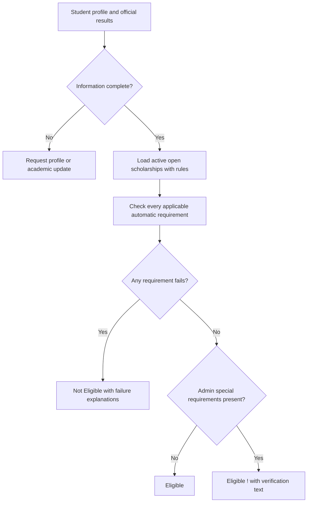

# ScholarMatch Improvement Log

**Updated:** 2026-10-20 (Asia/Singapore)

This file records completed changes, verification, and the project/FYP documentation to revise. Chapter numbers are omitted because the student's report structure has not been supplied.

## Current agreed behaviour

| Situation | Result |
| --- | --- |
| General requirements pass and any one complete qualification route passes (or no routes restrict it); no special text | Eligible |
| Same automatic checks pass; administrator entered special text | Eligible !, inside the Eligible group |
| A general requirement fails, or none of the configured qualification routes passes | Not Eligible |
| Required profile/official academic information is incomplete | Ask the student to complete it before generating recommendations |

The ! warning applies only to administrator-entered special requirements. It is not used for missing student results. The provider makes the final award decision.

Academic information uses one latest study level, Currently Studying/Completed status, current year when studying, and a manually selected Study Level Seeking Funding. SPM requires completed exams and official results. Other levels require a latest official cumulative CGPA, or final CGPA if completed. SPM credits count subjects graded C or above, including A subjects.

Administrator qualification boxes combine with OR; requirements inside each box combine with AND. Each box has its own result/status/year settings. See IMP-005 for the current route editor and migration; earlier entries describe previous stages.

## IMP-001 — Establish this improvement log

**Date:** 2026-10-19
**Type:** Documentation
**Status:** Completed

Added this record so implementation changes can be traced to the corresponding FYP report edits.

## IMP-002 — Review the original recommendation engine

**Date:** 2026-10-19
**Type:** Implementation review
**Status:** Completed; original behaviour superseded by IMP-003

The original engine checked hard requirements and then calculated weighted academic/field/institution/income points, normalized the result, and classified it as Eligible, Partially Eligible or Not Suitable. Academic minimums affected points rather than acting as universal eligibility requirements. The same education-level field was used for academic evidence and funded study level.

The review identified the need to separate qualification and funding level, remove scores and hard/soft categories, and explain individual requirements.

## IMP-003 — Replace scoring with requirement-based eligibility

**Date:** 2026-10-19
**Type:** Recommendation redesign, academic workflow, interface, data migration and documentation
**Implementation status:** Completed and verified

### What changed and why

| Area | Before | After / benefit |
| --- | --- | --- |
| Decisions | Score thresholds determined Eligible, Partially Eligible or Not Suitable | Every applicable automatic condition must pass for Eligible; any failure produces Not Eligible |
| Requirement settings | Hard, soft and none selectors, plus weighted points | Every specified condition is enforced; empty criteria are Not Applicable |
| Academic evidence | One level mixed qualification and funded programme; pending grades could be evaluated | Latest qualification and manually selected funding level are separate |
| Study status/year | Not recorded | Currently Studying or Completed; current year required for studying CGPA-based records |
| Official results | Pending results generated preliminary guidance | Official results are required before recommendations; SPM additionally requires completed exams |
| SPM minimums | As and credits used a points fallback | Both configured minimums must pass; credits must include all A subjects |
| Qualification routes | Threshold applicability could silently skip the intended academic evidence | Admin specifies accepted latest qualifications; threshold types provide a fallback for existing rules |
| Special conditions | No scholarship-level field | Optional Add/Edit Scholarship textbox; otherwise Eligible results display expandable ! and provider-check guidance |
| Explanations | Score circles, point breakdowns and message-wording guesses | Explicit Requirement / Required / Your Information / Result comparisons |
| Ordering | Highest score first | Eligible group (including !) then Not Eligible; nearest deadline, name and ID within each group |
| Availability | Expired active listings were evaluated as unsuitable | Only active, open, configured scholarships enter recommendations; deadline day remains open |
| Income updates | Stored category and cached results could become stale | Reclassify current income and invalidate decisions when admin thresholds change |
| Cache updates | Timestamp-only keys could collide within a second | Input-content hash, catalog version and calendar date determine cache identity |
| Nationality | Student choices and admin country-specific choices differed | Shared options; a broad Non-Malaysian answer requests clarification when a specific nationality is needed |
| Old evaluations | Old score statuses could be mistaken for current results | Preserve a legacy snapshot and label Previous Evaluation until refreshed |

### Files and implementation areas

- Engine: app/Services/ScholarshipRecommendationService.php.
- Models: app/Models/AcademicResult.php, Scholarship.php, ScholarshipRule.php and RecommendationLog.php.
- Student controllers: AcademicResultController.php, RecommendationController.php, DashboardController.php and ProfileController.php.
- Admin controllers: ScholarshipController.php, ScholarshipRuleController.php, IncomeCategoryController.php and RecommendationLogController.php.
- Shared configuration: config/scholarship.php.
- Database upgrade: database/migrations/2026_10_19_000000_add_decision_based_recommendations.php.
- Student screens: academic result, profile, recommendations list/detail, dashboard and saved-scholarship deadline display.
- Admin screens: scholarship Add/Edit, rule Add/Edit/summary, dashboard and recommendation-log list/detail.
- Shared views: components/decision-badge.blade.php, requirement-results.blade.php and scholarship-card.blade.php.
- Public information: resources/views/public/home.blade.php and about.blade.php.
- Supporting files: resources/css/app.css, ScholarshipRuleSeeder.php and the affected unit/feature/migration tests.

### Implementation choices

- At this stage, keep one latest qualification record. Multiple academic-history records and different CGPA thresholds for individual qualification routes were outside scope. IMP-005 subsequently adds different per-route thresholds; multiple student academic-history records remain outside scope.
- Funded level is selected directly. The system does not infer new-entry, existing-award or renewal status solely from that level.
- Matching any supported field/qualification value is sufficient. Independent applicable conditions combine with AND; equality passes at minimums/maximums.
- Within the student's accepted qualification route, all configured academic minimums must pass.
- Missing official results or required onboarding fields block recommendations; they are not classified as Not Eligible and do not produce !.
- Scholarships without a rule record are excluded with a configuration notice. An intentionally saved unrestricted rule can pass its non-applicable criteria.
- Special text is plain text, safely escaped, with no internal administrator approval workflow.
- Existing score/rule-type database columns remain inactive to preserve compatibility and historical data. No active scoring code or score display uses them.

### Documentation updated and FYP report impact

| Project document | Updated sections | FYP report material to revise |
| --- | --- | --- |
| PRD.md | 1, 5, 6.2–6.9, 7–14 and 16–17 | Requirements, user stories, use cases, decision table, validation and scope |
| ARCHITECTURE.md | 3.2–3.5, 4–10 and 11 | Academic/rule data design, ERD/data dictionary, algorithm, execution/cache strategy and limitations |
| DESIGN.md | Scholarship Cards, Badges & Chips, Academic Form and Requirement Explanations | Interface design, warning behaviour, academic form and screenshots |
| README.md | Key features, How recommendations work, upgrade and testing guidance | System overview, installation/upgrade and demonstration instructions |
| MANUAL_TEST_CASES.md | 4, 5, 10, 12–13 and regression/coverage notes | Academic/recommendation/admin test tables and expected results |
| Public Home/About pages | Feature descriptions and methodology | User guide and public-page screenshots |

Replace the report's weighted-score formula, 40/25/20/15 point table, score-threshold classification and hard/soft flowchart with the decision flow below. Update screenshots that show circular match scores, Partially Eligible tabs, pending-result choices or hard/soft selectors.

**Suggested report wording:** “ScholarMatch applies a requirement-based eligibility process. The system compares the student's official academic results and socioeconomic profile with each applicable scholarship condition. A failure produces Not Eligible; satisfying all automatic conditions produces Eligible. Administrator-entered special conditions add an exclamation warning to otherwise Eligible results and identify what the student must verify with the provider. The student's latest academic qualification is recorded separately from the study level seeking funding.”

### Verification and database upgrade

- Baseline before application edits: 133 tests and 444 assertions passed.
- Updated suite: 162 tests and 495 assertions passed after the final code changes.
- Laravel Pint passed; git diff --check passed after documentation whitespace cleanup.
- Frontend production build succeeded with Vite 8.1.0.
- Desktop browser checks used a separate synthetic SQLite database: decision tabs, expandable ! text, failed CGPA explanation, academic form switching, Add Scholarship special textbox, rule editor and administrator logs.
- The actual project-local SQLite database was backed up, then upgraded. The pending existing multi-field migration was also applied.
- Record counts were unchanged: users 5; profiles 2; academic records 2; scholarships 21; rule records 20; saved scholarships 1; recommendation logs 20.
- SQLite integrity_check returned ok.
- Backup retained at storage/app/private/scholarmatch-before-decisions-20261019-021601-27456.sqlite.
- Verification environment: PHP 8.5.11 and SQLite. MySQL integration and the full manual/mobile checklist have not been executed.

### What the student must update for the FYP

1. Replace the recommendation methodology and flowchart with the new decision process.
2. Revise the academic-result and scholarship-rule data dictionaries/ERD with the added fields.
3. Capture current student/admin screens, especially the official-result form, Eligible ! disclosure and requirement explanation table.
4. Replace score-based test cases/results with the requirement-based cases and verified automated results.
5. Describe the latest-qualification scope and provider verification as limitations.

### Upgrade note

Existing students must update their academic form to confirm study status, required year, funding level and official results. These values were not guessed during migration. Existing scholarships and student records were preserved; old evaluations refresh when students open recommendations.

## IMP-004 — Clarify required form inputs

**Date:** 2026-10-19
**Type:** Form usability and guidance
**Status:** Completed

- Added red * markers to required academic inputs and the official-results confirmation, with screen-reader text. Existing conditional visibility and validation remain in place: SPM shows As/credits, other levels show CGPA, and current year is shown for Currently Studying.
- Added a required-field legend to student profile, academic-result and administrator scholarship Add/Edit forms. Existing profile and scholarship markers were retained; scholarship description is explicitly labelled optional.
- Clarified admin rule guidance: configure only provider restrictions; Diploma uses the CGPA route; academic minimums can be empty when unrestricted; year limits require Currently Studying and a maximum year requires a minimum.
- No new mandatory eligibility criteria or scoring were introduced. * means an input must be completed, while every configured scholarship condition still applies equally.

**FYP report updates:** Revise the form/interface design and user-guide explanation of required versus optional inputs. Replace academic-form and scholarship Add/Edit screenshots. Explain conditional SPM/CGPA/year inputs and the distinction between required form entries and optional administrator restrictions. DESIGN.md records the input-marker convention.

**Admin workflow discussion:** A future option is to show only the result inputs relevant to explicitly accepted qualifications, and show year controls only for Currently Studying. This visibility change has not been implemented as part of the marker update.

**Verification:** Existing student academic/profile and admin scholarship/rule feature tests passed: 57 tests, 201 assertions. git diff --check passed. No eligibility algorithm or validation rules changed in this update.

## IMP-005 — Add repeatable qualification boxes and alternative matching

**Date:** 2026-10-19
**Type:** Administrator workflow, database, recommendation logic and explanations
**Status:** Completed; supersedes the shared academic settings in IMP-003 and the proposed workflow in IMP-004

### Behaviour and reason for the change

An Undergraduate award can accept a Completed Diploma applicant with CGPA >= 3.00 OR a Currently Studying Undergraduate applicant with CGPA >= 3.30 in Years 1–3. The previous shared status/year/CGPA fields could not express these independent alternatives.

- Add/Edit Scholarship now includes general eligibility settings and an Add Qualification button. The same editor is used on Add/Edit Rules.
- Each repeatable box stores its own qualification level, study status, result minimums and current-year boundaries. Qualification and status have required * markers. Each box has Remove; removing a middle box keeps the remaining values associated correctly.
- SPM shows optional minimum As and credits and requires Completed. Other qualifications show optional minimum CGPA. Currently Studying reveals optional minimum/maximum years. Either status is available for non-SPM, including unrestricted legacy settings.
- Result minimums and year boundaries are optional independently. Both year bounds, when supplied, are inclusive and ordered. Zero is a real result minimum. Switching qualification/status hides, disables and clears inapplicable fields; the server also clears them.
- All conditions within a box use AND. Complete boxes use OR. Students must pass any one complete box plus every applicable general nationality, funded-level, income, field and institution requirement. Conditions from separate boxes cannot be combined.
- No boxes means no academic qualification/result/status/year restriction. Students still need complete official academic information before recommendations. Removing the last box clears old academic columns so old restrictions cannot return.
- Funded Study Level remains outside the boxes. The student still supplies only one latest qualification; historical qualifications are not inferred.
- Student and administrator-log explanations include the matched route (or closest relevant failing route), plus an expandable comparison of every alternative. Failing an unused alternative does not override a passing route. Eligible ! keeps its existing special-requirements meaning.
- Scholarship metadata, general requirements and route rows save in a transaction. Invalid routes prevent partial updates. An initialization marker prevents submissions without a working JavaScript editor from erasing routes.

### Database and implementation

- Added scholarship_qualification_routes: id, scholarship_rule_id, education_level, study_status, min_spm_as, min_spm_credits, min_cgpa, min_year_of_study, max_year_of_study and timestamps. A scholarship rule has many routes; deleting its scholarship/rule cascades to the route rows.
- Added migration 2026_10_19_010000_create_scholarship_qualification_routes_table.php, which backfills equivalent routes from existing settings and retains legacy columns. Existing imports/seeders have a legacy fallback; new form saves use route rows and clear old academic columns.
- Added ScholarshipQualificationRoute model, ScholarshipRuleEditor service and AcademicRouteEvaluator service; updated scholarship/rule controllers, route relationships and recommendation service.
- Added admin/rules/_qualification-routes.blade.php and qualificationEditor in resources/js/app.js; updated shared rule form, scholarship Add/Edit, rule summary and requirement explanation component.
- Algorithm version is decisions-v2-routes. Earlier cached results cannot be reused; previous logs remain identifiable until recommendations refresh.

### FYP documentation to revise

| Report area | Required change | Updated project reference |
| --- | --- | --- |
| Functional requirements / use cases | Add/remove multiple qualification boxes directly on Add/Edit Scholarship; separate general restrictions from alternatives | PRD.md sections 6.4–6.7 |
| Database / ERD / data dictionary | Add one-to-many scholarship_rules to scholarship_qualification_routes; document per-route nullable result/year fields and cascading relationship | PRD.md section 8; ARCHITECTURE.md sections 3.5 and 6 |
| Recommendation methodology / flowchart | General conditions AND any one complete qualification route; AND within each route; no mixing partial matches | PRD.md section 6.6; ARCHITECTURE.md section 4 |
| Interface / user guide | Screenshot Add/Edit with Diploma Completed and Undergraduate Currently Studying boxes; explain *, optional thresholds, conditional fields and Remove | DESIGN.md Administrator Qualification Boxes; screenshot storage/app/private/qualification-routes-preview.jpg |
| Testing / evaluation | Add alternative-route, same-level alternatives, partial-match rejection, middle-removal, stale-field clearing, transaction and migration cases | MANUAL_TEST_CASES.md section 10; new QualificationRoutesTest and engine tests |
| Scope / limitations | Continue to state that each student has one latest qualification and that provider award decisions/manual verification are external | PRD.md sections 9 and 14 |

**Suggested report wording:** “ScholarMatch represents accepted academic backgrounds as alternative qualification routes. Each route defines a qualification level, study status and optional result or current-year thresholds. A student must satisfy all applicable conditions within at least one route, together with the scholarship's general requirements. This supports scholarships that accept both completed Diploma applicants and current Undergraduate students under different academic conditions.”

### Verification and local database upgrade

- Automated suite passed: 185 tests, 584 assertions. Includes separate qualification thresholds/statuses, same-level alternatives, failure of incomplete routes, SPM As/credits, general-condition priority, transactional saves, server normalization, removal, initialization guard and legacy backfill.
- Laravel Pint passed and the Vite production build succeeded. git diff --check passed.
- Browser checks used a separate synthetic SQLite database: Add/Edit shared controls, SPM-to-Diploma switching, adding/removing a middle box, current-year controls/clearing, saving/reopening both routes, and Eligible ! with a passing Undergraduate route plus expanded alternatives.
- Before applying the route migration, created storage/app/private/scholarmatch-before-qualification-routes-20261019-110935.sqlite.
- Existing local database counts were preserved: users 5; profiles 2; academic records 2; scholarships 21; rules 21; saved scholarships 1; recommendation logs 30. Counts reflect the database at this upgrade and may differ from earlier log entries.
- Backfilled 94 qualification route rows; SQLite integrity_check returned ok. No sample preview records were inserted into the user's database.
- MySQL integration and the full manual/mobile checklist have not been executed.

## IMP-006 — Group programme details inside Academic Result

**Date:** 2026-10-20
**Type:** Student workflow, data ownership and migration
**Status:** Completed

- Moved Institution Type and Field of Study from Profile into Academic Result, grouped with Study Level Seeking Funding under Programme Seeking Funding. Both retain required * markers and describe the programme seeking funding, which may differ from the latest qualification supplying results.
- Profile now edits nationality, state, household income and dependents, and links to Academic Result for programme details. Its save endpoint ignores programme fields and cannot overwrite academic choices.
- Added required academic validation and completeness checks for shared supported institution/field options. Matching and explanations read academic_results; edits change the recommendation input hash immediately. Missing programme choices produce an academic-completion prompt.
- Added migration 2026_10_20_000000_move_programme_details_to_academic_results.php. It copies existing selections to existing academic records, keeps nullable legacy profile columns for recovery, and does not invent qualifications, results or academic records. Profile-only legacy choices prefill the first academic form. Rollback copies updated academic values back to existing profiles.
- Updated models/controllers, shared configuration, student/public views, test fixtures and recommendation checks. Existing qualification-route and special-warning logic is unchanged.

**FYP report updates:** Revise Profile and Academic Result functional requirements/user guides, form screenshots, data dictionaries and ERD field ownership. Institution Type and Field of Study now belong to academic_results; legacy profile columns are inactive compatibility data. Describe Programme Seeking Funding separately from the qualification supplying results. PRD.md sections 6.2–6.3, 8–9 and 11; ARCHITECTURE.md sections 3.2–3.3 and 6; DESIGN.md, README.md and MANUAL_TEST_CASES.md were updated.

**Verification:** 196 tests passed with 622 assertions; Vite production build passed. PHP formatting checked. A full-suite run initially encountered a Windows lock in the shared compiled-view cache; rerunning with a separate test view folder passed. Browser checks with synthetic data confirmed Profile saves without programme fields, the academic section displays all three choices, and changed institution/field selections save and reopen correctly. Screenshot: storage/app/private/programme-details-preview.jpg. MySQL integration and the full mobile checklist were not run.

**Local database:** Backed up to storage/app/private/scholarmatch-before-programme-details-20261020-19aa1d9b.sqlite before migration. All original academic values and record counts were preserved: users 5; profiles 2; academics 2; scholarships 21; rules 21; qualification routes 94; saved scholarships 1; logs 30. Both existing academic records received the matching saved programme choices. SQLite integrity_check returned ok.

## IMP-007 — Give View Details a visible button border

**Date:** 2026-10-20
**Type:** Interface consistency
**Status:** Completed

Changed View Details in the shared scholarship-card component from the borderless ghost style to btn-outline, matching Save. Apply Now remains the filled primary action. The border, padding, corner radius, hover and focus treatment come from the existing shared button styles; destination and behaviour are unchanged. This applies wherever the shared card appears, including the dashboard and recommendations.

**FYP report updates:** Replace scholarship-card/action screenshots in the interface design or user guide. DESIGN.md Scholarship Cards and MANUAL_TEST_CASES.md REC-21 describe the outlined View Details action. No algorithm or database change is associated with this styling update.

**Verification:** Browser preview confirmed a visible 1px border matching Save, and clicking View Details still opens the scholarship. Screenshot: storage/app/private/view-details-button-preview.jpg. The styling reuses existing compiled button CSS; no additional automated test was added for the class-only change.

## IMP-008 — Position card badges and colour requirement explanations

**Date:** 2026-10-20
**Type:** Interface layout, visual emphasis and accessibility
**Status:** Completed

- Moved Eligible / Eligible ! / Not Eligible to the top-right corner of the shared card header. Titles/providers wrap on the left without overlapping the badge, including narrow recommendation-grid cards.
- Preserved the Eligible ! disclosure as a keyboard-accessible, bounded amber panel anchored below the top-right badge. It retains the existing special text and verification meaning.
- Card explanations now use pale green panels for Met and pale red panels for Not Met. Labels, required values and student information receive stronger emphasis. Award type uses a blue-tinted chip and the deadline date is bold.
- Shared requirement tables use green met rows, red unmet rows and neutral Not Applicable rows. Applicable required/student values are bold; student values and result pills use darker outcome colours. Added a shared requirement-status component with check/cross/dash and explicit labels, preserving meaning without relying on colour alone.
- Alternative-route tables and administrator recommendation-log explanations inherit the shared styling. The detail page highlights award/deadline information, failed requirements and amber special conditions.
- Changed presentation only. Academic routes, AND/OR evaluation, thresholds, decisions and database records are unchanged. All displayed values and special text remain escaped.

**FYP report updates:** Replace dashboard/recommendation-card screenshots and scholarship/log detail screenshots. Describe badge placement, required-versus-student-value emphasis and the green/red/neutral outcome convention in interface design and the user guide. DESIGN.md Scholarship Cards, Badges & Chips, and Academic Form and Requirement Explanations were updated; MANUAL_TEST_CASES.md REC-22–REC-24 cover the new presentation.

**Verification:** Existing dashboard, recommendation and administrator-log tests passed: 27 tests, 104 assertions. Vite production build and git diff --check passed. Synthetic browser checks confirmed the top-right badge on wide and 310px cards without title overlap, keyboard activation of the ! disclosure, green expanded card explanations, and red/green/neutral detail rows with bold results. Screenshots: storage/app/private/recommendation-card-colours.jpg and storage/app/private/requirement-result-colours.jpg. No new automated tests were added for the presentation-only changes, and no live student data was modified for previewing.

## IMP-009 — Simplify the card explanation list

**Date:** 2026-10-20
**Type:** Readability refinement
**Status:** Completed; replaces the expanded card panels from IMP-008

Restored View Explanation to one plain message per applicable check, with a bold green Met or red Not Met label. Removed the individual boxes, separate status pills, repeated requirement headings and duplicated required/student value rows. Longer messages wrap naturally. The top-right eligibility badge, highlighted award/deadline and colour-coded detail/log tables remain in place; recommendation logic is unchanged.

**FYP report updates:** Replace any screenshots of the expanded card-panel design with the simplified explanation list. Update the card interaction/user-guide description: View Explanation is a quick summary, and View Details provides the full comparison table. DESIGN.md Scholarship Cards and MANUAL_TEST_CASES.md REC-25 reflect the final layout.

**Verification:** Existing dashboard and recommendation tests passed: 21 tests, 76 assertions. Vite production build and git diff --check passed. A synthetic browser preview confirmed the plain, wrapping green explanation lines, bold outcome labels and retained top-right badge. Screenshot: storage/app/private/simple-explanation-preview.jpg. No recommendation rules or live student records were changed.

## IMP-010 — Simplify required-field notes and fix income input overlap

**Date:** 2026-10-20
**Type:** Form readability and layout correction
**Status:** Completed

- Removed the separate “* Required field.” note from Profile, Academic Result and administrator Add/Edit Scholarship forms. Required label stars, accessibility text and validation remain in place. The academic form retains its useful explanation about conditional result/year fields.
- Removed the overlaid RM prefix and its special padding from Household Income. The currency remains clear in the Household Income (RM) label, while the input shows only the numeric amount without overlap.

**FYP report updates:** Refresh Profile and affected form screenshots in the interface design/user guide. Describe required fields using their label stars and household income as a numeric amount with the currency in its label. DESIGN.md Input Fields reflects this update. No database, income classification or recommendation logic changed.

**Verification:** Existing Profile, Academic Result and administrator Scholarship tests passed: 51 tests, 177 assertions. Browser preview with synthetic income 3000.00 confirmed a readable numeric amount and the removed top note. Screenshot: storage/app/private/profile-income-layout-preview.jpg. MANUAL_TEST_CASES.md S10–S11 cover the layout and required-label behaviour. No new automated tests were added for this presentation-only change; git diff --check passed.

## IMP-011 — Align the Academic Result programme section divider

**Date:** 2026-10-20
**Type:** Form layout correction
**Status:** Completed

Moved the Programme Seeking Funding divider from the fieldset onto an outer wrapper. The line now spans the content width above the heading instead of being interrupted by the legend. Removed the legend's extra top padding while preserving the accessible fieldset grouping, section spacing, inputs and validation.

**FYP report updates:** Refresh the Academic Result screenshot in interface design/user-guide sections to show the full-width divider above Programme Seeking Funding. DESIGN.md Academic Form and Requirement Explanations describes the corrected layout. No data or eligibility logic changed.

**Verification:** Existing Academic Result tests passed: 26 tests, 88 assertions. Synthetic browser previews confirmed the continuous divider and readable section spacing at desktop and 390px widths. Screenshots: storage/app/private/academic-divider-preview.jpg and storage/app/private/academic-divider-mobile-preview.jpg. MANUAL_TEST_CASES.md AR-15 covers the visual check. Existing CSS utilities were reused; git diff --check passed.

## IMP-012 — Add recommendation filters, full-width cards and 10-item pages

**Date:** 2026-10-20
**Type:** Scholarship browsing functionality and responsive layout
**Status:** Completed

- Added a desktop filter sidebar for scholarship/provider search, award type, funded study level, supported field and institution type. Search ignores case; filters combine with AND. Unrestricted programme criteria also match a selected programme choice, and field filtering supports multiple accepted fields.
- Replaced the small multi-column card grid with one full-width card per row, reusing the Dashboard card component. Filters stack above the list on narrow screens.
- Eligible (including !) and Not Eligible use GET navigation with filtered totals. Each selected group displays at most 10 cards, with result ranges, current page, numbered links and previous/next controls. Filters/group persist across pages; applying/resetting filters or changing group starts at page 1. Stale high page values resolve to the last available page.
- Empty groups retain the filter controls, Reset and helpful guidance. Query values are validated and displayed text remains escaped. The results anchor respects the sticky header.
- Filtering runs after evaluation/cache retrieval and preserves existing ordering. It does not alter student data, scholarship rules or eligibility outcomes. Evaluation logs still cover all evaluated scholarships, including those hidden by filters or pagination; Dashboard behaviour is unchanged.

**FYP report updates:** Add recommendation filtering/pagination to functional requirements and browsing use cases. Refresh recommendation-page screenshots to show the sidebar, single-column list and page controls. Explain unrestricted filter matching, filtered group totals and preserved selections in the interface design/user guide. PRD.md 6.7, ARCHITECTURE.md 5, DESIGN.md and MANUAL_TEST_CASES.md REC-26–REC-30 describe the implementation. No database migration is required.

**Verification:** Recommendation filter, existing recommendation and Dashboard tests passed: 36 tests, 160 assertions. PHP formatting, Vite production build and git diff --check passed. Browser checks using a separate synthetic database confirmed combined filters, 10-card pages, remaining results on page 2, preserved query parameters, group/page resets, empty results and Reset. A 390px preview confirmed filters stack above readable cards. Screenshots: storage/app/private/recommendation-filters-preview.jpg, recommendation-page-two-preview.jpg and recommendation-filters-mobile-preview.jpg. Live student/scholarship data was not used for the preview.

## IMP-013 — Limit nationality to Malaysian or Non-Malaysian

**Date:** 2026-10-20
**Type:** Shared form choices, validation and eligibility matching
**Status:** Completed

- Reduced the shared nationality choices to Malaysian and Non-Malaysian for Profile and all scholarship/rule forms. The student placeholder remains unanswered; administrators can still use Any nationality for an unrestricted requirement.
- Profile and rule validation reject individual-country and Other values. Matching compares the two supported categories exactly, while an unrestricted scholarship accepts either. Removed the request for a specific country, since that is no longer an available input.
- Unsupported legacy student nationality values now request a valid Profile selection before evaluation. Unsupported country-specific legacy scholarship rules remain intact and awaiting configuration rather than being silently broadened or blocking other awards. Country-specific conditions can be entered as Special Requirements for provider verification.
- Advanced the evaluation version to decisions-v3-nationality so old cached results and logs refresh under the current rules. Academic-route evaluation, special-warning meaning and list filters/pagination remain in place.
- Read-only audit of the existing local SQLite database found 2 student profiles and 21 scholarship rules, all using Malaysian. No data conversion, schema migration or live-record modification was required.

**FYP report updates:** Update the Nationality input definition and screenshots to show Malaysian/Non-Malaysian only. Explain exact-category matching and the optional unrestricted scholarship setting; place country-specific conditions under special verification. Update the current algorithm version in implementation/cache/log descriptions. PRD.md 6.2, ARCHITECTURE.md, README.md, DESIGN.md and MANUAL_TEST_CASES.md S12–S13 reflect the changes.

**Verification:** Full suite passed: 226 tests, 756 assertions, including exact-category/unrestricted matching, unsupported legacy values, profile/rule validation, and the new filters/pagination. PHP formatting and git diff --check passed; the frontend production build from IMP-012 remains current. A synthetic browser preview confirmed the Profile dropdown contains only its placeholder, Malaysian and Non-Malaysian, and that Non-Malaysian can be selected. Screenshot: storage/app/private/nationality-options-preview.jpg.
